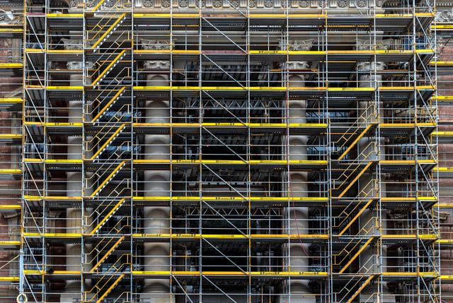

The New York City Department of Buildings (DOB) continues to streamline plan review for all permits. After the [Building One City](/final-review-blog/streamlining-new-york-city-building-permits-dob-now/) report was released in 2015, the City implemented a number of changes to customer service and began to update submittal and permit processes. DOB is now making further updates to the existing DOB Now system to make more project eligible for electronic submittal, with an eventual goal of all project submitted electronically. We’re taking a look at the current drawing requirements as well as changes to the DOB’s submittal processes this year. 

<em>image by [Reto Simonet](https://unsplash.com/photos/WN9QRESOu5c)</em>

## General Submission Guidelines

All new construction and alteration projects must include sufficient detail for the entire scope of work and comply with the NYC Building Code, Zoning Code, and any additional Federal, New York State, and city requirements. According to the DOB [Plan Examination Guidelines](http://www1.nyc.gov/assets/buildings/pdf/plan_exam_user_guide.pdf), the City requires that all projects include the following items on any plans submitted:

-   Plans must comply with [DOB Graphic Standards](https://www1.nyc.gov/assets/buildings/pdf/drawing_standards_08132010.pdf)
-   Standardized title block, discipline designators, and revision numbers as applicable
-   Standardized sheet numbering
-   Scale of each drawing/detail included
-   North indicated on all plans
-   Dimensions for all drawings and details
-   Clear description of the project scope including all demolition work without extraneous details
-   Signature and seal by a registered New York State design professional
-   Proof of compliance with the New York City Energy Conservation Code, including the following documents: Professional Statement, Energy Progress inspections requirements, Energy Analysis, supporting documentation (as applicable)

The DOB discourages any boilerplate details, any relevant details should be included on a separate General Notes sheet to avoid confusion. Depending on the construction type, project scope (new construction, interior alterations, or otherwise) and site conditions, additional documentation may be required:

-   Zoning details: Block and lot number, zoning lot dimensions, height and number of stories, zoning district designations and adjacent zoning districts, any special zoning designations
-   Zoning Analysis if applicable to project
-   Site Plan: Site background information, site improvements, and building related information such as the dimensioned building footprint

## Architectural Sheet Requirements

Projects of all scopes must include architectural plans and details. Depending on the level of proposed work and changes made to existing systems, projects may require additional documentation upon review, however the City requires the following drawings for all initial plan submittals:

-   Floor plans: All floor plans must be scaled and should include all rooms, spaces, and other features contained within the scope of work. General floor plans should include a partial demolition plan as applicable and clear markings of existing and proposed work
-   Egress plan: Egress plans should show any fixed furnishings and equipment layouts and all exit signs, emergency lights, exit widths, stair plans, and roof plans
-   Fire Safety/Code Analysis: Supplementary documentation including fire-resistance ratings of components such as walls and roofs, carbon monoxide and smoke detectors/alarms, and fire sprinkler locations
-   Flood zone requirements, if applicable
-   Accessibility: All project submittals must demonstrate accessibility compliance and show all accessible entrances and components of accessible routes such as elevators, ramps, doors, or lifts

The following may also be required, depending on proposed work and project scope:

-   Exterior and interior building elevations
-   Building sections: These drawings should provide cross sections of structural and construction elements, if requested
-   Detail drawings, including Energy Code compliance documentation and firestopping details (see above section for details on Energy Code requirements)
-   Structural drawings, may include subgrade and foundation drawings as well as superstructure details, including all floor and roof framing plans depending on project type
-   Mechanical drawings, including heating systems, air conditioning systems, and exhaust air systems
-   Plumbing drawings, including fixtures, risers, and piping diagrams
-   Fire Protection drawings, including automatic sprinkler and alarm systems and standpipe systems
-   Electrical drawings, including all lighting fixtures and emergency lighting

## 2018 Changes to DOB Now: Build Submittal Processes and Inspection Ready

The New York City Department of Buildings continues to update their plan submittal processes as part of an ongoing modernization project. The initiatives implemented by the City, DOB Now: Build and Inspection Ready, began in 2016 and will expand to include more project types in 2018.

[DOB Now: Build](https://www1.nyc.gov/site/buildings/industry/dob-now-build.page) aims to replace all paper submittals with electronic filing. The program initially accepted basic filings, including plumbing, sprinkler, and standpipe submittals, antenna and curb cut filings, sidewalk, scaffolding, fence, and sign submittals, as well as electrical and elevator permitting. Currently, applications must be registered with the DOB Now system and must be either a Professional Engineer, Registered Architect, Licensee, Special Inspector, Progress Inspector, Filing Representative, or Owner to submit projects using DOB Now.

Submitting plans electronically enables the user to pay permit fees online, upload plans and supporting documents for DOB plan review, and online tracking of plan review comments and objections. The system automatically releases letters of completion upon plan approval and notices of application milestones, as well as schedule virtual meetings with plan examiners to review objections and make corrections. DOB will eventually expand the system to include all project submittals including alterations to existing buildings and new construction.

For projects submitted using the system, both After Hours Variances and work permits may be [pulled electronically](https://www1.nyc.gov/site/buildings/industry/dob-now-build.page), eliminating additional steps that may slow permit issuance.

The DOB now requires all inspection requests filed online via the Inspection Ready system and phone requests are no longer accepted.

## Further Changes to Program Expected in 2018

In January 2018, the DOB released changes to the system, including new requirements. As of this year, Electrical documents must be uploaded prior to any Place of Assembly inspections, and new plumbing inspection types are required, including Plumbing Sign Off for Certificate of Occupancy or Temporary CO and Special Service Pump Test.

For any projects with objections, a proof of correction is now required when certifying an objection before any inspection approvals.

The Inspection Ready system provides users with tracking capabilities as well as notifications when inspections are complete, and inspection certifications can be submitted to DOB via DOB Now.

As the City updates their review processes and releases projects for submittal electronically, we will continue to provide updates on drawing requirements and projects that can utilize the new system. As always, the Burnham New York team is available to handle project submittals of any scope and manage DOB online filings - please contact [our team](/contact/new-york/) with any questions.

<em>This post was updated March 8th, 2018.</em>
