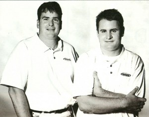

This year Burnham celebrates its 20th anniversary and we'd like to share with you the story of how Burnham Nationwide came to be, where we are headed and how Daniel Burnham's message has inspired us along the way.

## "Make no Small Plans; They Have no Magic to Stir Men's Blood. Make Big Plans, Aim High in Hope and Work."

These words, attributed to Chicago architect and urban planner, [Daniel Hudson Burnham](https://en.wikipedia.org/wiki/Daniel_Burnham), capture the essence of his visionary spirit. And just as Burnham envisioned greatness in every endeavor undertaken, at Burnham Nationwide so do we on a daily basis. 

Daniel Burnham not only served as a catalyst for the company name, but also his beliefs have helped us become one of the premier regulatory and compliance consulting firms to the building and construction industries.

## In the Beginning there was two...

Back in 1992, gas was $1.05 a gallon, the [Sears Tower (Now Willis Tower)](https://en.wikipedia.org/wiki/Willis_Tower) was the tallest building in the world, and Microsoft Works was released by Microsoft, there were two friends and business partners, [Carson Kyhl](https://www.linkedin.com/profile/view?id=AAkAAAEvgW4BfbmRlU2FlAFTUgN4wgTmun55fTQ&authType=NAME_SEARCH&authToken=QARB&locale=en_US&trk=tyah&trkInfo=clickedVertical%3Amynetwork%2CclickedEntityId%3A19890542%2CauthType%3ANAME_SEARCH%2Cidx%3A1-1-1%2CtarId%3A1445343695233%2Ctas%3ACArson) and Mike Gaynor; each of whom shared a vision and a common goal: to offer a special experience for the construction industry to maintain municipal compliance. Creating this experience would require a new way of thinking, including: promoting a transparent approach for information exchange with governments, understanding the roles and responsibilities of everyone on the team, and most importantly - doing what we say we are going to do.

20 years later, with the support of dedicated and passionate employees, their vision, inspired by Daniel Burnham's, can lay claim to success, having obtained well over 100,000 permits from coast to coast, Hawaii and Puerto Rico.

## The Burnham Difference

The landscape that gave rise to Burnham Nationwide 20 years ago may be slightly different than today's, but the [principles that guide](/about/why-burnham/) our business remain steadfastly unchanged:

-   Caring for People - Appreciating every stakeholder, their role and responsibility, and always working to effectively and efficiently support one another
-   Leading Through Innovation - Recognizing that success and growth happen by creating new and better processes
-   Improving Productivity - Learning from experience and practicing tenacious problem solving
-   Perfecting Customer Service - Assuming ownership of your satisfaction by consistently meeting or exceeding client expectations

At Burnham Nationwide, we add the human touch to a process that at times can be cumbersome and tedious. Every employee is committed to enhancing your experience, assuming ownership of each project from start to finish, and consistently following through on our promise to "Simply Get It Done". 

That's only the beginning... up next, Burnham Nationwide expands upward and outward! Learn more about the Burnham mission by downloading the Burnham blueprint! We look forward to connecting with you.
