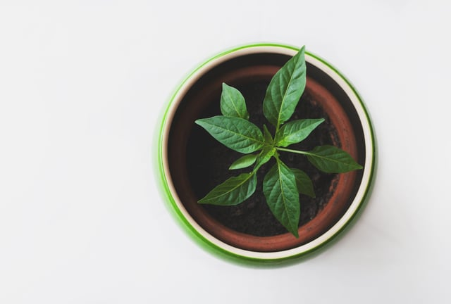

The environmental and financial costs of traditional building practices have grown over time and will only continue to rise, potentially impacting the ongoing construction booms throughout the United States, including in Chicago.

One way to fight this trend is to use green construction materials and methods whenever possible - they offer many advantages over traditional approaches, including cost savings, environmental benefits, and productivity and wellness improvements when tailored to to the project scope. 

<em>image by [Peter Zagar](https://unsplash.com/photos/bLgWa9b0ioY)</em>

## Cost Savings

While the cost of sustainable building materials varies depending on the specifics of the material and the scope of work, when viewed as a whole, green construction materials offer significant financial benefits:

-   Green materials are often recycled or reclaimed from other projects, avoiding initial production fees.
-   Some green materials make it easier to conform to building codes, which are becoming increasingly stringent across the nation. This reduces or eliminates costly delays in obtaining permits and passing inspections.
-   Many green materials are becoming less expensive every day due to increased production and improved fabrication methods. The opposite is true of more traditional products, which do not see consistent innovation.
-   Major cities such as Chicago, as well as states like New York, offer bonuses and other incentives to spur the development of building projects that incorporate green materials and methods into their makeup, including for [green roofs](/final-review-blog/project-drawdown-green-roofs-mandates-denver/).  
    

Eco-friendly building materials are a growing portion of the materials market, including some with historical precedence. A [perennial grass](https://www.smartcitiesdive.com/news/most-eco-friendly-building-materials-world-bamboo-cork-sheep-wool-reclaimed-metal-wood/526982/), bamboo is extremely sustainable, low-cost, traditionally used as a scaffolding material, and increasingly used as an [innovative modern building material](/final-review-blog/project-drawdown-bamboos-quick-growth-sequesters-more-carbon-than-trees/). Bamboo pavilions built in Sydney and Berlin demonstrate its viability as a [component](https://www.architecturaldigest.com/gallery/most-beautiful-bamboo-structures-in-the-world) for built spaces with a myriad of uses. It also reduces transportation costs due to its light weight, but does require treatment for building use.

Reclaimed and recycled wood and metal combat the energetic costs of using aluminum and steel, both of which are high embodied energy materials. 'Embodied energy' is the "sum of all the energy required from extracting a material", according to Mike Stopka with [Delta Institute](https://www.smartcitiesdive.com/news/most-eco-friendly-building-materials-world-bamboo-cork-sheep-wool-reclaimed-metal-wood/526982/), and recycled materials are lower in environmental costs because they do not require extraction of any raw materials. Recycled building components are often used during [adaptive reuse](/final-review-blog/reurbanism-and-adaptive-reuse-preservation/), one of the most environmentally-conscious methods of construction.

## Enhanced Health, Productivity, and Well-Being

The hazards of using traditional materials in construction are well-documented. Not the least of these is the presence of volatile organic compounds (VOCs), which have a proven association with increased cancer risks and other health problems, and have an impact on [indoor air quality](https://www.epa.gov/indoor-air-quality-iaq/volatile-organic-compounds-impact-indoor-air-quality) even after construction.

Green products are often free of such contaminants, leading to better health for building residents. As a plywood alternative, wheat straw can be formed into sheets known as "straw board wheatboard" that provides the benefits of wood particle board without the use of formaldehyde. Vinyl-free floor coverings offer less toxic versions of a traditionally ubiquitous building material.

Being guided by such facts in selecting construction materials offers many benefits. It enhances the overall environment in the completed structure, leading - in the case of commercial buildings - to more productive employees, and in the case of residential dwellings to healthier, more physically active occupants. The Well Building Standard and other programs highlight the benefits of healthier buildings, include the economic benefits to tenants and owners alike. Healthier spaces often lease more quickly and improved air quality improves performance.

Green construction materials naturally go hand in hand with environmentally-friendly building designs and methods that incorporate natural light sources, open spaces, and brighter surroundings. All of these elements are associated with enhanced health and greater happiness and have considerable payoffs for employers, builders, health care providers, and society at large.

## Achieving These Benefits

In order to reap the rewards of using green materials and methods, a commitment to using them must be made from the project’s onset, even prior to obtaining the first <strong>general construction permit.</strong> The engineers, architects, consultants, and other professionals should be well-versed in environmentally friendly building methods and any certifications they are attempting.

The design and construction teams should work together to ensure that every possible sustainable method is taken advantage of that may result in a savings, such as water systems should be designed to collect and use local rainfall as much as possible, or incentives provided for [green roof installations](https://www.chicago.gov/city/en/depts/bldgs/provdrs/permits.html).

## Site Choice Criteria

Choosing an appropriate location for the project involves numerous considerations. Some of the factors that may disqualify a particular choice include:

-   The nearby presence of endangered species
-   The site’s cultural or historical significance
-   The need to deforest large areas, significantly alter the landscape, or disrupt the local ecosystem in any major way, such as altering the course of waterways or draining wetlands

Determining that the land isn't best suited to another purpose, such as agricultural production or providing recreational opportunities, is also an essential part of this stage of the project. While these considerations might limit the choice of sites, they will help ensure that the final structure is an asset rather than detriment to the surrounding environment.

## Site Design

Traditional design often fails to consider the effect of the local environmental, such as sunlight and wind, on the shape the completed structure should take. For example: air conditioning costs are affected by the predominant breezes in the area, and locations free of existing trees can incorporate natural sunlight into structures better than can locations in valleys or those with significant overhead vegetation cover.

A long, narrow structure is well-suited to making the most of prospects for solar power generation. Locating fixed structures, like stairwells, in the building’s interior zones can leave room for work areas to receive a greater share of natural light.

## Planting and Landscaping

Eco-friendly structures incorporate vegetation choices into their overall design. Traditional lawns require maintenance by gas-driven lawn mowing equipment and the use of pesticides, however alternative plants such as [Dutch clover](https://learn.eartheasy.com/articles/how-to-establish-a-clover-lawn/) have a pleasing appearance, require less upkeep, and provide food or resources for wildlife. Green roofs similarly provide [micro-environments](/final-review-blog/project-drawdown-green-roofs-mandates-denver/) for local wildlife.

As much as possible, the choice of plants, shrubs, and trees must be determined by what is native to the local environment. Arid regions are home to drought-resistant plant species that flourish on minimal water, greatly reducing or even eliminating the need for such intrusive methods as installing sprinkler systems. A green landscaping plan will take such factors into consideration - while the upfront costs may be higher for some designs, the benefits include a cooler building and [stormwater](http://default.sfplanning.org/Citywide/livingroof/SFLivingRoofCost-BenefitStudyReport_060816.pdf) management.

## Technology

Modern building automation developments offer significant benefits for minimizing waste and should be incorporated into the structure as much as possible: motion detectors can switch off lights in unoccupied rooms, and individualized climate control systems can limit heating and cooling to areas of the building where people are present. The benefits are measurable and ongoing. HVAC systems that use green refrigerants avoid the damage to the ozone layer caused by CFCs, the leading cause of global warming according to Project Drawdown.

In addition, wind turbines and solar panels should furnish as much of the building’s power needs as possible.

## We Can Help With Your Green Building Project

We can provide you with the assistance of a **LEED accredited professional** to advise you on all aspects of eco-friendly building materials and methods. This will help ensure that your completed structure will benefit from as much as possible from all applicable certifications and incentives. Get in touch with us today, and put our expertise and experience to work for you.

<em>This post was last updated on January 29th, 2019.</em>
