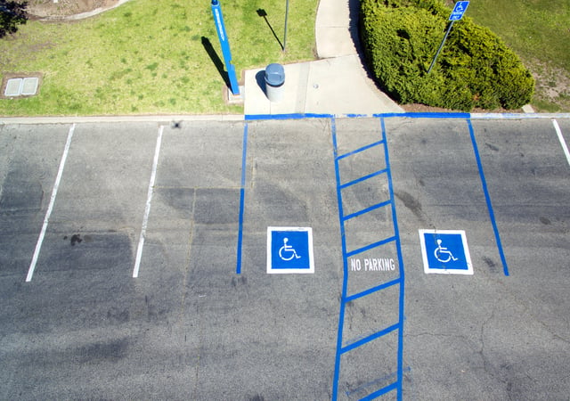

The Americans with Disabilities Act (ADA) specifies parking requirements, and these regulations are important for any business to be familiar with whether facilities have a tiny lot or thousands of spaces to avoid potential code violations. Below, we've provided a partial summation of the rules currently in force, however this is intended purely as a high-level overview. Please direct specific questions to an attorney or ADA expert, such as those found [here](/what-we-do/code-consulting/) at Burnham Nationwide: we're happy to answer your questions.

<em>image by [Robert Ruggiero](https://unsplash.com/photos/EHil9yGtKak)</em>

## Overview

In 2010, the Department of Justice (DOJ) released revised regulations under the Americans with Disabilities Act. The new rules apply to commercial facilities, places of public access, and all levels of government. The complete text of the guidelines appears in the <em>2010 ADA Standards for Accessible Design,</em> and we've summarized key points below.

## Rules for Existing Locations

-   Existing buildings and sites that are <strong>*not*</strong> undergoing major renovations are unbound by the new rules. For example, the 2010 guidelines mandate a minimum of two van-accessible spots for parking lots with at least 250 spaces. However, facilities that are currently in line with the 1991 directives need not be changed, until and unless they are significantly altered. This is known as the ADA’s “safe harbor” provision.
-   On the other hand, all new construction must meet the 2010 rules.

## Revised Requirements for Accessible Spaces

The following chart shows current requirements for accessible spots:

<table><tbody><tr><td>
Number of spaces in parking lot or facility
</td><td>
Required number of accessible parking spaces
</td></tr><tr><td>
1 – 25
</td><td>
1
</td></tr><tr><td>
26 – 50
</td><td>
2
</td></tr><tr><td>
51 – 75
</td><td>
3
</td></tr><tr><td>
76 – 100
</td><td>
4
</td></tr><tr><td>
101 – 150
</td><td>
5
</td></tr><tr><td>
151 – 200
</td><td>
6
</td></tr><tr><td>
201 – 300
</td><td>
7
</td></tr><tr><td>
301 – 400
</td><td>
8
</td></tr><tr><td>
401 – 500
</td><td>
9
</td></tr><tr><td>
501 – 1000
</td><td>
2% of total
</td></tr><tr><td>
1001 and over
</td><td>
20, along with 1 more for each 100
</td></tr></tbody></table>

One of every six accessible spots, <em>or every fraction of six,</em> must be van-accessible. For instance, say a lot has 400 spaces. Per the 2010 rules for ADA parking requirements, eight spaces must be accessible, and two of those eight must be van-accessible.

## Rules for Adjoining Lots

In cases where a parking lot serves two or more facilities, accessible spaces should be dispersed rather than concentrated in a single area. If a shopping center has 15 different businesses with a total of 1000 spaces for all customers, it will need to have 20 accessible spaces spread across the lot (but still close to the merchants.)

In cases where there is a single facility served by multiple lots, it’s permissible to group space requirements together. For instance, imagine that a sports complex has a lot immediately next to it with 1000 spaces and another lot three blocks away that contains an additional 1500 spaces. This creates a total of 2500 spaces, of which 45 must be accessible (with four of those being van-accessible). <strong><em>However,</em></strong> since the act also requires that accessible spaces must be as close as possible to the facility, all 45 must be:  

-   In the 1000-space lot that adjoins the complex.
-   As close to the facility’s entrances as possible.

## Rules for Medical Facilities

Different rules apply to doctors’ offices, clinics, and hospitals than to other types of facilities.

For instance:

-   10% of the spaces surrounding hospital out-patient locations must be accessible.
-   20% of the spaces surrounding a rehabilitative facility must be accessible, provided the facility provides out-patient and/or mobility-related treatment services.

## Parking Space Size Requirements

-   Regular accessible spaces must be at least eight feet wide, while van-accessible ones must be at least 11 feet wide. Access aisles for both types of spaces must be at least five feet wide. This extra width is needed to give persons room to deploy mobility aids such as walkers, wheelchairs, etc.
-   An exception to the 11 foot rule for vans applies <strong>*if*</strong> the adjacent access aisle is at least eight feet wide.
-   Access aisles must be marked with hash signs to notify motorists not to park in them.
-   Accessible parking spaces and access aisles must have smooth, stable surfaces that are level (or close to level) in each direction.
-   Van-accessible spaces must have a minimum vertical height of 98 inches. This allows for the height requirements of vehicles equipped with wheelchair lifts.

## Accessible Space Signage Requirements

-   Signs indicating accessible spaces must include the international accessibility symbol. In addition, signs marking van spaces must include the phrase “van-accessible.”
-   The lower edge of each sign should be at least five feet above the ground, to allow visibility for both drivers and law enforcement officers.

## Exceptions to Signage Requirements

-   Parking areas with less than five spaces are not required to have signs marking accessible spaces.
-   In such cases, anyone may park in the accessible space, <strong>*unless*</strong> this is forbidden by local laws.
-   Residential buildings such as apartments are excused from signage requirements, provided that each resident has an assigned parking space.

## Maintenance Requirements for Spaces and Signage

Accessible spaces and routes should be kept in good repair and free of snow, leaves, ice, and other impairments to access and visibility.

## Exceptions to ADA Parking Requirements

Certain types of facilities are not required to have accessible spaces <strong>*unless*</strong> those facilities are intended for public access. Examples include bus and trucking depots, parking lots around law enforcement centers, and lots where impounded vehicles are kept. A lot that is used exclusively for a municipality’s public bus fleet, for example, is not required to have accessible spaces.

## Have Questions about the ADA? We have Answers

Our expert ADA consultants possess the specialized knowledge needed to ensure that your business is compliant. We also offer code consulting, permit expediting, and other building-related services, and can assist on your project with code compliance: connect with us today and ask us anything.
