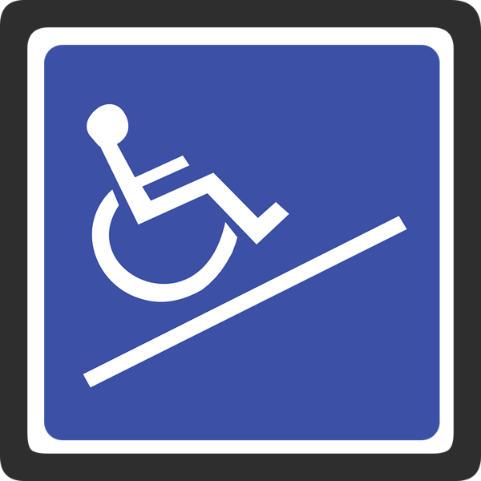

The Americans with Disabilities Act (ADA) Title III has very specific requirements for ramps when being used in newly constructed or renovated places of public accommodation and commercial facilities. At Burnham, we receive many questions about ramp ADA compliance and thought it would be useful to provide an overview of the statute’s ramp requirements.

## Finding the ADA’s Ramp Requirements

The ADA Title III’s technical requirements for ramps are found in § 405 of the [ADA Accessibility Guidelines, Chapter 4: Accessible Routes](https://www.access-board.gov/guidelines-and-standards/buildings-and-sites/about-the-ada-standards/background/ada-aba-accessibility-guidelines-2004/chapter-4-accessible-routes). The rules implementing the ADA, the 2010 Standards for Accessible Design, incorporate the 2004 ADA Accessibility Guidelines (ADAAG), developed by the U.S. Access Board. Section 303.4 of ADAAG, part of Chapter 3: Building Blocks, identifies when ramps are required. Curb ramps have separate technical requirements that may be found in § 406 and are not covered in this post.

## Overview of Requirements

According to § 303.4, when there are changes in level greater than a ½ inch above a floor or ground surface in facilities subject to ADA Title III, these shall be ramped. Ramps shall be located adjacent or in close proximity to the same routes used by the general public. § 206.3.

### Slope, Width, and Rise

Ramps must have a running slope, the slope in the direction someone travels, of no more than 1:12. The cross slope, the slope perpendicular to the running slope, must be no more than 1:48. These slope proportions match the physical abilities of most people, whether they be ambulatory or in wheelchairs. A steeper slope is permitted in existing facilities where there is less space for a more gradual slope. §§ 405.2 - 405.3.

Ramps must have a minimum width of 36 inches between handrails, and the maximum allowable rise for a ramp run of any length is 30 inches. §§ 405.5 - 405.6.

### Landings

Landings are required at the bottom and top of the ramp and must be:

-   level;
-   at least as wide as the ramp;
-   a minimum length of 60 inches;
-   anda minimum of 60 x 60 inches if the ramp changes direction (is a landing between the two sections of a ramp).

The door maneuvering (pull side and push side) clearance may overlap the ramp landing. § 405.7. Also, landings located where they may become wet must be designed so water doesn’t accumulate. § 405.10.

### Handrails

According to § 405.8, handrails must be available on both sides of any ramp with a rise of more than six inches and must comply with the extensive handrail requirements of § 505. The following are some highlights from § 505 which specifies that handrails must:

-   be the length of the ramp;
-   be continuous between ramp runs for dogleg (L-shaped) or switchback ramps;
-   extend at least 12 inches beyond the length of the ramp, both at the top and bottom landings, when not continuous;
-   have a space between the wall and the handrail of 1.5 inches;
-   provide a top of the gripping surface between 34 and 38 inches above the ramp’s surface;
-   be solidly fixed; and
-   be rounded or extend into a wall, post, or floor where the handrails terminate.

### Edge Protection

Edge protection, where applicable, is required on the sides of ramp runs and landings. This can be achieved by providing a surface of at least 12 inches farther than the inside handrail face or a curb/barrier that prevents a four-inch diameter sphere. These options limit an element, such as a wheelchair caster, from slipping off the ramp or landing. § 405.9.

## Local Requirements and Additional Information

It is necessary to know your state and local jurisdiction’s requirements in addition to the ADA’s standards for ramps. State and local accessibility requirements may sometimes have different or stricter requirements than the ADA.

The United States Access Board has a very helpful online [Guide to the ADA Standards](https://www.access-board.gov/guidelines-and-standards/buildings-and-sites/about-the-ada-standards/guide-to-the-ada-standards). Although the guide is still in the process of being completed, there is a useful [section on the ADA’s ramp requirements](https://www.access-board.gov/guidelines-and-standards/buildings-and-sites/about-the-ada-standards/guide-to-the-ada-standards/chapter-4-ramps-and-curb-ramps) with excellent illustrations. However, it is necessary to still look at the requirements as they appear in ADAAG and not completely rely on the guide.

We specialize in helping companies of all sizes comply with the ADA’s requirements, including the ramp requirements. Feel free to [contact us](/contact/) if you have any questions.
