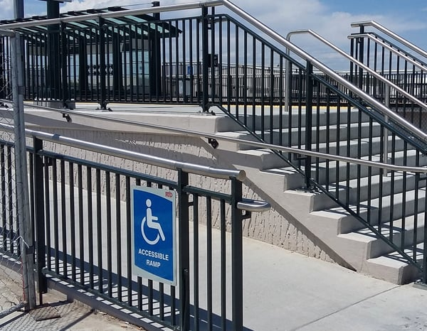

It is critical to be aware of the [Americans with Disabilities Act (ADA](https://www.ada.gov/pubs/adastatute08.htm)) Title III’s requirements for handrails (especially hand railing heightwhen designing and building new or renovated places of public accommodation and commercial facilities. T

The ADA’s specific handrail requirements are found in the rules implementing the ADA, the 2010 Standards for Accessible Design (2010 Standards), that incorporate the 2004 ADA Accessibility Guidelines (ADAAG) developed by the United States Access Board. It is essential to strictly adhere to these handrail requirements to be in compliance with the ADA.

[Burnham’s Code Group](/what-we-do/code-consulting/) can assist your team in reviewing drawings as early as the schematic design phase, advising on current ADA requirements and alerting the team to any necessary changes. [Contact Burnham Nationwide](/contact/) if you are concerned about adhering to ADA requirements. 

<em>photo by [Alex Rodriguez Santibanez](https://unsplash.com/@alexrds)</em>

## When are Handrails Required?

The ADA’s handrail requirements are found in Section 505 of the 2010 Standards, [Chapter 5: General Site and Building Elements](https://www.access-board.gov/guidelines-and-standards/buildings-and-sites/about-the-ada-standards/ada-standards/chapter-5-general-site-and-building-elements). According to Section 505.1, handrails are required along ramps on accessible routes with a rise greater than 6 inches and stairways when newly constructed or if handrails are removed and replaced as part of an alteration.

If handrails are provided along a walking surface with a running slope that is less than 1:20, the handrails must comply with Section 505.

## Where Should Handrails be Placed?

Handrails for stairs and ramps must be provided on both sides and along the entire length of each stair flight or ramp run, including switchback or dogleg stairs and ramps. In assembly areas, handrails may be on only one side if the handrails are within the aisle width and are not required to be continuous if the aisle is for seating.

The handrail must be at a consistent height with the top of the gripping surface between 34 to 38 inches above the walking surface, stair, or ramp. In our experience, regulators recommend splitting the difference (36 inches) if there is any confusion about the standard handrail height. There should also be a clearance of at least 1½ inches between the handrail and wall or adjacent surface.

In cases when a building is mainly used by children, a second set of handrails with a maximum height of 28 inches should be provided. Also, to prevent entrapment, there should be a minimum vertical clearance of 9 inches between the two sets of handrails.

## How Should Handrails be Constructed?

Handrails must have a gripping surface along their entire length without obstruction on the top or side and only a maximum of 20 percent of their length may be obstructed on the bottom. Also, a horizontal projection such as a handrail bracket cannot be any closer than 1½ inches from the handrail gripping surface bottom. See Section 506.6 for exceptions to these requirements.

A round handrail should have a cross-section diameter from 1¼ to 2 inches, and the perimeter of a non-circular handrail must be from 4 to 6¼ inches with a cross-section dimension of no more than 2¼ inches. Also, handrails must have rounded edges and should not be sharp, abrasive, or rotate.

Handrails must extend horizontally on the top and bottom a minimum of 12 inches beyond a ramp run and unless they continue to the next ramp, should return to the wall or the landing surface.

On stairs, handrails must extend horizontally at the top at least 12 inches starting at the first riser nosing and at the bottom at least the length of the stair tread just after the last riser nosing. The requirements for the stair handrail returning to the wall are the same as for ramp handrails. During [our compliance inspections](/what-we-do/permit-management/), we frequently see handrails that are not properly extended in accordance with Sections 505.10.2&3.

See Section 505.10 for exceptions to the handrail extension requirements.

## Do I Really Need to be in Compliance With the ADA?

If you are not in compliance with the ADA’s handrail and other requirements, you could be subject to a United States Department of Justice [enforcement action](/final-review-blog/essential-guide-to-ada-title-iii-enforcement-dojs-role/) or a [private party lawsuit](/final-review-blog/essential-guide-to-ada-title-iii-enforcement-private-party-lawsuits/). It is also necessary to be aware of your state and local accessibility requirements that may be stricter than the ADA’s regulations.

We at Burnham Nationwide are experienced at conducting ADA compliance reviews, and have a dedicated team of code compliance experts that can assist you on your project. If you have any questions, please [contact us](/contact/) before you waste valuable time and money.
