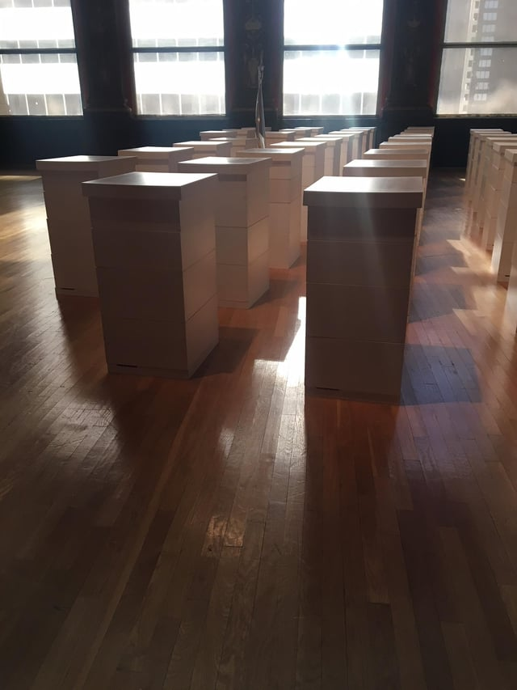
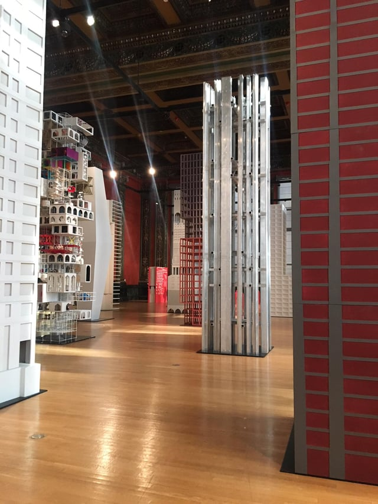
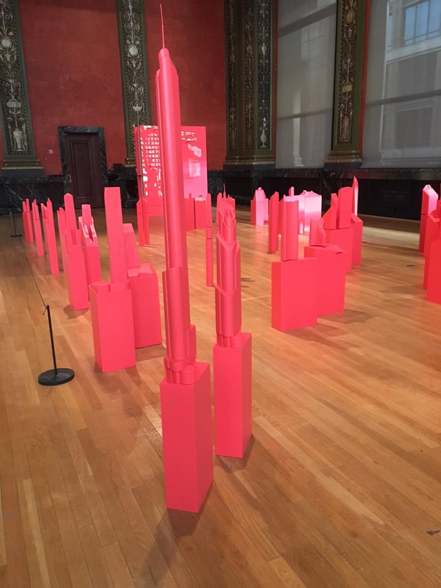
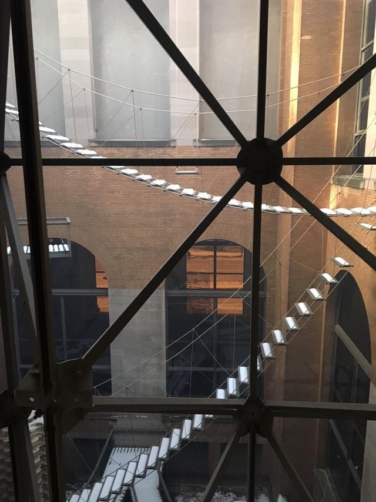
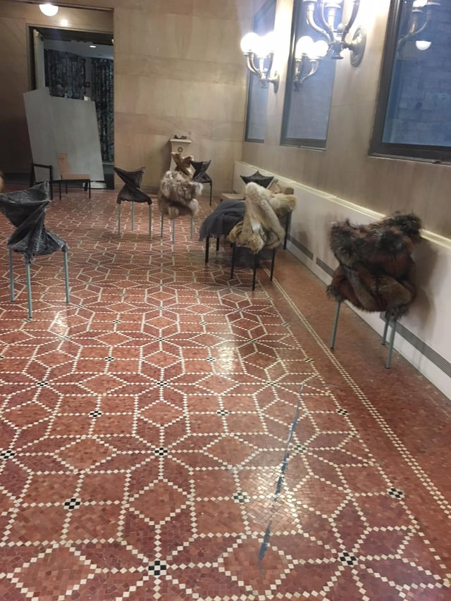

The [Chicago Architecture Biennial](http://chicagoarchitecturebiennial.org/) (CAB) completed its second run this weekend after over three months of programming and exhibitions. The 2017 event brought together 140 international participants who contributed models, photography, films, and installations engaging with the role and relevance of history in the future of architecture.

As the event closes, we’re taking a look back at some of the CAB’s events and discussions around “making new history” at the Chicago Cultural Center and the CAB’s six Community Anchor sites in neighborhoods throughout Chicago - and sharing some of our own photos below.  

## Beehives with Asteroid and Prototype for Re-entry <em>- Inigo Manglano-Ovalle (Chicago, USA)</em>

## Installations at the Chicago Cultural Center Linked Art, Architecture, Fashion, and Politics

### *Vertical City* and <em>Horizontal City</em>

The Vertical City <em>- Collective. All images via Michelle DiFranco.</em>

Installed at the Chicago Cultural Center - the CAB’s home base - “The Vertical City” reimagined the [1922 Tribune Tower design competition](https://www.architecture.org/) and the subsequent 1980 “Late Entries to the Chicago Tribune Tower Competition” publication by Chicago architect Stanley Tigerman that collected drawings by Frank Gehry, Alison and Peter Smithson, Bernard Tschumi, and Tadao Ando.

Fifteen firms were invited to design new skyscrapers that echoed the history of the original challenge and its influence on architecture, including Tigerman’s publication, and to explore and examine the unbuilt Tribune Tower designs.

The models utilized stylistic pastiche, explored the process of recreating designs without thorough plans, and expanded the competition’s original goals to include new building technologies, adaptive reuse, and

All designs were contributed by emerging firms: 6A Architects, Barbas Lopes, Christ & Gantenbein, Ensamble Studio, Eric Lapierre, Barozzi Veiga, Go Hasegawa, Kéré Architecture, Kuehn Malvezzi, MOS, OFFICE Kersten Geers David Van Severen, PRODUCTORA, Sam Jacob Studio, Sergison Bates, Serie Architects, and Tatiana Bilba.

Adjacent to *The Vertical City*, Charles Waldheim, the Harvard GSD Office for Urbanization, and Siena Scarff Design’s *Heliomorphic Chicago* paired buildings that formed two alternative visions for Chicago - prioritizing solar access and ecological performance. The pairings of iconic buildings are optimized for either social equity or sustainable energy and posit an alternative Chicago with equitable access to solar energy. 

Heliomorphic Chicago <em>- Charles Waldheim with Harvard GSD Office for Urbanization and Siena Scarff Design</em>

The CAB’s [other collective exhibition](https://www.archdaily.com/880306/in-horizontal-city-24-architects-reconsider-architectural-interiors-at-2017-chicago-architecture-biennial), the *Horizontal City*, explores the status of the interior through referencing a photograph of a canonical interior. Twenty-four architects contributed a vision, with each design’s description including the referenced photograph. The display itself, composed of plinths, reflected the footprint of Mies van der Rohe’s IIT Campus plan.

### Other Cultural Center Exhibitions Merge Mediums

This year’s event integrated fully into the Cultural Center’s architecture. Installations such as Atelier Bow-Wow (Tokyo, Japan)’s *Piranesi Circus* and *Bless No. 60 Lobby Conquerors - Lobby Conquerors* interacted with the building itself and the Biennial’s visitors.

*Piranesi Circus*, located in the inaccessible-to-the-public courtyard visible from all sides of the of the Cultural Center, simultaneously recalls G. B. Piranesi’s *Carceri d’Invenzione* (“Imaginary Prisons”) and aerial and acrobatic apparatuses. With no way to access the staircases, ladders, balconies, and swings climbing the courtyard’s walls, the installation remained in a void that was yet still governed by the established rules of the building. 

Piranesi Circus <em>- Atelier Bow-Wow (Tokyo, Japan)</em>

The Cultural Center’s public lounges doubled as installations - BLESS’s fourth floor lounge challenged the boundaries between architecture and fashion with their “chairware,” and each piece of Artek seating was dressed in garments that created a feeling of interiors and exteriors even within the space. 

Bless No. 60 Lobby Conquerors / Lobby Conquerors <em>\- BLESS in dialogue with Artek furniture classics (Berlin, Germany)</em>

Other fashion-architecture [hybrids](https://chicagoarchitecturebiennial.org/) included a performance by the Chicago Sinfonietta at the Garfield Park Conservatory, who played in wearable mesh structures that filtered the Conservatory’s air, and Studio Gang’s “Here Hear Chicago.”

Dellekamp Arquitecto’s “[Wallderful](https://chicagoarchitecturebiennial.org/)” model near the Cultural Center's Washington Street lobby recreated the original Garfield Park installation - an open, inhabitable answer to the U.S.-Mexico border wall - as a playful pavillion meant to be a gathering place and platform, fostering an ongoing conversation around developing community relationships through openness and inclusion.

## The Chicago River Edge Ideas Lab

New to this year’s event, the Chicago River Lab connected Chicago’s residents with the riverfront’s future by inviting them to engage with nine [proposals](/final-review-blog/chicago-river-edge-ideas-lab/) from world-class architecture firms: Ross Barney Architects; Skidmore, Owings, & Merrill (SOM); James Corner Field Operations; site design group, ltd (site); Sasaki, Studio Gang, Adjaye Associates, SWA, and Perkins + Will with Omni Ecosystems.

Each proposal reimagined three sites on the Chicago River that are currently underutilized or inaccessible, including the existing riverwalk at the Civic Opera Building, a portion of the Chicago River adjacent to the Congress Parkway where four major highways converge, and potential parkland near the St. Charles Airline Bridge on the South Branch in Chinatown.

After exploring all nine designs [online](https://www.chiriverlab.com/survey) and at Expo 72 during the Biennial, visitors were invited to attend gallery talks from participants such as SOM and to provide feedback to the City of Chicago, Metropolitan Planning Council, and the CAB prior to a panel hosted in January. Using the input from city residents, the City plans to create river edge design guidelines for future projects along the Chicago River.

Once the survey results are released, we’ll update this space with the designs most resonant with the City’s residents.
