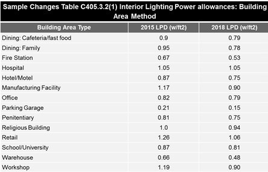

In a previous [post](/final-review-blog/2018-illinois-energy-conservation-code-preview/), we discussed the upcoming adoption of the 2018 Illinois Energy Conservation Code (Illinois Energy Code) based on the 2018 International Energy Conservation Code (IECC). We documented the history of the Illinois Energy Code and some of the differences between the current version of the IECC and the 2018 edition. This post discusses some of the specific changes to the IECC’s commercial building provisions that are likely to impact the Illinois Energy Code.

<em>Photo by [Fineas Anton](https://unsplash.com/@fineas_anton)</em>

The following highlights some of the important 2018 IECC changes covering commercial buildings that will most likely be adopted in Illinois:

## Climate Zones

Both the IECC and ASHRAE 90.1 split Illinois into two zones – 4 in the south and 5 in the north. There are a few counties that are misaligned and may be in need of an adjustment by the state.

## Reduced Solar Heat Gain Coefficient In Illinois Climate Zones

Within the Envelope section, Table C402.4 Building Envelope Fenestration, the Maximum U-Factor, and Solar Heat Gain Coefficient (SHGC) Requirements were modified for more stringent (lower) SHGC in the two Illinois climate zones, 4 and 5, making Fixed Fenestration 0.38, Operable Fenestration 0.45, and Entrance Doors 0.77.

## Hotel Key Cards or Networked Controls

Section C403.7.6 covers automatic control of heating, ventilation, and air conditioning (HVAC) systems serving guestrooms (a mandatory provision). In Group R-1 buildings containing more than 50 guestrooms, each guestroom must now be provided with local controls or networked guestroom controls (a new definition) complying with the provisions of Sections C403.7.6.1 Temperature Setpoint Controls, and C403.7.6.2 Ventilation Controls. However, hotels are not precluded from having an automatic daily preoccupancy purge cycle.

## Mechanical and Lighting Control Configurations

  

Throughout Mechanical and Lighting Control Requirements, the phrase “capable of” was replaced with “configured.” The overall intent of this code change was to increase the likelihood that energy savings intended by the IECC will be realized. Much of the savings from energy codes is dependent on the presence and functionality of building controls for HVAC and lighting systems. For example, control equipment can be provided that could be said to be capable of achieving the desired result even though the required software, hardware, and programming is not present and the setpoint is not correct or the programming is not even complete.

## Part Load Controls

  

Section C403.4.4 expanded the application of variable speed drives in hydronic systems greater than or equal to 300,000 Btu/h (146.5 kW) in design output capacity supplying heated or chilled water to comfort conditioning systems, reducing the threshold where variable flow and variable speed drives (VSD) are required for pumping systems. The pump threshold is now reduced from 10 to 2 hp for continuous operation and time-schedule controlled pumps. Pumps that have operation controlled by direct digital control based on zone demand will result in a varied threshold based on climate zone. Requirements for heating pump VSDs are also added.

## Open Office Lighting Controls

  

Modifications to Sections C405.2.1. Occupant sensor controls and C4052.1.1 establish the application of lighting controls to open plan offices. New language in Section C405.2.1.3 defines the application, applying to function in open office plans > 300 ft that are to be configured to control zones < 600 ft. Controls are based on occupancy of both individual control zones and entire office area.

  

## Luminaire Lighting Controls

  

Section C405.2 Lighting Controls was modified to specifically identify Luminaire Level Lighting Controls (LLLC). It now requires lighting systems be provided with controls that comply with one of the following:

1.  Lighting controls as specified in Sections C405.2.1, C405.2.2, C405.2.3, C405.2.4, and C405.2.5. (Previous requirement)
2.  LLLC and lighting controls as specified in Sections C405.2.4, and C405.2.5. for adjustments and wireless zoning configurations, for each control strategy.

  

The purpose of this code change is to acknowledge lighting control technology that meets the intent of the provisions of the IECC if the technology has specific capabilities. LLLC refers to a lighting control solution where each luminaire in a space has independence from every other and can, therefore, maximize incremental control within very small areas.

  

## Interior and Exterior Lighting Levels

  

Table C405.3.2(1) was modified throughout to reduce watts/ft. Sample changes are noted below.

Table C405.5.1(2) Individual Lighting Power Allowance for Building Exteriors, was also modified to reduce watts/ft. Changes included:

  

-   Base site allowance for all zones
-   Uncovered parking areas
-   Building grounds
-   Building entrances and exits
-   Sales canopies
-   Outdoor sales
-   Non-tradeable surfaces

  

## Additional Options Packages

  

Section C406 additional efficiency package options were modified to include two new efficiency options:

-   C406.8 Enhanced envelope performance. The total UA of the building thermal envelope as designed shall be not less than 15 percent below the total UA of the building thermal envelope in accordance with Section C402.1.5, and
-   C406.9 Reduced air infiltration. The measured air-leakage rate of the building envelope shall not exceed 0.25 cfm/ft.

  

## Other Fixes and Reorganizations

  

There was a complete restructuring of HVAC provisions, grouping categories of provisions together. In addition, three important changes corrected the code to reflect original intentions. 

C403.7.1 Demand Control Ventilation revised to be triggered at a threshold of 25 people/1000ft or greater, rather than 25 people/1000ft

C403.5 Economizers (Prescriptive), corrected 2015 C403.3(1) exception 4 reference to an unintended number

C503.1 General, Exception 7 – 50 percent threshold for luminaire replacement triggering requirements, conflicted with C503.6 10 percent threshold

Also, a new appendix, Appendix CA Solar-Ready Zone-Commercial, includes provisions for new construction where solar-ready provisions are required. It includes:

-   Minimum roof area for solar
-   Roof loads and documentation
-   Interconnection pathway
-   Electrical service reserved space
-   Construction documentation certificate

  

The Illinois Energy Code Advisory Council, charged with overseeing changes to the Illinois code, could delete or modify any or all of these modifications in the coming months. If past history is any clue, you can safely assume that in all likelihood these changes will be part of the new Illinois Energy Code in 2019. In an upcoming post, we will cover the changes to International Energy Conservation Code’s residential provisions in the 2018 edition.

Is the 2018 IECC-based Illinois Energy Code described in this post still the current commercial code? No — Illinois adopted the 2024 Illinois Energy Conservation Code, effective November 30, 2025, based on the 2024 IECC. The 2018 edition this post previewed has been superseded by two full cycles, and current commercial buildings in Illinois must comply with the 2024 IECC baseline with Illinois-specific amendments. What is the Solar Heat Gain Coefficient (SHGC) and why does it matter for commercial buildings? SHGC measures how much solar heat passes through a window — a lower value means the glass blocks more solar heat gain, reducing cooling loads. Illinois Climate Zones 4 and 5 each have specific maximum SHGC limits for fixed, operable, and entrance door fenestration that have continued to tighten with each new code cycle. Why did changing "capable of" to "configured" in control requirements matter? It's a meaningful enforcement shift — "capable of" allowing a building to technically comply by installing control hardware that could achieve energy savings, without requiring the system to actually be programmed and functioning. "Configured" requires that controls are actually set up and working as intended, not just installed. What are Luminaire Level Lighting Controls (LLLC) and are they still part of the code? LLLC allows each individual light fixture to be independently controlled, enabling very fine-grained occupancy and daylight-responsive control rather than controlling whole zones together. They were introduced as a recognized compliance path in the 2018 IECC and have remained an accepted lighting control strategy in subsequent editions.
