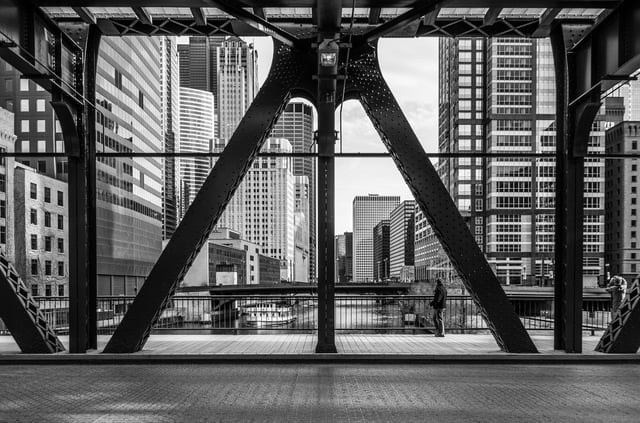

Illinois is in the process adopting the [2018 Illinois Energy Conservation Code](https://www2.illinois.gov/cdb/business/codes/Pages/2018-IECC-Announcement.aspx) (Illinois Energy Code). As required by state law, Illinois must adopt amendments to the Illinois Energy Code based on the latest version of the [International Energy Conservation Code](https://www.iccsafe.org/codes-tech-support/codes/2018-i-codes/iecc/) (IECC), a model code that is updated on a three-year cycle. The new version of the Illinois Energy Code will be based on the 2018 IECC. Over three posts, we will preview some of the changes we are likely to see in the 2018 Illinois Energy Code.

<em>Photo by [Andrew Seaman](https://unsplash.com/@amseaman)</em>

The state has made considerable progress in mandating buildings’ energy efficiency over the last 15 years. In 2002, only 25 percent of local Illinois jurisdictions had some building energy code provisions. Chicago took the lead by adding a whole new chapter (18-13) to their building code in 2003, a modified version of the 2000 IECC, then in its second edition. However, the only means of enforcement was to require certification by Registered Energy Professionals (REP), licensed engineers or architects who attended special training classes. That same year, Illinois adopted the latest ASHRAE 90.1 standard as part of the Illinois Capital Development Board (CDB) Act (20 ILCS 3105), that was only applicable to state-funded construction.

Ten years ago, Illinois formally adopted rules mandating the use of the 2003 IECC for both state and commercial construction. These rules became the Illinois Energy Code. The state required in 2007 that each new version of the Illinois Energy Code be implemented, following the International Code Council’s three-year cycle, within one year of the IECC’s publication. By 2009, Public Act 096-0778 establishing an energy code for residential buildings was passed and became effective on January 29, 2010. The CDB is the administrator of the Illinois Energy Code; however, each local jurisdiction (as with the Plumbing and Accessibility Codes) provides independent enforcement.

Since 2016, Illinois has followed the 2015 IECC, with some published modifications. In fact, Chicago has now rescinded their previous code (as well as the requirement for REP certification) and follows the Illinois Energy Code, adding their own “‘home rule” amendments. Following the three-year cycle mandate, Illinois will be adopting in 2019 the latest 2018 IECC. The state-appointed Illinois Energy Code Advisory Council, which is made up of six members, has been working since earlier this year to review the provisions of the new code and make any changes they deem necessary before to its submission to the Joint Committee on Administrative Rules for public comment prior to passage and publication.

As we await the official changes coming next year, let’s look at some of the differences between the current version of the IECC and the 2018 edition. First, the overall format of the code will not change very much from the previous edition. It will still be separated into two books, one for commercial buildings (designated with a ‘C’ in front of the section numbers) and one for residential buildings (designated with an ‘R’ in front of the section numbers). The new edition maintains the same six chapters for each book. There will also be the same compliance paths, allowing the use of the IECC provisions or those of ASHRAE 90.1 (updated for 2016) except for single family homes, multi-family buildings less than four stories high, mobile homes and modular homes.

It should be noted that although the IECC does cover residential buildings, those that contain more than three stories in height above grade are classified as being commercial buildings for the purpose of following the Commercial Provisions. In addition, the law still does not apply to historic buildings, buildings exempt from a local building code, or buildings that do not use either electricity or fossil fuel for comfort conditioning.

Also, the Chapter One requirement to provide certain information on the drawings submitted for a permit still applies. In addition, the code for commercial construction now requires that the drawings specify that the following documents be provided to the building owner or owner’s authorized agent within 90 days of the date of receipt of the certificate of occupancy:

(1) Record documents of the completed work, including mechanical, electrical and control drawings that indicate all changes to the size, type, and location of components, equipment, and assemblies.

(2) Energy code compliance documentation and supporting calculations as part of the project record documents or manuals, or as a standalone document, and shall include the specific energy code edition utilized for compliance determination for each system, documentation demonstrating compliance with Section C303.1.3 for each fenestration product installed, and the interior lighting power compliance path, building area or space-by-space, used to calculate the lighting power allowance.

For projects complying with Item (2) of Section C401.2, the documentation shall include:

-   The envelope insulation compliance path.

-   All compliance calculations including those required by Sections C402.1.5, C403.8.1, C405.3, and C405.4. For projects complying with Section C407, the documentation shall include that required by Sections C407.4.1 and C407.4.2.

(3) Training shall be provided to those responsible for maintaining and operating equipment included in the manuals required by Section C103.6.2.

When the Illinois Energy Code Advisory Council met at the beginning of this year, International Code Council staff members attending the meeting provided a list of commercial code changes considered to be most relevant to the adoption process. They included:

-   Climate Zones
-   Reduced Solar Heat Gain Coefficient in Illinois Climate Zones
-   Hotel Key Cards or Networked Controls
-   Mechanical and Lighting Control Configurations
-   Part Load Controls
-   Open Office Lighting Controls Luminaire Lighting Controls
-   Interior and Exterior Lighting Levels
-   Additional Options Packages
-   Other Fixes and Reorganizations

  

We will highlight in [upcoming posts](/final-review-blog/2018-illinois-energy-conservation-code-preview-commercial-buildings/) some of the specific IECC changes that will impact the 2018 Illinois Energy Conservation Code.

How frequently is the Illinois Energy Conservation Code updated? Illinois is required by state law to adopt amendments to the Illinois Energy Code based on each new edition of the IECC, which is updated on a three-year cycle. The state must implement each new version within one year of the IECC's publication. Does the Illinois Energy Conservation Code apply to historic buildings? No - historic buildings, buildings exempt from a local building code, and buildings that don't use electricity or fossil fuel for comfort conditioning are all exempt from the Illinois Energy Code. Does Chicago follow the same energy code as the rest of Illinois? Chicago follows the Illinois Energy Code as a base but adds its own "home rule" amendments on top of it - a long-standing arrangement that gives the city latitude to be more stringent than state minimums in certain areas. Who oversees amendments to the Illinois Energy Conservation Code? The Illinois Energy Code Advisory Council - a six-member state-appointed body - reviews proposed changes, modifies them as needed, and submits them to the Joint Committee on Administrative Rules for public comment before passage and publication. What documentation must be provided to a building owner after a commercial project receives a certificate of occupancy? Within 90 days of receiving the CO, the owner must receive record documents of completed work (including mechanical, electrical, and control drawings showing all changes), energy code compliance documentation with supporting calculations, and training for those responsible for operating and maintaining the equipment.
