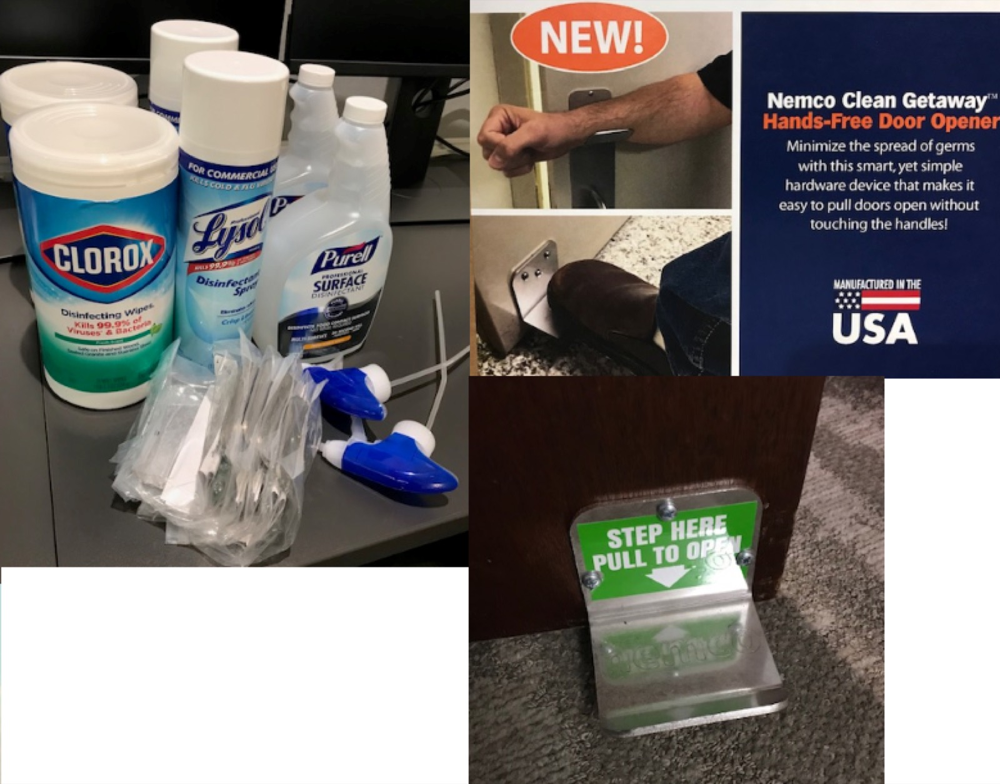

As cities see an influx in COVID-19 cases, now more than ever it’s crucial that businesses keep their interior spaces sanitized and safe for employees. This is not only essential for life safety purposes, but also for employees to feel less stressed as they return to the office. Architectural trends are predicting adjustments in [city designs](https://architizer.com/blog/inspiration/industry/covid19-city-design/) and [office designs](https://www.gensler.com/research-insight/blog/the-future-workplace-will-embrace-a-hybrid-reality)<strong>.</strong> Returning to work isn’t easy for everyone and [it’s crucial](https://www.osha.gov/as/opa/worker/employer-responsibility.html) for employees to have a safe and clean workspace. Our team assembled a checklist of items to keep in mind when going back into the office.

### 1\. Start with a plan

Creating a health preparedness plan for your office and off site work will help eliminate confusion for those wanting to return to the office; giving them protocols to follow. Our code consultants have made adjustments to their site inspections. While some have gone virtual, nothing beats an in person inspection which can be daunting during these times. Having a written plan to exchange and request with other companies, keeps both sides accountable. This plan should include:

-   Prerequisites to follow before going to the office or going to any Outside Visits
-   Building Management Accountability
-   Field, Contracting and Business Partner Visits
-   Visitor Policies

-   On first arrival Must wear a mask, sign in with temperature check, and apply hand sanitizer

-   Conference etiquette
-   Create a shared online office schedule
-   Kitchen adjustments
-   Workspace and office safety precautions

-   Prepare office space with disinfectant items
-   Go “touchless”: Burnham got creative by installing footholds at the bottom of our entry doors and installed a bluetooth badging system to avoid skin contact.

### 2\. Building Management Accountability 

Keep your building management accountable and ask for safety or operational plans taken. Specifically, how they plan on keeping the public space sanitized, establishing social distancing and alternative communication forms. Keeping them accountable will help tenants one step closer to a safe environment.

### 3\. Communication and Organization

During a time of uncertainty, it’s important more than ever to have clear and concise communication with teams to acknowledge changes. With employees going into spaces at a higher frequency, weekly updates and shared schedule changes are key. Below are some best practices on execution:

-   Provide weekly updates that include any local policy shift both locally and nationally in safety standards.
-   Create an alternating schedule for those that do go into the work space to create a healthy balance.
-   Designate a point person/people that will make sure cleaning and office supplies needs are met.

As businesses continue to navigate office safety, it’s essential to find a balance and set a positive standard as we find our new norm. What methods is your business taking to create a safer office space? [Share them with us](mailto:vmacias@burnhamnationwide.com)!

Are the COVID-era safety protocols in this post (temperature checks, mandatory masks at entry) still standard practice today? No, these were specific 2020 pandemic-era protocols tied to active COVID-19 case surges and are no longer standard requirements in most workplaces today. Touchless entry features and badging systems some companies adopted have often stuck around as general convenience upgrades, but the explicit health-screening steps described here have largely been phased out. Is having a written workplace health and safety plan still a good practice, even without an active pandemic? Yes, this underlying principle holds up well beyond COVID specifically. A written plan covering visitor policies, building management responsibilities, and clear protocols for in-office and off-site work continues to be useful for general workplace safety, emergency preparedness, and setting clear expectations between companies and visitors. Why does holding building management accountable for safety planning matter for tenants? This remains broadly relevant, tenants benefit from understanding how building management handles things like public space maintenance, communication during disruptions, and general operational safety, regardless of whether the immediate concern is a pandemic, severe weather, or another type of building-wide issue. Is alternating or hybrid office scheduling still a relevant practice today? It evolved rather than disappeared, what started in 2020 as a social-distancing measure has, in many industries, continued in a different form as standard hybrid work scheduling, now driven more by employee preference and flexibility than by health protocols. How important is regular internal communication during periods of workplace change? This remains a sound general practice independent of any specific crisis, weekly updates, a shared schedule, and a designated point person for operational needs are useful structures for managing any kind of workplace transition, not just a pandemic-specific one.
