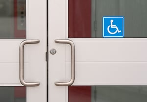

You can’t afford to be in non-compliance with the Americans with Disabilities Act (ADA) requirements. In fact, without an *ADA compliance review* of your building, you could be throwing money out the window. The ADA requires all existing public facilities to remove barriers and all new ones to meet full compliance. You see, non-compliance with the ADA can be expensive; impacting your profits, finances and more importantly, how your business is viewed in the community and at large.

Has your building undergone an ADA compliance review yet? If not, here are four reasons it needs to happen today:

1.    <strong>Reputation –</strong> ADA non-compliance can hurt your reputation in the eyes of customers with disabilities, as well as their families, loved ones, and supporters in the community if they can’t enter and have the same access to products and services as any other person. It could even deter people from doing business with you in the future.
2.    <strong>Cost –</strong> Violations of ADA regulations can result in civil penalties from the U.S. Department of Justice. For a first-time violation, that means a fine of $55,000 to $75,000, and for a second violation, fines could reach as high as $150,000.
3.    <strong>Lawsuits –</strong> On top of civil penalties, you could also be sued by a person with a disability who visits your building. This has become a common occurrence as more people with disabilities understand their rights, or at times use this as a means to generate income. In addition to being required to bring the facility into compliance, this can impact the reputation of a business and result in significant compensation for the plaintiff. In California, plaintiffs in ADA incompliance cases are automatically guaranteed a minimum of $4,000, plus substantial attorney’s fees.
4.    <strong>Employment issues –</strong> A Business or Organization that is located in a building that is not compliant with the ADA can also face problems with the Equal Employment Opportunity Commission. The EEOC could sue the organization for not providing accessible facilities and accommodations for their employees with disabilities. . This could result in fines and fees.

Without knowing what to look for, you may not know whether your building is compliant or not. Every day when out in the field at a Restaurant, Retail Store, Office Space; even ones that have been recently constructed, our ADA Specialists see ADA required elements that are not installed correctly. Removal of Barriers at a public building or space is required per the ADA. An *ADA compliance review* can help protect your company’s reputation and save you money in the long run. To schedule an ADA compliance review of your building or space – or to ensure the structure that you’re currently building is compliant – contact our [ADA experts](/what-we-do/code-consulting/) today. We’re here to help.
