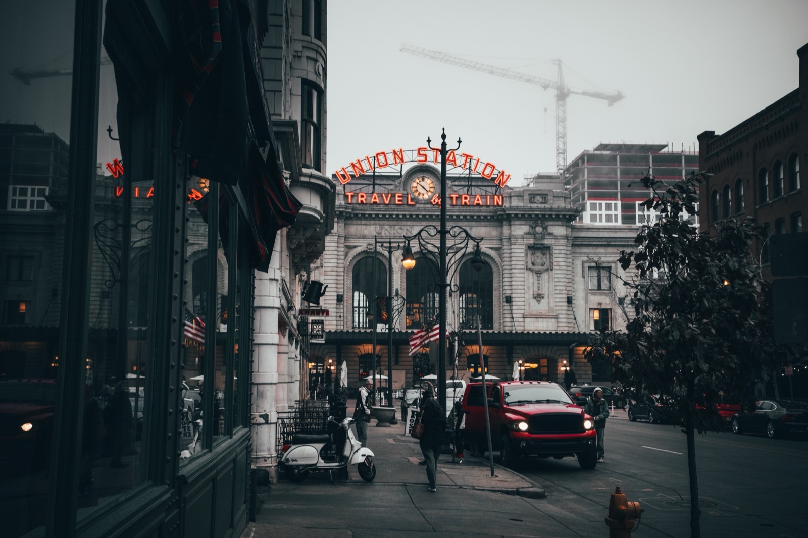

Before beginning a project within the City of Denver, it is vital to follow the City’s Building and Zoning Codes for efficient permit approval and a successful project. The Denver permitting process has undergone [n](/final-review-blog/changes-to-denvers-permit-processes-promote-efficiency/)[ew development strategies](/final-review-blog/changes-to-denvers-permit-processes-promote-efficiency/) focused on sustainable growth within the city, as well as a new green roof [ordinance](/final-review-blog/denver-green-roof-ordinance-requirements/) with requirements for all large new construction projects as well as retrofitting of existing buildings.

Taking your project step by step – and planning ahead for review timelines and other project delays – will keep it on schedule and up to code through the process. In addition, we have listed the four key areas you should be aware of when complying with building codes in the City of Denver.

#### <em>image by [Owen CL](https://unsplash.com/photos/chaqHXlOzYs)</em>

## 1\. Zoning

Adopted in 2010, the Denver Zoning Code divides the City into multiple zoning districts over seven general Neighborhood Contexts: Suburban, Urban Edge, Urban, General Urban, Urban Center, Downtown, and Special Contexts and Zone Districts. Each district is coded using a key consisting of the context, dominant building form and character, minimum zone lot size or maximum building height, and special purpose.

Never assume the land your project sits on is zoned for the goals you have in mind. The [Denver Building Code](https://www.denvergov.org/content/denvergov/en/denver-development-services.html) provides a step-by-step guide for ensuring compliance within a specific district. In order to determine your project's district and any zoning stipulations, please follow the following steps:

### Determine the Zoning District

Confirm with the Denver County assessor’s office or [online](https://www.denvergov.org/content/denvergov/en/denver-development-services/help-me-find-/zoning-for-your-project.html) to determine the zoning overlays for your property as well as adjacent properties. The zoning overlays will determine if there are any outstanding requirements that must be met.

#### Neighborhood Context

Once you’ve determined the Zoning District, use the first letter of that code to find the property’s specific zoning regulations.

S = Suburban

E = Urban Edge

U = Urban

G = General Urban

C = Urban Center

D = Downtown

#### Building Form

Find the type of new construction or remodeling project and review the design standards required of buildings within that neighborhood context to determine building form requirements.

#### Allowable Uses and Parking

This section contains a table to determine if your building’s use type is allowed within that neighborhood context, as well as what the parking requirements for both cars and bicycles may be for buildings within the zone.

#### Procedures and Enforcement

There are a number of steps you’ll need to take to obtain zoning approval for your project, and the Denver Building Code outlines each one.

## 2\. Permitting

Work allowed is dependent on the use limitations for each zone. Use limitations take into account the neighborhood context, the character and use of existing surrounding buildings, and what traffic the local infrastructure is designed to handle. 

Prior to applying for a permit, determine any business limitations that may result from your property's zone:

1.  Residential: Single and multi-family homes, home/office combinations, homeless shelters, residential care facilities, and correctional facilities
2.  Civic, Public, and Institutional: Utility buildings, recreation centers, day care centers, parks and open spaces, cemeteries, schools, and churches
3.  Commercial Sales, Service, and Repair Buildings: Arts and entertainment, medical/dental, parking, restaurants and pubs, tattoo parlors, pawn shops, and more
4.  Industrial, Manufacturing, and Wholesale: Buildings for telecommunications, contractors, oil and gas drilling, quarries, wind energy, transportation hubs, junkyards, recycling centers, storage buildings, and more
5.  Agricultural: Includes aquaculture, urban gardens, and plant nurseries, as well as farms  
    

Depending on the scope of work, outside agencies may require approval prior to permit issuance such as the Denver Health Department. It is vital to confirm outside agency reviews prior to plan submittal to avoid approval delays.

## 3\. Inspections

Inspections are required throughout the life of all projects, including general construction (roof, walls, steps/stairs, floors, doors, basements), electrical work, plumbing, signage installation, mechanical/HVAC installation or repairs, and fire system work. Most inspections can be scheduled a day or two following your request in person, by phone, or [online](https://www.denvergov.org/content/denvergov/en/denver-development-services/help-me-find-/inspections/schedule-a-building-inspection.html) with the City of Denver.

Help the inspection go smoothly by making sure your permits, plans, and other paperwork are in order, assuring access to all relevant areas, and having someone on-site at all times.

## 4\. Appeals

If a permit isn’t approved or a portion of your project doesn’t pass inspection, you can [file an appeal](https://www.denvergov.org/content/denvergov/en/denver-development-services/help-me-find-/building-codes-and-policies/building-code-appeals.html) application with the Denver Board of Appeals (BOA) under the Development Services Department. When it’s time to make your case with the BOA, [follow these guidelines](https://www.denvergov.org/Government/Agencies-Departments-Offices/Agencies-Departments-Offices-Directory/Community-Planning-and-Development/Building-Codes-Policies-and-Guides) for a more successful review:

1.  Show up on time, even if your case isn’t presented first
2.  You’ll have about 15 minutes; being organized and concise is important.
3.  If your case is particularly complex, be prepared to come back for additional review
4.  If possible, have the property owner present
5.  Know both the Building and Zoning Code well enough to present your interpretation intelligently as it applies to your project

  
The Denver Building Code can be a challenge to navigate for complex projects including new construction. [Last year,](/final-review-blog/changes-to-denvers-permit-processes-promote-efficiency/) the City updated its permit processes, affecting commercial building submittals. Enacted in April 2017, the Community Planning and Development Department’s Simultaneous Zoning and Building [Code Reviews](https://www.denvergov.org/content/denvergov/en/community-planning-and-development/news/2017/simultaneous-review.html) program combines the zoning permit and building permit processes into a single review for eligible commercial projects. Using standard plan review, previously the only option, commercial projects must receive a zoning permit prior to applying for a building permit.   
Our Denver team is always available to answer any questions and assist with submittals throughout the process within both the City and County of Denver.

<em>This post was last updated on September 12th, 2018.</em>
