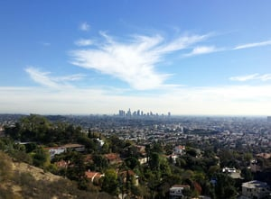

Understanding the Los Angeles building codes and permit process can be difficult, even for the most seasoned experts. Environmental issues, like flood hazards, soil conditions and coastal zones, can affect your architectural plans and construction permits. Add that to a variety of city departments to go through, and it can be tough to know where to start. Here are five of the most important things to know about building permits in Los Angeles.

## 1\. (Department of) Safety First

All structural projects in the city must first be approved by the Department of Building and Safety. During this time, you’ll need to submit your completed building plans in order to get the green light for construction.

While reviewing your plans, it's possible that the Department of Building and Safety will approve your plan as is, reject part of it, reject all of it, or call you in to answer any questions they may have. Some of the many things that can cause delays include:

-   Overlay zoning decisions
-   ZAA hearing outcomes
-   Changes in planning ordinances
-   Zoning designation conflicts

## 2\. Determining the Type of Permit You Need

The Los Angeles Department of Building and Safety is responsible for issuing construction permits such as building, plumbing, electrical, pressure vessel, elevator, heating, ventilating and air conditioning permits. A permit from the Department of Building and Safety is required for private property construction, alteration or repair work on buildings within the City of Los Angeles.

The array of permits you might need for your building project can include:

-   Plan approval
-   Work permits
-   Permits to allow for use of heavy construction equipment
-   Environmental permits for features like underground storage tanks, storm water runoff, flood control, etc.
-   Solar/photovoltaic permits
-   Electrical vehicle charger permits
-   Plumbing, electrical, grading, fencing, fire suppression, roads/walks/driveways, trenching, signage, etc.

## 3\. Environmental Issues Can Affect the Permitting Process

Due to the unique environmental issues that can affect the Los Angeles area, the Public Works Department reviews all architectural plans for potential flood hazards and storm drainage issues. If this office decides that the area in which you want to build is flood-prone, it can deny your request altogether, or require expensive modifications to your plans. The department can also disapprove your plans if it foresees issues related to grading or soil conditions.

You may also have to deal with the Geo-Technical and Materials Engineering Division if your plans might possibly affect geological stability or soil conditions in the area that you want to build in. Your plans might be denied by this department altogether, unless you can prove that you have the wherewithal to deal with any concerns it has.

## 4\. Get to Know the Los Angeles Fire Department

Before you can erect a structure in Los Angeles, the fire department must determine whether it will be able to tap into sufficient water resources to extinguish the flames, in case it ever burns down. The local water purveyor will make this determination. If he or she says that not enough water can be locally accessed, then you will need to see the people at the Plan Check Unit, to see if you can get a variance on this requirement. In addition, this department must also approve all projects proposed in buffer fire zones, Fire Zone 4, or areas rated as Very High Hazard Severity Zones.

## 5\. Location, Location, Location

The location of your property will be a major factor in how long the process takes. Some of the ways that land is divvied up by the Department of Building and Safety include:

-   Hilly areas
-   Q condition specific plan areas
-   Enterprise zones
-   General specific plan areas
-   Historic preservation zones

If you’re planning to build in the unincorporated areas of Los Angeles, the Regional Planning Department will evaluate your plans. The officials will want to see that they meet all applicable regulations involving zoning, height, lot locations, number of stories, vehicular access, and parking spaces.

Additionally, if the land you wish to build in is designated as a “coastal zone,” then you must first obtain the necessary permits from the California Coastal Commission. If you’re unsure whether or not your property falls within coastal zone, then you will need to visit your local Building and Safety Office for clarification.

At Burnham, our business connections mean that we understand the Los Angeles building codes, often have preemptive knowledge of changes, and know how to manipulate the approval process.

You can also learn more about building permits in Los Angeles at the [City of Los Angeles Department of Building and Safety](http://ladbs.org/LADBSWeb/public-home.jsf) website.
