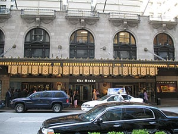

Hotel building permits differ from traditional building permits in a variety of ways. In order to meet construction goals and timeframes, it’s important to understand key differentiators of hotel building permits, including hotel licenses, hotel zoning areas and the hotel inspection process. In this post, we’ll share five things you should know about hotel building permits in Chicago.

## 1\. Hotel Licenses

In Chicago, a hotel license is required of all inns, hotels, apartment hotels, motels, lodging houses, dormitories, or any other places where sleeping accommodations are rented. However, hotel licenses are not required for Bed & Breakfasts, single room occupancy, shelters or vacation rentals. Those types of establishments require a specific license which differs from a hotel license.

When applying for a hotel license in Chicago, you’ll need the following information:

-   The name of your business
-   Business address
-   Square footage
-   Lease or proof of ownership of the property
-   Illinois Business Tax (IBT) number
-   Federal Employers Identification Number (FEIN)
-   Photo ID

The hotel license application can be filled out [online](http://resources.cityofchicago.org/coc-error/license-maintenance.html) or in person.

## 2\. Hotel Zoning Areas

Before beginning any construction work or filing any building permits, you must ensure that the site where your hotel intends to operate is in an appropriately zoned area and that it complies with the current Chicago Municipal Code. You can find out if your location is in the appropriate zone by using the [Interactive Zoning Map](https://gisapps.cityofchicago.org/zoning/) on the City of Chicago website. You can also speak with a Department of Business Affairs and Consumer Protection (BACP) consultant to learn more.

## 3\. Hotel Permits and Inspections

Before a hotel license can be issued, a representative from the Chicago Department of Buildings - Special Inspection Program and the Electrical Bureau must inspect and approve the premise. The inspections will cover the sanitary condition of the rooms, beds and bedding, and lighting, heating and ventilation of all rooms.

Additionally, building permits are required for any structural build out, including rehab, of a hotel. Structural work includes:

-   Plumbing
-   Electrical
-   Natural gas
-   HVAC
-   Drywall
-   Demolition
-   Construction

All structural work must be completed before the initial building inspection. In addition to the initial inspection, hotels are subject to recurring inspections by the Chicago Department of Buildings. Inspections will occur on a semiannual basis to ensure compliance with the Chicago Municipal Code.

## 4\. Retail Food and Alcohol Licenses for Hotels

If your hotel plans to offer onsite food service, you must apply for and receive a Retail Food Establishment (RFE) license. If your hotel intends to sell alcohol as well, you must obtain a liquor license. While both licenses require additional steps, liquor licenses in particular require more extensive inspections including a Criminal History Review and an inspection from the Local Liquor Control Commission.

## 5\. Signage and Use of the Public Way

The Department of Business Affairs and Consumer Protection (BACP) not only grants hotel licenses, but is also responsible for the general Grants of Privilege for the use of the public way. These Grants are required when a hotel owner wishes to hang a sign, awning, or anything else above or below the public way.

Before permanently hanging anything that hangs over the public way, a hotel owner or operator must file a Sign Permit Application. Note that there is an approved list of sign contractors that must be used to obtain a sign construction permit. For temporary use of the public way, like a temporary obstruction for construction, contractors may obtain a Public Right of Way Use Permit for the Chicago Department of Transportation.

Learn more about hotel building permits in Chicago on the [City of Chicago website](http://www.cityofchicago.org/city/en/progs/inspectionspermitting/hotels.html). Want to stay up to date on hotel construction in your area? Access the PermitMapper to seamlessly search for construction details quickly and accurately in Chicago, New York and Los Angeles.
