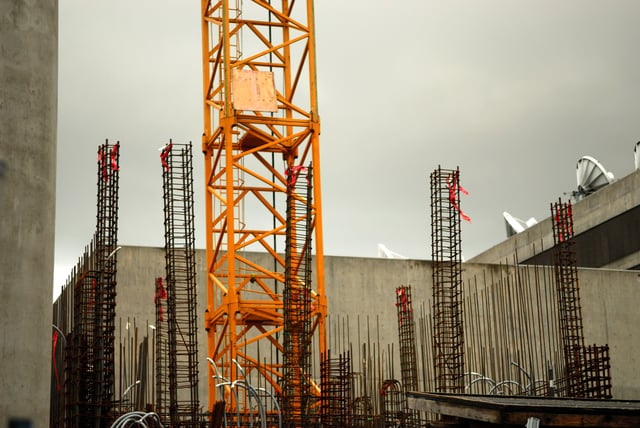

Building permits play an important role in any new construction project and can make or break your project’s timeline. Even when permit applications are handled correctly, the process often doesn’t go as quickly or easily as planned. If permit applications are handled incorrectly, it can lead to a massive amount of paperwork and costly delays.

<em>image by [TR Davis](https://unsplash.com/photos/vWMJMPZyMhc)</em>

Here are five ways to speed up the building permit process to make sure your new project goes off without a hitch.

## 1\. Get to Know Your Local Municipality

In order to move through the permit process quickly and efficiently, you’ll need to have a strong understanding of your local municipality’s requirements and processes. The most common permit issues occur when applications aren’t submitted correctly or a project doesn’t comply with local permitting requirements. Each jurisdiction has different requirements, especially in complex locales.

For example, the [Chicago permit process](/final-review-blog/chicago-building-permits-how-the-process-works/) begins by submitting architectural drawings, prepared by a licensed architect, to the permit office. However, in New York you must pre-file your application and pay your permitting fee at the Department of Buildings office in your borough before starting a new project.

In addition to learning the processes, take the time to become acquainted with your local permit office. Knowing the right contacts to speak with each step of the way will help things run smoothly.

## 2\. Be Organized

Knowing exactly which forms to file to get your permit will save you time and money. If you file the wrong paperwork, make any errors on forms or fail to submit a supporting document it could result in the denial of your permit. If you take the time to understand how and why permits are approved you’re that much closer to guaranteeing compliance every step of the way. 

## 3\. Understand Building Codes and Zoning

Your permit may also get denied if the plans, specifications, materials, or other features of your project don’t comply with local zoning and building code regulations. The best way to avoid this issue is to understand the intricacies of the building codes in your city so you can spot potential problems early on and fix any issues before they become a problem. Every jurisdiction has unique codes and zoning restrictions, so you’ll need to understand each set of guidelines before beginning the permitting process.

## 4\. Focus on One Area

On that note, if you’re managing a large project across multiple cities and states you’ll need to submit a unique, customized application for each permit. As previously mentioned, each municipality will have its own permit requirements and processes making it harder to keep track of the ins and outs and potentially slowing down the process. If you are managing the permit process on your own and are looking to speed up the permitting process, it is easier to focus on one location at a time in order to better understand and manage the unique requirements.

## 5\. Use a Permit Expediting Service

The permitting process might seem overwhelming. Fortunately, there is another route you can take ensure it goes smoothly. Using a knowledgeable permit expediter will help you comply with necessary codes, prevent unnecessary delays and ensure you receive any health or fire department approvals needed for your project.

Permit expediters are intimately familiar with the permitting process, including the regulations specific to your geographic area. This allows them to obtain quick and easy approvals for your project because they know which forms to file, how to fill them out correctly, what documents to include and who to contact for each one. Permit expediters can also anticipate potential code and zoning violations that could delay your permit approval, and they can assess your project plans to ensure that no non-compliant areas or violations will affect your permits.

At Burnham Nationwide, we are experienced in jurisdictions across the United States. Do you have a question about your specific project? [Contact our permitting team](/contact/) and ask us anything!
