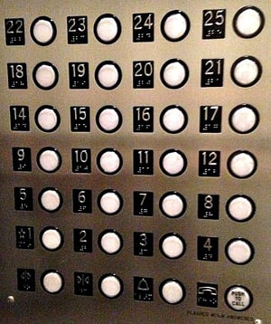

Americans with Disabilities Act (ADA) requirements cover just about every inch of a building: the entryway, halls, signage, parking lot - and of course, the elevator! In fact, because elevators are commonly used by people with both mobility and communication disabilities to travel from floor to floor, the ADA has some very specific requirements. Complying with the requirements is critical in providing for overall building accessibility and to avoid potential litigation, settlement costs and legal fees.

Here are just a few of the ADA elevator requirements you’ll want to pay attention to:

-   Call buttons on walls or in hallways must be at least ¾ inches at their smallest dimension.
-   The ground must be clear and free of obstructions at all times.
-   Floor and car designations on jambs must have tactile characters that are at least 2 inches high and accompanied with Braille.
-   Visible and audible signals are required to indicate which elevator car is arriving, which floor arriving on and whether it is going up or down.  
-   Elevator doors must remain open for a minimum of three seconds and must have a protective/reopening device that can be activated without physical contact.
-   Doors must be 36-42 inches in width at minimum (the exact specs depend on the location of the door and the size of the elevator car).
-   Elevator cars must be designed to allow for maneuvering clearance and meet the minimum inside dimensions.
-   All buttons within the elevator must be within reach range and have accompanying tactile characters and Braille, including emergency stop, alarm, door open/close, and main entry floor.

There are some [Safe Harbor allowances](http://www.access-board.gov/guidelines-and-standards/buildings-and-sites/about-the-ada-standards/guide-to-the-ada-standards/chapter-4-elevators-and-platform-lifts) that are less restrictive than new construction requirements for existing elevators undergoing alterations and/or as part of barrier removal. 

This is only a small sampling of the extensive ADA elevator requirements on the books. To learn more or to make sure your building’s elevators are up to code, [contact our team](/contact/) today. Our ADA consultants can assess your entire building, ensuring you’re in complete compliance with all local, state and national codes.
