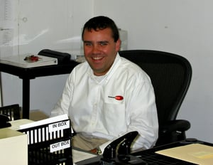

It’s been 14 years since that fateful day, but to Tom Walsh, Executive Vice President here at Burnham Nationwide, September 11th will live forever in his memory.

## Burnham on 9/11

On Sept. 11, 2001, I was serving as Senior Project Manager and Operations Manager at our New York City office. I started my day as usual, taking a train from Westchester and arriving at my desk about an hour later.

Not long afterwards, I received a call from Mike, a former Burnham employee. Mike had just emerged from the subway near the World Trade Center when the first plane hit the North Tower. He told me what he had seen.

Myself and many other Burnham NYC employees rushed down the street to see what was happening. We arrived just in time to see the second plane hit the South Tower.

At that point, everyone ran—myself included—back to our building. I was able to get a phone call out to my family to let them know what was happening and that I was okay.

Soon, the phones stopped working. I went back outside and saw the first tower come tumbling down. A cloud of debris covered the street and everyone around. The rest of the Burnham employees and myself returned to the building, it quickly lost power and everyone was forced to evacuate.

## Evacuating the Area

As a group, we left Burnham’s office and headed north.

We all placed shirts over our mouths to limit what we were breathing in. Everyone I saw—including myself and the team of Burnham employees—was in a state of shock.

When our group reached City Hall, we split up, some going toward Brooklyn and Queens, with others continuing to head north. That’s when the second tower collapsed. I was overcome with panic and extreme sadness.

We walked to Grand Central station, but it had been evacuated due to a bomb threat. It wasn’t until hours later that I was able to board a train and head home to my family. I arrived around 4 p.m.—nearly seven hours after the first plane hit.

## The Aftermath

After 9/11, over a month elapsed until the Burnham NYC office reopened. The team met in a temporary office starting on Sept. 13, but we didn’t return to our original office until the end of October.

One of the first tasks after returning to work was creating an Emergency Action Plan in case anything similar ever happened again.

Although more than a decade has passed, the events of Sept. 11 will stay with me forever.

I just wish my children will never have to witness such a horrific act of terrorism. That day will always be in my thoughts.
