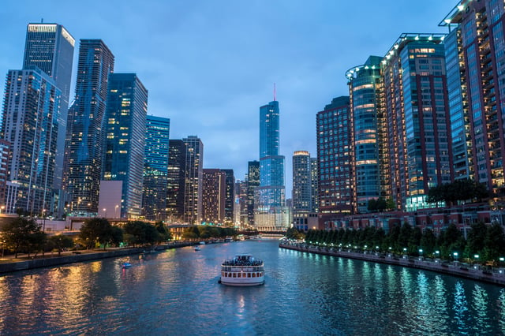
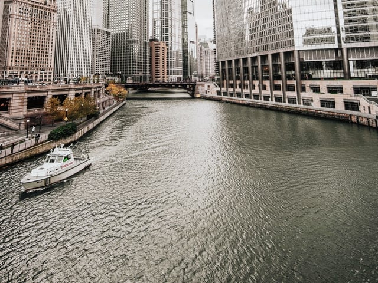

Chicago’s Riverwalk - stretching from Lake Street to Lake Michigan in downtown Chicago - saw its final stage completed in October 2016. Now 1.25 miles long, the entire length of the Riverwalk will be open during the summer season for the first time since construction on the newest sections began in 2012. The Riverwalk has reimagined the role of the Chicago River in the Loop district and created a new public space, opening more of the city’s river to exploration by residents and visitors.

<em>Photo by [Roman Arkhipov](http://unsplash.com/photos/LNOJuUSJZqM?utm_source=unsplash&utm_medium=referral&utm_content=creditCopyText) on [Unsplash](https://unsplash.com/?utm_source=unsplash&utm_medium=referral&utm_content=creditCopyText)</em>

While at first glance the amenity’s biggest draw might be its riverfront views and growing collection of restaurants and kiosks below street level, the City of Chicago has envisioned it as a cultural hub and a nexus for new installations of public art in the city. The symbiosis between art and the built environment continues to create excitement through its reinvention of urban spaces.

## Expansion Utilizes Existing Historic Elements

The Riverwalk’s [history](https://www.chicago.gov/city/en/sites/chicagoriverwalk/home.html) is closely tied to the Chicago River. Until its [reimagining](https://www.cityofchicago.org/content/dam/city/depts/zlup/Sustainable_Development/Publications/Chicago_River_Main_Branch_Framework_Plan/mainbranchframeworkplan.pdf), the majority of the riverfront was uninviting and inextricably linked to the city’s industrial past, however a section running from Franklin Street to State Street called “the Arcade” was rebuilt in 2002 during construction on East/West Wacker Drive. The historic architectural features were fully restored and this portion became somewhat accessible to the public, with a few restaurants opening directly on the river in 2008.

With the relocation of Wacker Drive completed to allow for construction of the extension, plans for the newest sections were created, titled the Confluence (at the confluence of the Main, North, and South branches of the Chicago River), the Civic District (from State Street to Stetson Avenue including Michigan Avenue), and the Market District (from Stetson Avenue east to the lakefront.)

## Completion of the Riverwalk Adds to Public Spaces

The latest sections in the Confluence and Arcade Districts were designed by Ross Barney Architects and Saski Associates and are split into “rooms”, each with unique features. When reviewed by the Chicago Tribune’s architecture critic Blair Kamin after [completion](http://www.chicagotribune.com/news/columnists/ct-riverwalk-kamin-met-1023-20161021-column.html) last fall, most of the features were off-season, however the Water Plaza between LaSalle Street and Wells Street and the Jetty room between Wells and Franklin streets were both ready for viewing.

The Water Plaza features a zero-depth fountain with lighting integrated into the design which can be programmed into a variety of light shows, and the Jetty room utilizes floating green spaces to mimic the edges of natural rivers, including water plans and piers for fishing. Though the Chicago River itself still faces ongoing cleanup efforts, it is now home to recreation including urban kayaking accessible from downtown. Use of the river will only continue to grow as allowing the public to access the river is an integral part of the space’s design - the aforementioned kayaking as well as river tours can be boarded from the riverwalk.

## <em>Photo by [Caleb Jones](http://unsplash.com/photos/mzaCNDhBbcA?utm_source=unsplash&utm_medium=referral&utm_content=creditCopyText) on [Unsplash](https://unsplash.com/?utm_source=unsplash&utm_medium=referral&utm_content=creditCopyText)</em>

## Reimagining the Space as Art

While the space is primarily a linear park and the features are designed for pedestrians to congregate at the waterfront in its plazas, it also provides opportunities for the public to see installations. A goal of the Riverwalk is to function as a downtown cultural hub that can host changing exhibits. One of these is a [floating museum](https://www.thefloatingmuseum.com/) scheduled to dock at the Riverwalk in August as part of the Year of Public Art (YOPA) in Chicago. Built on a barge, the museum will host free programming, sculpture, and performances during the summer from the river.

By next year, the Riverwalk will also be host to a massive new installation - projections on the historic Merchandise Mart. Visuals created by local Chicago artists will be projected on the building’s block-long facade and will illuminate the Riverwalk canyon. The initiative is also part of YOPA and is an example of digital public art, a growing trend in cities such as [Los Angeles](/final-review-blog/convergencela-installation-celebrates-past-future-of-los-angeles/).

Even before the Merchandise Mart display is complete, City of Chicago has experimented with illuminating the Riverwalk, including the surrounding buildings as part of its summer kick-off event.

Uniting properties adjacent to the Riverwalk, the City of Chicago debuted its newest public space on May 20th with all-day events by the Department of Cultural Affairs and Special Events (DCASE.)  As part of a [schedule](https://www.cityofchicago.org/city/en/depts/dca/provdrs/attractions_eventsandexhibitions/news/2017/april/riverwalk.html) featuring architecture tours, fishing, and a water and pyrotechnic display, the buildings along the riverfront illuminated their exteriors with the color blue or the phrases “escape” or “embrace” to create ambiance in the river canyon that complimented the programming.

The use of the Riverwalk in this manner illustrates how spaces can be redefined and repurposed when built to support both the public and the arts.

Additional [programming](https://www.chicago.gov/city/en/sites/chicagoriverwalk/home.html) includes the upcoming "Unifest on the River: One Globe, Many Cultures", a weekly event on Thursday afternoon celebrating Chicago's sister cities. The "Jetty" will host seven sister cities each week and offer food, drinks, and music from 4:30pm-8:30pm July 13th-August 17th. 

## Chicagoans Connect More Closely With the Iconic Waterway

The Riverwalk has transformed the downtown riverfront and its nascent success has had an effect on plans for the Chicago River throughout the city - development of the [North Branch Industrial Corridor](/final-review-blog/chicago-north-branch-corridor/) will certainly feature new points of access to the river - but most significantly, it offers Chicagoans a chance to become closer to the river and offer new ways of showcasing one of Chicago’s distinctive features.

<em>This post was last updated on July 10th, 2017.</em>
