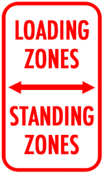

Parking signs are scattered throughout Chicago, each one making city dwellers hesitate when determining where they should legally park their vehicle. The more congested the neighborhood, the more loading and standing zone signs appear. What differentiates a loading zone from a standing zone? As an applicant, which one works best for them? If needed, how does one apply for a zoning sign permit? Follow along as we review the process to obtaining a parking zone sign. 

### Time to Unload

## <strong></strong>

Loading zones are designated for loading and unloading deliveries by commercial vehicles. An applicant researching this zone type is looking for an efficient way to load and unload, which helps in congested business districts with limited street parking and alley access. 

A drawback of obtaining a loading zone outside one’s business is that the designated area can be utilized by any commercial vehicle to make deliveries to other businesses. Because of that, some businesses resort to posting additional “reserved” signage on their own; which we advise against, as any additional signage in the public way is both illegal and misleading. Passenger vehicles unloading goods in a loading zone are eligible to be ticketed.

#### Standing Still

Standing zones typically appear in the 15-minute and 30-minute varieties. **Any vehicle** can utilize a standing zone as opposed to only commercial vehicles utilizing a loading zone. Standing zones require hazard lights flashing at all times; with any additional time spent resulting in possible citations. Along with loading zones, anyone may use the standing zone unrelated to your business. Because of that, many businesses resort to posting additional “reserved” signage on their own; which we advise against, as any additional signage in the public way is both illegal and misleading

When you’re deciding which one of the two parking regulations will work best for your business’s needs, keep in mind that the Chicago Department of Transportation (CDOT) is the final arbiter and CDOT routinely denies parking regulations within dedicated driving lanes.

### What You Need to Apply

When gathering to submit for either parking regulation, be prepared to have a comprehensive cover letter to present to your local Alderman, the completed application, photos of the site, as well as, a site diagram. The cover letter should include why you need the zone, providing how it will be useful for you and the area. It is key to have this detailed piece because the local Alderman has the sole discretion to approve or deny the application, which will prevent it moving onto the Chicago Department of Transportation (CDOT). 

The application process can be frustrating and tedious, but it does not have to be. Burnham has experts that can assist with the process and help. 

Is the application process for a standing or loading zone still entirely paper-based, as this post implies? Largely no - CDOT moved standing/loading zone and driveway sign applications to an online system (accessible via the city's permit portal) back in 2020. You still need your Alderman's approval first, but once you have that Letter of Continued Review, the rest of the application is typically submitted online rather than only in person. Is there a fee just to submit a loading or standing zone application? Yes - there's a non-refundable application fee (commonly cited around $55) paid at a City of Chicago payment center, separate from the installation and ongoing annual maintenance fees, which are based on the length of the zone. How does CDOT actually decide whether to approve a proposed loading or standing zone, after the Alderman signs off? Once the Alderman approves the initial request, CDOT conducts a site survey to determine whether the proposed zone would interfere with pedestrian or vehicular traffic and ingress/egress to surrounding buildings, or whether it would meaningfully serve public convenience and safety - it's not an automatic approval just because the Alderman is on board. Can I get valet service approval combined with a loading zone permit? Yes, but only after the fact - a Loading Zone permit must already be in place before BACP will issue a valet permit for it, and the loading zone itself needs to be at least 25 feet long to support valet operations. What if I want to switch my zone type, remove it, or never receive my annual fee invoice? All of these go through your Aldermanic Office first, not CDOT directly - including requests to switch between standing and loading zone designations or to remove a zone. Note that you remain responsible for the annual fee even if an invoice gets lost in the mail; nonpayment isn't excused by a missing notice.
