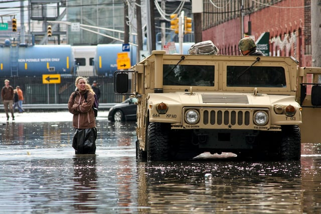

In October 2015, Hoboken, New Jersey published its Resilient Building Design Guidelines, intended to increase protection against flooding. Hoboken was severely flooded during Hurricane Sandy, and since that time, has been proactively working to design and build a more resilient city. In our recent post about President Obama’s initiative to [promote resilient building codes to respond to climate change](/final-review-blog/creating-resilient-building-codes-to-respond-to-climate-change/), we described a number of national programs supporting ways to mitigate climate change’s impact. We thought we would take a closer look at Hoboken’s Resilient Building Design Guidelines as an example of one program component of a city’s strategy to improve building resiliency.

## The Effects of Hurricane Sandy

Hoboken sits on the Hudson River directly across from New York City and much of Hobken is located at a low ground elevation, creating a high risk of flooding. The city is densely populated and contains a mix of residential and commercial buildings. According to the Union of Concerned Scientists, the City of Hoboken [took a number of steps](http://www.ucsusa.org/center-for-science-and-democracy/case-studies/hoboken-case-study.html#.V9GRV5MrJMV) over the past century that increased its risk of flooding, such as draining tidal marshes and building parks, walkways, and roads on top of aging docks and marinas.

As a result of Hurricane Sandy’s storm surge, high winds, and intense rainfall in 2012, most of Hoboken was flooded, resulting in more than $100 million in damages to private property. The majority of residents remained without power for days after the storm. In addition, the public transportation system, including the major access for commuters to New York City, was paralyzed due to severe damage. Although this was not the first time Hoboken was flooded, it was by far the worst damage the city had ever experienced.

## Hoboken Resiliency and Readiness Plan

In response to Hurricane Sandy and other events causing flooding, the city released the [Hoboken Resiliency and Readiness Plan](https://www.hobokennj.gov/resources/resilient-buildings-design-guidelines-addendum) in August 2013. It is a comprehensive plan to protect Hoboken from future flooding, prevent financial hardship for city residents and businesses, and maintain Hoboken’s urban character. The Hoboken Resiliency and Readiness Plan calls for multiple layers of protection including: adding emergency flood pumps, dunes, flood barriers, floodbreak gates and other methods of storm surge protection; deploying energy resiliency for critical operations; developing outreach to foster community preparedness; and improving stormwater management. To support the plan, Hoboken applied for a variety of different grants, including those funded by state and federal programs.

## Hoboken Resilient Buildings Design Guidelines

[Hoboken’s Resilient Buildings Design Guidelines](http://www.hobokennj.gov/docs/communitydev/Resilient-Buildings-Design-Guidelines) (Guidelines) is a manual that brings together the federal, state, and municipal regulations, as well as best practices, that apply to residential and commercial buildings in the city’s designated Special Flood Hazard Area (SFHA). The city used a New Jersey Department of Community Affairs’ Post Sandy Planning Assistance Grant to fund the project which included the assistance of Princeton Hydro, an environmental services and engineering consulting company. The resulting Guidelines are intended to be used by architects, planners, property owners, builders, and contractors to help them understand and comply with the relevant flood-proofing requirements.

The Guidelines outline the city’s approval process for repairs, renovations, and new construction located in the SFHA. The Hoboken Floodplain Administrator must review applications and plans for compliance with the Hoboken Flood Damage Prevention Code. It notes that for substantial renovations or new construction, one must also obtain a Floodplain Permit which requires an Elevation Certificate or Property Survey.

The Resilient Building Design Guidelines provide an overview of the requirements and recommendations for different categories of projects: Residential Rehabilitation, Retrofitted Commercial Space, Substantial Improvement (value of the alterations exceeds the pre-renovation structure value by 50% or more), and New Construction. For each category, the Guidelines describe the type of flood-resistant building materials and construction methods that should be used as well as the location of different portions of the building such as residential dwelling units, parking, mechanical equipment, and utility connections. They also discuss the insurance available under the National Flood Insurance Program (NFIP) for different building types, including methods for reducing the cost of flood insurance.

The Guidelines contain many case studies illustrating ways to flood-proof existing and new buildings. They also note some unique challenges for Hoboken’s existing buildings. For example, it is difficult to elevate Hoboken’s many row houses above the Design Flood Elevation (DFE). The Guidelines provide recommended alternatives such as relocating existing residential living spaces below the (DFE) to an upper floor or a newly constructed level atop the existing structure.

Also in the Guidelines are the City of Hoboken’s Design Standards & Guidelines which contain the design specifications for foundations, mechanical systems and utilities, elements below the DFE, flood resistant materials, wet floodproofing, streetscapes, and accessibility. The Guidelines include a variety of resources such as a flood zone map, the methodology for determining the DFE, and a summary of the relevant New Jersey and Hoboken codes. It is apparent from the Guidelines that the city’s goal is to flood-proof its buildings while preserving the unique qualities of Hoboken’s neighborhoods.

## Other Elements of Hoboken’s Resiliency Plan

Hoboken’s Resilient Building Design Guidelines are only one important piece of the city’s work to decrease its vulnerability during storms and rising sea levels. In a future post, we will take a look at Hoboken’s plans for an [innovative microgrid](/final-review-blog/creating-a-more-resilient-city-hobokens-microgrid/) to improve the city’s energy reliability during future extreme weather events.
