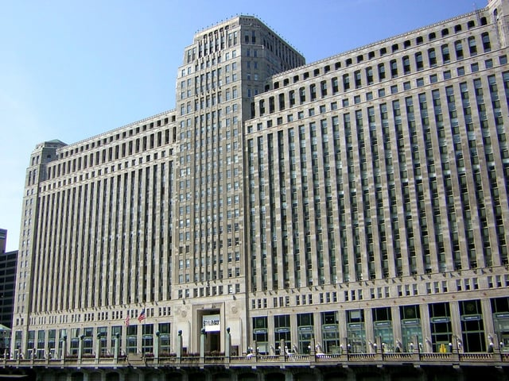

The Americans with Disabilities Act (ADA) requirements for existing facilities are a source of great confusion. We periodically encounter building owners or managers who believe the ADA only applies to new construction or alterations; and therefore, buildings that existed prior to the ADA’s enactment do not need to be accessible. However, the ADA does require the removal of barriers to accessibility in older buildings, and it is critical to understand the precise circumstances when such barrier removal is needed for ADA compliance.

If you are concerned that your building, office, or space is not ADA compliant, [Contact Burnham Nationwide](/contact/) to to do your [due diligence.](/code-consulting-process/)  

## The ADA Statute and Existing Facilities

The [Americans with Disabilities Act](https://www.ada.gov/pubs/adastatute08.htm) is the federal statute that prohibits discrimination against people with disabilities. It is divided into five titles, and Title III of the ADA prohibits discrimination by private entities operating as places of public accommodation and commercial facilities. All new construction and modifications to public accommodations and commercial facilities must be built in compliance with the ADA’s requirements for accessible design.

Title III also specifically states that for public accommodations discrimination includes “failure to remove architectural barriers . . . in existing facilities” unless it can be shown that removing a barrier is “not readily achievable” or accommodations cannot be provided through other means. (See 42 U.S.C. Section 12182(b)(2)(iv)&(v))

The ADA defines readily achievable as “easily accomplishable and able to be carried out without much difficulty or expense.” The statutory definition also provides factors to be considered in determining whether barrier removal is readily achievable and recognizes what may be achievable for one business might not be for another:

-   The nature of cost of the required barrier removal;
-   The financial resources of the involved facility or facilities;
-   The number of people employed by the facility;
-   The effect on the facility’s expenses and resources;
-   Impact on the operation of the facility;
-   Overall finances of the covered entity;
-   The number of employees in the covered entity;
-   The number type and location of its facilities;
-   The type of operations of the covered entity, including the composition, structure and functions of its workforce; and
-   The geographic, administrative or fiscal relationship of the facilities at issue to the covered entity.

(See 42 U.S.C. Section 12181(9))

It is important to be aware of these factors because a court will consider them in a case alleging ADA non-compliance. However,  it is necessary to look at court decisions from a variety of federal jurisdictions to really understand how these factors are interpreted.

Also, it is not clear from the statutory language who has the burden of proving that removal of an architectural barrier is or is not readily achievable, the government or the facility being sued. While the plaintiff would need to assert that barrier removal is “readily achievable,” many courts have viewed “readily achievable” as a defense. Thus, the defendant facility would need to ultimately prove that barrier removal could not be readily achieved. In addition, It is important to note that a form of barrier removal that is not readily achievable at one point in time might be possible to accomplish at a later date. Therefore, it is necessary to regularly review what is readily achievable.

Not sure if your space has a barrier that is easily removable? [Contact Burnham](/contact/) for a [code compliance review.](/what-we-do/code-consulting/) 

## The ADA Regulations and Existing Facilities

The United States Department of Justice (DOJ) develops and enforces the regulations that implement the ADA. After the ADA became law in 1990, DOJ created the first set of ADA Title III regulations, the [1991 Standards for Accessible Design](https://www.ada.gov/1991standards/1991standards-archive.html) (1991 Standards). The most recent version of the ADA Title III regulations is the [2010 Standards for Accessible Design](https://www.ada.gov/regs2010/2010ADAStandards/2010ADAstandards.htm) (2010 Standards). The section of DOJ’s ADA Title III regulations that specifically applies to existing facilities is codified at [28 C.F.R. Section 36.304](https://www.gpo.gov/fdsys/pkg/CFR-2011-title28-vol1/xml/CFR-2011-title28-vol1-sec36-304.xml). Most of the regulatory requirements for existing facilities were part of the 1991 Standards.

Section 26.304 reiterates the statutory requirement that architectural barriers be removed in existing facilities when readily achievable. However, the section also provides 21 different examples of steps that may be taken to remove barriers. Highlights of these examples include:

-   Adding curb cuts to sidewalks and entrances
-   Rearranging furniture such as tables, chairs, vending machines, and display racks
-   Widening doors
-   Using accessible door hardware
-   Moving toilet partitions to increase space for maneuvering
-   Eliminating high pile, low-density carpets

The regulations also include a description of four priorities to be considered when taking steps to meet the barrier removal requirements:

1.  Access to places of public accommodation from public sidewalks, parking or public transportation by, for example, installing an entrance ramp, widening an entrance, or creating accessible parking
2.  Making goods and services available to the public by, for example, changing the layout of display racks, moving tables, or using Braille or raised character signage
3.  Making public restrooms accessible
4.  Any other measures necessary to make a place of public accommodation accessible

Section 305.7 reviews accessibility for existing buildings, more specifically the alterations affecting an area containing a primary function. Under the ADA, [hallways and restrooms](https://www.ada.gov/reachingout/lesson33.htm) usually are not considered primary function areas, so when altered those areas do not have to comply with the same elements. 

As opposed to the [Chicago Building Rehabilitation Code](https://codes.iccsafe.org/content/CHIBRC2019P2/chapter-3-provisions-for-all-compliance-methods#CHIBRC2019P2_Ch03_Sec305) (with May 2020 Supplements),where the accessible route to the primary function area *includes* toilet facilities and drinking fountains serving the area of primary function. 

The exceptions are as follows: 

1.  The cost of providing the accessible route is not required to exceed 20 percent of the costs of the alterations affecting the area of primary function. 
2.  This provision does not apply to *alterations* limited solely to windows, hardware, operating controls, electrical outlets and signs. 
3.  This provision does not apply to *alterations* limited solely to mechanical systems, electrical systems, installation or *alteration* of fire protection systems and abatement of hazardous materials. 
4.  This provision does not apply to *alterations* undertaken for the primary purpose of increasing the accessibility of a *facility*. 
5.  This provision does not apply to altered areas limited to <em>Type B units.</em> 

## Safe Harbor Provision

The ADA Title III regulations also have a safe harbor provision stating that any of a facility’s elements built or altered before March 15, 2012, and that comply with the 1991 Standards do not need to be changed to satisfy the 2010 Standards. However, if an element already existed but didn’t comply with the 1991 Standards prior to March 15, 2012, this element must be modified to meet the 2010 Standards to the extent readily achievable.

Also, the safe harbor provision does not apply to elements in existing facilities that were not included in the 1991 Standards but are now regulated by the 2010 Standards. These elements must satisfy the 2010 Standards to the extent readily achievable. The following are some examples of the elements that do not fall under the safe harbor provision:

-   Residential facilities and dwelling units
-   Amusement rides
-   Recreational boating facilities
-   Golf facilities
-   Play areas
-   Swimming pools

This is not a comprehensive list; so [contact Burnham Nationwide](/contact/) to see if your element s fall under the safe harbor provision. 

## ADA Checklists for Existing Facilities

The DOJ website has a [Checklist for Readily Achievable Barrier Removal](https://www.ada.gov/checkweb.htm) that was last revised in 1995. The checklist is intended to be used when surveying an existing facility for barriers to accessibility. It is organized by the priorities stated in the regulations and includes possible solutions to accessibility barriers. After conducting a survey, DOJ recommends developing an implementation plan identifying the steps to eliminate barriers and a timeline for undertaking the improvements. The DOJ checklist notes that an implementation plan may serve as a piece of evidence showing a “good faith effort to comply.” It is important to note that this checklist does not include the new elements from the 2010 Standards.

The Institute for Human Centered Design has an updated [ADA Checklist for Existing Facilities](http://www.adachecklist.org/checklist.html) that incorporates the 2010 ADA Standards for Accessible Design. Therefore, it includes the more recently added elements that do not fall under the safe harbor provision. Another benefit of this checklist is that different formats are provided, including a word fillable form and the ability to customize the checklist.

Understanding and assuring compliance with the ADA requirements for existing facilities can be very complicated. It is necessary to use the help of an expert to determine the best approach for meeting the ADA’s requirements. We at Burnham frequently conduct ADA compliance reviews for existing facilities. [Contact Us](/contact/) if you have any questions.  

Does the ADA really apply to buildings built before 1990? Yes - this is the core misconception this post addresses. Title III requires existing facilities to remove architectural barriers whenever it's "readily achievable" (easily accomplishable without much difficulty or expense), regardless of when the building was constructed. It's not just new construction and renovations that have ADA obligations. Who has to prove whether a fix is "readily achievable" - the business or the person suing? Many courts treat "readily achievable" as an affirmative defense, meaning the business being sued generally bears the burden of proving that a particular barrier removal couldn't reasonably be accomplished - not the plaintiff proving that it could have been. What is the ADA's "safe harbor" provision, and does it apply to every part of my building? It protects elements built or altered before March 15, 2012 that complied with the 1991 Standards at the time - those don't need to be retrofitted to meet the newer 2010 Standards. But it doesn't cover everything: residential units, swimming pools, play areas, and recreational boating/golf facilities are explicitly excluded and must meet 2010 Standards regardless of when they were built. If I'm only renovating a small area, do I have to upgrade the restrooms too? Generally not automatically - restrooms and hallways usually aren't considered "primary function areas," so altering them doesn't trigger the broader accessible-route requirement the way altering a primary function area does. There's also a cost cap: the accessible route requirement generally doesn't have to exceed 20% of the cost of the alteration itself. Is there an official checklist I can use to assess my building's ADA compliance? The DOJ's original 1995 "Checklist for Readily Achievable Barrier Removal" is still publicly available but predates the 2010 Standards. The Institute for Human Centered Design publishes an updated checklist that incorporates the 2010 Standards elements, which is generally more useful for a current self-assessment.
