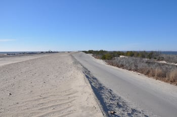

The Long Island Unified Solar Permit Initiative was one of the first regional efforts to create an expedited solar permit and served as a foundation for New York’s statewide model permit. The Suffolk County Planning Commission’s coordination of a variety of stakeholders, including the involvement of the local utility, was critical to the process. At Burnham, we help our clients with solar permitting and believe the Long Island Solar Unified Permit Initiative serves as an important model for expediting solar permits. In this post, we will look at the history of the initiative that advanced the adoption of solar in Long Island.

## Collaborative Effort Critical to the Process of Streamlining Solar Permits

David Calone, Chairman of the Suffolk County Planning Commission from 2008-15, spearheaded the Long Island Unified Solar Permit Initiative (LIUSPI). Suffolk County, located in the easternmost portion of New York State, is the largest of Long Island’s counties. The county has 10 towns and more than 30 villages. The Suffolk County Planning Commission’s role is to provide regional land use advice to municipalities and renewable energy is one of the commission’s priorities. According to Mr. Calone, a group of area solar installers brought to the commission’s attention the problems the installers encountered when obtaining solar permits. As distributed solar rapidly increased in the region, each town and village scrambled to develop its own solar permit process. This resulted in a variety of different solar permitting requirements across Suffolk County which caused unnecessary delays and significantly increasing installation costs.   

In response to the permitting problems, the Suffolk County Planning Commission began LIUSPI in 2009, a collaborative effort to create a uniform solar permit. Mr. Calone led a committee comprised of local government officials; solar installers; and environmental and renewable energy non-profits such as Renewable Energy Long Island. The committee held a series of meetings over a year and brought in experts, including building inspectors, who could talk about issues, such as fire safety, that impact solar installations.  

## Creation of the Solar Energy System Fast Track Permit Application

The LIUSPI committee developed a model streamlined application process for municipal adoption, the [Solar Energy System Fast Track Permit Application](https://www.cuny.edu/about/resources/sustainability/nyssolar/NYSolarSmartPermitWorkshops/LongIslandUnifiedSolarPermitForm.pdf) (Fast Track Permit), that was shared with the public in September 2011. The expedited solar permit was designed to cover the vast majority of residential photovoltaic rooftop panels and solar hot water installations in Suffolk County.  

In developing the Fast Track Permit, the LIUSPI committee tried to eliminate unnecessary requirements imposed by some towns as part of their solar permit application such as the completion of a new property survey. The Fast Track Permit also shortened the time period for approving a submitted application to 14 days or less. In addition, the fee for submitting the application is capped at $50, and the model permit suggests that municipalities consider waiving the fee.   

To be eligible for the Fast Track Permit, an installation must meet the criteria for a “standard” installation stated in the application checklist of requirements. The submitted application has three main components: a completed requirements checklist, three sets of plans, and an information sheet. Diagrams included in the plans must be prepared by a Professional Engineer or Registered Architect. A Professional Engineer or Registered Architect must also certify that the structure can support the system’s weight and wind loads.

The LIUSPI committee also realized that there were important items the towns and villages were leaving out of their solar permit applications. In addition to increasing the efficiency of the solar permit process, the Fast Track Permit policies were designed to help local jurisdictions increase safety. For example, the streamlined application requires the use of prescreened installers identified on the local utility’s website (now on NY-Sun’s [website](http://ny-sun.ny.gov/Get-Solar/Find-A-Solar-Electric-Installer)). Also, jurisdictions that adopt the Fast Track Permit must keep a list of solar installation locations on behalf of first responders. The expedited solar permit encourages municipalities to ensure proper training of solar installation inspectors in accordance with “nationally recognized guidelines” and consider using third-party inspections which usually provide a more comprehensive review.  

## Financial Incentives Provided to Support Permit Adoption

Members of the LIUSPI committee asked the local utility, Long Island Power Authority (LIPA), to provide financial incentives to encourage the adoption of the Fast Track Permit. LIPA was the New York State public authority responsible for providing electricity to Long Island’s customers in Suffolk and Nassau Counties. As part of the agreement to provide funding, LIPA asked that the Fast Track Permit be extended as an option to towns and villages in Nassau County. LIPA initially made $15,000 available to towns and $5000 to the first 10 villages that officially adopted the streamlined permit process by December 31, 2011. As of 2014, most of LIPA’s operations, including responsibility for its electric transmission and distribution system, was transferred to Public Service Enterprise Group Incorporated, and PSEG Long Island began managing the LIPA system. Now, the New York State Energy Research and Development Authority, pursuant to its [Cleaner, Greener Communities Program](http://ny-sun.ny.gov/-/media/Files/About/Statewide-Initiatives/CGC-Plans/Guidance/LIPA-permit-application.pdf), is responsible for providing financial incentives to any Long Island town or village newly adopting the streamlined permit. 

All of Suffolk County’s ten towns, as well as some of its villages, have adopted the Fast Track Permit. This means that 95% of Suffolk County residents live in areas covered by the expedited solar permit. Portions of Nassau County have also adopted the Fast Track Permit.

## Important Model for Other Initiatives

According to Mr. Calone, the key to the Fast Track Permit’s success was obtaining buy-in from local government officials and helping them understand they were participating in something that would have an important regional impact. By involving elected representatives from Suffolk County’s towns and villages early in the permit model’s development, they became willing to encourage the adoption of the expedited solar permit in their town or village. The collaboration of the local utility was also critical to the streamlined permit’s adoption.  

The Suffolk County Planning Commission was awarded the National Association of Counties 2012 National Achievement Award for the Long Island Unified Solar Permit Initiative. The Fast Track Permit also became the template for the NYS Unified Solar Permit, a model permit for expediting the solar permit process across New York State. For a discussion of efforts to streamline solar permits in New York State, read Burnham’s recent post [The Solar Ombudsmen Part II: Expanding Their Successful Approach To Solar in New York State](/final-review-blog/the-solar-ombudsmen-part-ii-expanding-their-successful-approach-to-solar-in-new-york-state/).
