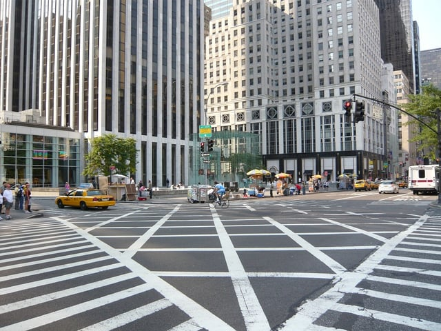

We frequently receive questions about the American’s with Disabilities Act (ADA) that relate to the Accessibility Guidelines for Pedestrian Facilities in the Public Right-of-Way (PROWAG). We're often responding to requests to explain the ADA’s curb ramp requirements covered by PROWAG, and although a draft of PROWAG has existed for a number of years, the guidelines are still only proposed rather than final. We thought it would be helpful to take a look at what the Accessibility Guidelines for Pedestrian Facilities in the Public Right-of-Way cover and their current status.

## WHY is PROWAG Necessary?

The Architectural and Transportation Barriers Compliance Board (Access Board) is the federal agency responsible for developing accessibility guidelines. These guidelines are used to design and construct buildings and other facilities to be in compliance with the ADA. The most recent accessibility guidelines are the 2004 ADA Accessibility Guidelines (ADAAG). ADAAG does not fully address public rights-of-way, defined by PROWAG as: “public land or property, usually interconnected corridors, that is acquired for or dedicated to transportation purposes.” It is, therefore, necessary to develop guidelines for these public rights-of-way.

Public rights-of-way are largely under the control of state and local governments, and Title II of the ADA prohibits discrimination against people with disabilities by state and local governments. As a result, PROWAG applies to state and local governments responsible for sidewalks and streets.

The Federal Highway Administration (FHA) is the agency charged with making sure disabled pedestrians are not discriminated against in their use of roadways and pedestrian facilities. Although the Access Board is responsible for creating PROWAG, the FHA also plays a role in the development of PROWAG. In addition, PROWAG refers to some FHA requirements.

## What is the History of PROWAG?

The most recent draft of PROWAG was published in the Federal Register on July 26, 2011 (76 Fed. Reg. 2011), and the public comment period was scheduled to close on November 23, 2011. However, groups of stakeholders, such as those representing counties and municipalities, requested extensions of the comment period. The original comment period was reopened twice and ultimately extended until February 2, 2012.

On February 2, 2013, the Access Board issued a supplement to PROWAG focused on shared use paths, paths designed to be used by both bicyclists and pedestrians, including pedestrians with disabilities. The original version of PROWAG did not contain provisions addressing shared use paths. The [supplement](https://www.gpo.gov/fdsys/granule/FR-2013-02-13/2013-03298/content-detail.html) was published in the Federal Register (78 Fed. Reg. 10110) with a new public comment period closing on May 14, 2013.

## What is Covered by PROWAG?

PROWAG provides minimum standards for newly designed and constructed public streets and sidewalks that are governed by the ADA and several other statutes. Existing public rights-of-way would also be subject to PROWAG if they are altered. PROWAG defines alterations as: “a change to a facility in the public right-of-way that affects or could affect pedestrian access, circulation, or use.” For example, resurfacing and restoration work are considered alterations for the purposes of PROWAG.

The types of pedestrian facilities covered by PROWAG include:

-   pedestrian access routes and alternate pedestrian access routes
-   pedestrian street crossings
-   curb ramps and blended transitions
-   detectable warning surfaces
-   accessible signals and pushbuttons
-   protruding objects in pedestrian paths
-   signs
-   street furniture
-   transit stops and shelters
-   on-street parking spaces and passenger loading zones
-   stairways and escalators
-   handrails
-   doors, doorways, and gates

## Is PROWAG an Enforceable Standard?

For Access Board guidelines such as ADAAG to become enforceable standards under the ADA, they must be adopted as regulations by the United States Department of Justice (DOJ) and the United States Department of Transportation (DOT). For example, ADAAG was incorporated into DOJ’s most recent ADA regulations, the 2010 Standards for Accessible Design, so ADAAG is now enforceable. Similar to ADAAG, PROWAG will not be an enforceable standard until it is formally adopted as a requirement by DOJ and DOT. However, in its current state, PROWAG is regarded as a recommended best practice for any subject addressed by PROWAG that is not fully covered by ADAAG.

## What is the Current Status of PROWAG?

The Access Board is still working on finalizing PROWAG which received over 600 public comments. In responses to the input on the proposed guidelines, the Access Board is making revisions to both the preamble and text of PROWAG. They are projecting that PROWAG will be finalized by the middle of 2017. However, some states have begun incorporating the guidelines into their own state accessibility laws. We will keep you informed of any updates to the status of the Accessibility Guidelines for Pedestrian Facilities in the Public Right-of-Way.
