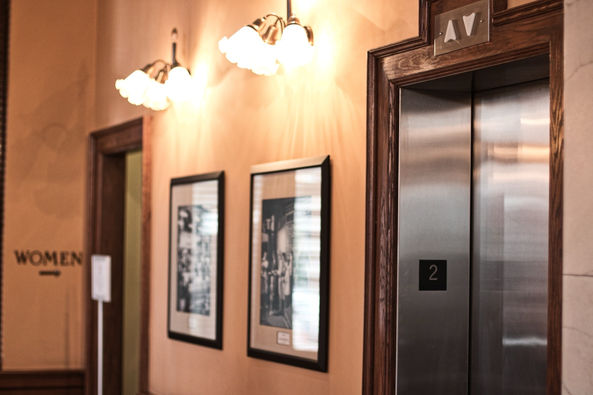

At Burnham Nationwide, our code team conducts reviews and site inspections for accessibility compliance, and we often see elevators that are not designed or installed to comply with the Americans with Disabilities Act (ADA law). It is critical to understand the ADA requirements for elevators when constructing or renovating a place of public accommodation or commercial facility where vertical accessibility is required - to avoid these mistakes, we're highlighting some of the ADA requirements for elevators below.

## Understanding the ADA and Local Accessibility Requirements

When examining ADA elevator requirements, it is important to understand that the ADA is a federal law that applies throughout the United States.The ADA, enacted in 1990, prohibits discrimination against people with disabilities.Title III of the ADA specifically prohibits discrimination by both governments agencies and private entities that operate as places of public accommodation, and all newly constructed or altered places of public accommodation and commercial facilities must comply with the ADA.

There are also rules implementing the ADA compliance, the 2010 Standards for Accessible Design (2010 Standards) which incorporate the [2004 ADA Accessibility Guidelines](https://www.access-board.gov/ada/) (ADAAG) of the U.S. Access Board, the federal agency charged with developing accessibility regulations and guidelines. ADAAG contains scoping and technical requirements for new construction and alterations, including requirements for elevators.

In addition to being aware of the ADA's requirements, one must know the accessibility requirements of services in your state and local jurisdiction. Although state and local accessibility standards for services are frequently similar to the ADA, they sometimes have different or stricter requirements.

## Highlights of ADA Requirements for Elevators

The ADA requirements for elevators in public accommodations are found in Section 407 of [ADAAG Chapter 4: Accessible Routes](https://www.access-board.gov/ada/chapter/ch04/). Section 206.2.3 of [ADAAG Chapter 2: Scoping Requirements](https://www.access-board.gov/ada/) specifies some exceptions to the elevator requirements for public accommodations. For example, private buildings that are less than three floors do not have to provide an elevator unless they are a shopping center, professional office or other specified type of use.

The requirements below represent some of the elevator standards for new construction or alterations. Less restrictive requirements apply to elevators in existing construction.

-   Every building must have at least one passenger elevator to meet the ADA's accessibility requirements. Service elevators may be used to comply with the accessibility standards as long as all required elements are included as part of the design. There are options for sizes and door placement to allow a wheelchair user to enter, maneuver to reach the controls, and then exit the elevator.
    
-   Raised and Braille floor designations must be located on both jambs. Call buttons are required to be either raised or flush and at least three-quarters of an inch in diameter.
    
-   The buttons both inside and outside of the elevator must be within the regulations' specified reach range for a wheelchair user. All buttons with numbers must be in ascending order. Raised and Braille designations shall be placed to the left of the control button.
    
-   There should be visible and verbal signals to indicate which elevator car is available, its direction, and when it has reached a designated floor.
    
-   The elevator door must remain fully open for at least three seconds in response to a call. The two-way communication device in the elevator cannot be more than 48" from the floor.
    

These are just a few of the ADA requirements for elevators. Staying abreast of all the ADA building requirements can be a challenge. However, we at Burnham can help you review building plans and make sure that the elevators and other aspects of your building are ADA compliant. Please feel free to [Contact Us](/contact/) for a consultation.

<em>This post was originally published February 23, 2012, and updated on April 3, 2024 with new information.</em>

What buildings are exempt from ADA elevator requirements? Private buildings under three stories, or with each floor under 3,000 square feet, are generally exempt - but this exemption never applies to shopping centers, professional offices of health care providers, public transit terminals, or airport passenger terminals, regardless of size. If a building is exempt from the elevator requirement, are upper floors exempt from ADA compliance entirely? No, the elevator exemption only removes the requirement to provide vertical access. Every other ADA accessibility requirement (restrooms, signage, door hardware, routes) still applies to those upper floors if access is otherwise provided. Can a service or freight elevator satisfy ADA accessibility requirements? A service elevator that also carries passengers can count toward ADA compliance as long as it includes all required accessible design elements. However, an elevator used strictly for freight - operated only by staff loading/unloading goods - does not satisfy the requirement for an accessible route between floors. How long must an elevator door stay open when responding to a call? At least three seconds, per ADA elevator standards - long enough to allow a wheelchair user adequate time to enter or exit safely. What is a LULA elevator, and when can it be used instead of a standard elevator? A Limited Use/Limited Application (LULA) elevator is a smaller, slower elevator designed for low-occupancy buildings - typically capped around 25 feet of travel and 1,400 lbs capacity. It's commonly used in smaller commercial buildings, schools, and offices where a full-size traditional elevator isn't required or practical.
