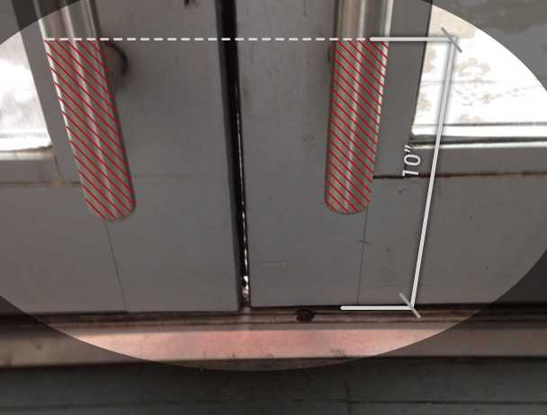

It's crucial to comply with the Americans with Disabilities Act (ADA), but unfortunately, some of the accessibility design requirements are commonly misunderstood or overlooked. We at Burnham Nationwide conduct ADA compliance reviews and site inspections and frequently see the same violation of the ADA’s door standards, which can pose a lawsuit risk for non-compliant buildings.

Do you know what to look for when complying with door requirements? See if you can find the violation of the ADA’s door rules in this picture:

##   
Where to Find the ADA Door Requirements

The ADA’s requirements for doors are part of the law’s design standards for accessible routes. Title III of the ADA, a federal law, requires all newly constructed or renovated places of public accommodation and commercial facilities to be designed to prevent discrimination against people with disabilities. The rules implementing the ADA, the 2010 Standards for Accessible Design (2010 Standards), incorporate the [2004 ADA Accessibility Guidelines (ADAAG)](https://www.access-board.gov/guidelines-and-standards/buildings-and-sites/about-the-ada-standards/background/ada-aba-accessibility-guidelines-2004). One must check ADAAG to find the detailed scoping and technical requirements for new construction and alterations.

[Section 404 of ADAAG](https://www.access-board.gov/guidelines-and-standards/buildings-and-sites/about-the-ada-standards/ada-standards/chapter-4-accessible-routes) contains all the ADA technical requirements for doors, and [Section 206 of ADAAG](https://www.access-board.gov/guidelines-and-standards/buildings-and-sites/about-the-ada-standards/ada-standards/chapter-2-scoping-requirements) provides the scoping standards that, for example, describe the minimum number of accessible doors needed for building entrances. To help understand the 2010 Standards, the U.S. Access Board developed a helpful Guide to the ADA Standards that includes [a discussion of the door requirements](https://www.access-board.gov/guidelines-and-standards/buildings-and-sites/about-the-ada-standards/guide-to-the-ada-standards/chapter-4-entrances,-doors,-and-gates). It is important to remember this guide is simply an explanation of the standards and is not a substitute for reading the regulations themselves.

## Specific Requirements for Door Surfaces

A common violation of the door standards is found in the smooth surface requirements of Section 404.2.10. The push side of all swinging manual doors, as well as gates, must have a smooth surface on the bottom of the door a minimum 10 inches in height from the finished floor or ground. Also, the smooth surface must be the full width of the door. This means there can be no hardware protruding from the push side of the bottom of a manual door within 10 inches from the finished floor. The rules do contain some exceptions, for example, sliding doors do not have to comply with the smooth surface requirement.

Now take a closer look at the doors:

Both door pulls located on the push side of the door are lower than the minimum 10 inches height from the finished floor. We regularly see door pulls similarly placed lower than the required minimum vertical distance from the ground. A walker, cane, or wheelchair can get caught on the door pull or other hardware lower than 10 inches from the finished floor and prevent exiting through the door.

## Know Both Federal and Local Requirements

We sometimes get questions about the ADA’s requirements in different states. As a federal law, the ADA’s requirements are the same in every state, but states and local jurisdictions have their own accessibility requirements. It essential to check the laws of the jurisdiction you are working in because they may be different from or stricter than the ADA’s requirements. Regardless of local requirements, you must comply with the ADA.

## Stay Informed about the ADA’s Requirements

The ADA’s smooth door surface requirements are just one example of a commonly overlooked ADA accessible design standard. We know staying up-to-date on the ADA standards can be difficult, and we at Burnham are available to help with building plan reviews for ADA compliance. Look for future posts on other frequently missed or misunderstood ADA requirements, and please feel free to [contact us](/contact/) for a consultation on your next project.
