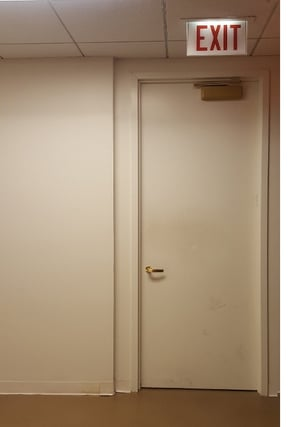
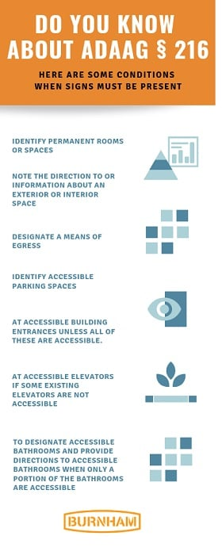
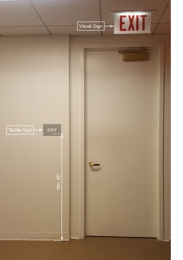

## Cushing and Burnham Nationwide Partner to Answer Your ADA Signage Questions

[For 90 years, Cushing has been a Chicago printer](https://www.cushingco.com/) with an international reach, first opening as a blueprint shop in 1929. In the decades following, the business grew to include film conversion, on-site printing (the first manned center in Chicago), color services, CAD plotting, and now a full suite of printing services.

Cushing retains its close ties to the architecture and construction community in the present day by offering wall graphics, construction fence wraps, and building signage. In recent years, they have added [wayfinding and directional signage](https://www.cushingco.com/custom-wayfinding-directional-signage/) and more recently [a suite of ADA signs for buildings](https://www.cushingco.com/ada-signage/) to their offerings.

Burnham’s Code Team often consults on Americans with Disabilities Act (ADA)-compliant signage, including exit and wayfaring signage, and we frequently see violations during our code compliance reviews. We’re excited to partner with Cushing, to address some of the most common signage mistakes in this post as well as in upcoming presentations and collaborations.

In the coming weeks, we’ll delve into frequently asked questions customers and prospects ask of both our companies. Additional blog topics will include [egress](https://www.dictionary.com/browse/egress) communications and informational versus directional signage.

## What are the ADA Exit Sign Requirements?

The ADA’s Title III prohibits discrimination by private entities operating as places of public accommodations covering accessible signage including exit doors. The rules implementing the ADA, the 2010 Standards for Accessible Design (2010 Standards), incorporate the [2004 ADA Accessibility Guidelines](https://www.access-board.gov/guidelines-and-standards/buildings-and-sites/about-the-ada-standards/background/ada-aba-accessibility-guidelines-2004) (ADAAG) that contain new construction, alterations accessibility scoping and technical requirements. See if you can identify the violation of the ADA’s requirements in this picture.

[ADAAG § 216](https://www.access-board.gov/guidelines-and-standards/buildings-and-sites/about-the-ada-standards/ada-standards/chapter-2-scoping-requirements) specifies locations and types of ADA compliant signs required to be posted, with the exception that signs are not required for temporary conditions of seven days or less. The most common conditions are highlighted below.

## Code Specifications

The requirements for exit doors signs are included in the provision governing signs for means of egress.

ADAAG § 216.4.1 further specifies signage requirements at doors to exit passageways, doors that are part of the exit discharge, and exit stairways. These requirements advise that signs at all exit doors must also include a tactile sign containing raised characters and Braille lettering; so exits must have both visual and tactile characters. It is acceptable to have two separate signs with visual and tactile lettering.

[ADAAG § 703](https://www.access-board.gov/guidelines-and-standards/buildings-and-sites/about-the-ada-standards/ada-standards/chapter-7-communication-elements-and-features) contains the technical requirements governing tactile signs. There are specific provisions pertaining to the type of tactile characters (uppercase and sans serif) that must be used as well as character proportions: height, stroke thickness, and spacing. Signs must also use Braille (Grade 2) and follow the specified requirements for dimension and position belowthe corresponding text. Signs’ tactile characters must be a minimum of 48 inches above the finished floor or ground to the lowest tactile character’s baseline and a maximum of 60 inches to the highest tactile character’s baseline.

The tactile sign must be located on the latch side of the door. If there are double doors with only one active side, the sign should be placed on the inactive side. If both doors are active, the sign should be placed on the right of the right door. There are also requirements regarding signs for recessed doors, push doors as well as clear floor space near a tactile sign.

Visual signs must comply with a variety of requirements outlined at ADAAG § 703.5. The character and background finish should be non-glare and there should be a contrast between the characters and background, and there are also requirements for character proportions, height, and spacing. Now take a closer look at the exit door:  
The exit door in the original photo does have a visual sign indicating the exit, however, there is no tactile sign next to the door handle. Since there is already a visual sign, a separate tactile sign would be sufficient.

## Be Aware of the  Difference Between Local  and Federal Requirements

  
It is important to note that not all local  jurisdictions require tactile signs at exit doors.

Chicago, where Cushing and Burnham are  headquartered, does not have a tactile sign  requirement for exit doors. However, if exit doors  do not have tactile signs - even if the local municipality doesn’t have a rule - one is in violation of the federal ADA requirement and can potentially be subject to a Department of Justice enforcement action, even if such signs aren’t locally mandated.  
At Burnham Nationwide, we specialize in conducting plan reviews for ADA and other code compliance. [Contact us](/contact/) for a consultation on future plans or for site services on your active projects.

Does every exit door need both a visual sign and a tactile Braille sign? Yes, ADAAG §216.4.1 requires both visual and tactile characters at doors to exit passageways, exit discharge points, and exit stairways. You can use one combined sign with both elements, or two separate signs - one visual and one tactile - as long as both are present. My city's building code doesn't mention tactile exit signs - does that mean I don't need them? No, this is the core misconception this post addresses. Local code silence doesn't override federal law. Even in jurisdictions like Chicago that don't separately mandate tactile exit signage, the requirement still applies under the federal ADA, and noncompliance can trigger a Department of Justice enforcement action regardless of local code. Where exactly should a tactile exit sign be mounted relative to the door? On the latch side of the door, with the tactile characters positioned between 48 and 60 inches above the finished floor (measured to the baseline of the lowest and highest characters, respectively). For double doors with one inactive side, mount it on the inactive door; if both are active, mount it to the right of the right-hand door. What Braille standard should tactile exit signs use? Grade 2 (contracted) Braille is required, specifically using Unified English Braille (UEB) - the version that became the official U.S. Braille standard in 2016 and remains the accepted equivalent of Grade 2 Braille under current ADA Standards. Can illuminated exit signs required by the building code also satisfy ADA's visual sign requirement? Often yes - illuminated exit signage required under life safety and building codes (like the IBC) can satisfy the ADA's visual character requirements, but the tactile component still typically needs to be addressed with a separate sign, since illuminated signs don't include raised characters or Braille.
