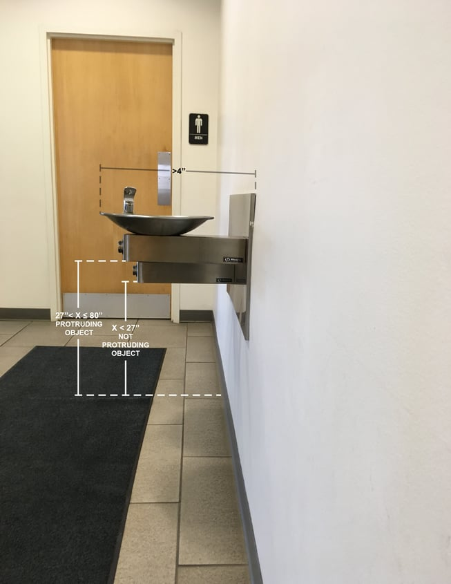

The Americans with Disabilities Act (ADA) contains specific requirements for objects that extend into circulation paths. During ADA compliance walk-throughs, we periodically see conditions that do not fully comply with these standards. It is important to understand the ADA’s requirements for protruding objects to avoid injury to people with visual impairments. See if you can find the violation of the ADA standards for protruding objects in this picture.

## Where to Find the ADA’s Requirements for Protruding Objects

The specific requirements governing protruding objects are found in the 2010 Standards for Accessible Design (2010 Standards) implementing the ADA. The 2010 Standards incorporate the 2004 ADA Accessibility Guidelines (ADAAG) created by the United States Access Board. ADAAG Chapter 2 contains the ADA’s scoping requirements and [§ 204](https://www.access-board.gov/guidelines-and-standards/buildings-and-sites/about-the-ada-standards/ada-standards/chapter-2-scoping-requirements) states that protruding objects found in circulation paths must follow the technical requirements of [ADAAG § 307](https://www.access-board.gov/guidelines-and-standards/buildings-and-sites/about-the-ada-standards/ada-standards/chapter-3-building-blocks). Objects extending into circulation paths in areas for play and sports activities are exempt from these requirements.

It is important to keep in mind that circulation paths are a broader category than accessible routes. Circulation paths are defined by [ADAAG § 106](https://www.access-board.gov/guidelines-and-standards/buildings-and-sites/about-the-ada-standards/ada-standards/chapter-1-application-and-administration#106%20Definitions) as passages (exterior or interior) for pedestrians, such as “walks, hallways, courtyards, elevators, platform lifts, ramps, stairways, and landings.” Thus, an area connecting to a corridor or a particular room may be a circulation path.

Burnham Nationwide's code experts are members of national and municipal code drafting committees and possess an in-depth understanding of all relevant municipal codes. In addition to ADA reviews, our specialists slso workn closely within clients during permit expediting to ensure compliance is addressed in time to prevent any delays that could be costly, [Contact us](/contact/) for a consultation with a compliance expert. 

## Requirements for Protruding Objects

### Horizontal Limits

Someone with a vision impairment is likely to detect an object along a wall within a cane’s sweep, a maximum of 27 inches in height from the ground or finished floor, so an object located within that height limit may protrude any amount. Similarly, there is no limit on how far an object may extend from a wall if it provides headroom clearance, meaning it must be positioned at least 80 inches from the floor.

An object that is above the cane detection area (more than 27 inches) and lower than the headroom clearance area (below 80 inches) may not extend beyond 4 inches horizontally into the path, except handrails may protrude up to 4 ½ inches. If such an object is right above an element that is within the cane detection area, the object may protrude up to 4 inches from the leading edge of the element below it. For example, a kitchen countertop set at a height over 27 inches may extend horizontally up to 4 inches from the leading edge of the element below it.

An object on a post or pylon with its leading edge more than 27 inches and less than 80 inches above the floor cannot extend beyond 12 inches into the circulation path. If the object is mounted at the same height between two posts or pylons, the distance between the posts cannot be more than 12 inches. The sloping portions of handrails are excluded from these requirements.

An object extending into a path may not reduce an accessible routes’ clear width.

### Vertical Clearance

All circulation paths must have a minimum vertical clearance of 80 inches. In areas where the clearance needs to be less than 80 inches, such as an open stairway, a guardrail, or another type of barrier, a leading edge must be provided that can be detected with a cane so it cannot be higher than 27 inches. Only a door closer or stop may be a minimum of 78 inches above the floor.

Now take a closer look at the fountains in this photo:

The accessible “lo” fountain is cane detectable as the underside is located no greater than 27 inches from the finished floor surface. However, as the “hi” water fountain’s underside is at a height greater 27 inches, and the fountain is extending well beyond the 4-inch minimum into the circulation path, it constitutes a protruding object.To bring the hi water fountain into compliance, a feature could be placed below the fountain to enable cane detection. Alternatively, this water fountain could be recessed or placed in an alcove to prevent it from extending into the circulation path. Depending on the layout of the space, side partitions or wing walls could also be used as another option for compliance.

Although there is no specific guidance in the ADA on the types of cane detection, it is important that the detectable feature at the hi fountain is mounted in a location that maintains the required clear floor space under the accessible lo fountain.

## Stay Informed About ADA and Accessibility Requirements

The ADA’s standards for protruding objects are only one example of overlooked ADA accessible design requirements. You can read our posts about overlooked ADA requirements for [exit door signage](/final-review-blog/ada-exit-door-signage-requirements-what-is-wrong-with-this-picture/), [restrooms](/final-review-blog/ada-restroom-requirements-what-is-wrong-with-this-picture/), and [doors](/final-review-blog/ada-door-requirements-what-is-wrong-with-this-picture/). Also, it is important to be knowledgeable about your state and local accessibility requirements that may be different or more stringent than the ADA standards. Addressing these requirements early especially during code consulting or permit review, will help avoid costly rework or delays.

At Burnham Nationwide, we conduct plan reviews for ADA and other compliance needs for projects across the country. Our team helps navigate complex challenges early in the process.  Please [Contact Us](/contact/) for a consultation with a compliance expert.
