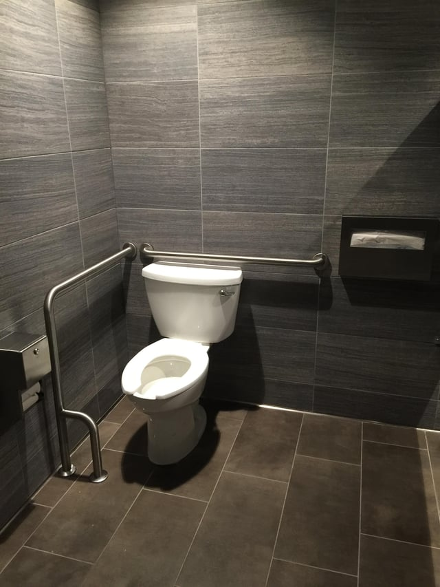
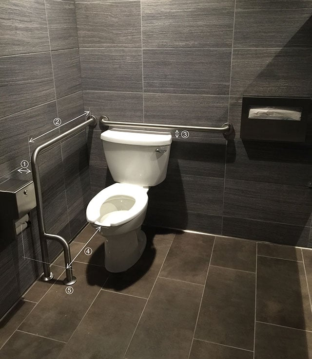

The Americans with Disabilities Act (ADA) has very specific requirements to make restrooms accessible. A variety of factors must be incorporated into the design and construction of toilet compartments so that they are compliant with the ADA. During our accessibility compliance reviews and site inspections, we see some common violations of these standards. See if you can find the violation the ADA’s restroom requirements in this picture:

## Where to Find the ADA Restroom Requirements

Title III of the federal ADA requires any newly constructed or renovated places of public accommodation and commercial facilities be designed to prevent discrimination against people with disabilities. Existing buildings are also required to remove barriers to bring elements into compliance. The [2010 Standards for Accessible Design](https://www.ada.gov/regs2010/2010ADAStandards/2010ADAstandards.htm) (2010 Standards) are the rules implementing the ADA and incorporate the [2004 ADA Accessibility Guidelines](https://www.access-board.gov/guidelines-and-standards/buildings-and-sites/about-the-ada-standards/background/ada-aba-accessibility-guidelines-2004) (ADAAG).

ADAAG contains all the scoping and technical requirements relevant to restrooms. ADAAG, [Section 213](https://www.access-board.gov/guidelines-and-standards/buildings-and-sites/about-the-ada-standards/background/ada-aba-accessibility-guidelines-2004/ada-chapter-2-scoping-requirements) states the restroom scoping requirements, and [Chapter 6, Plumbing Elements and Facilities](https://www.access-board.gov/guidelines-and-standards/transportation/facilities/ada-standards-for-transportation-facilities/chapter-6-plumbing-elements-and-facilities), sets forth the relevant technical requirements. Specifically, Section 604 contains requirements for toilet compartments. Other sections of the chapter, such as Section 605 on urinals and Section 609 on grab bars, are also relevant.

It is also important to be aware there are some other sections of ADAAG, such Section 309 governing operable parts, that relate to some of the elements found in a restroom. There are also specific requirements for children’s use depending on the nature of the facility.

## Specific Requirements for Restrooms

The following are some highlights of the ADA standards for toilet compartments, particularly those relevant to our picture. It should be noted that there are many additional requirements and exceptions to the standards summarized below:

#### Size and Clearance Area of Toilet Compartment

There are specific measurements for the size and layout of an accessible toilet compartment, including the water closet being located between 16” to 18” from the side wall or partition.

The clearance area must be 60” perpendicular from the side wall and 56” perpendicular from the rear wall for a wall mounted toilet (60” wide by 59” long for floor mounted toilets). This clearance can overlap certain elements, such as grab bars, dispensers, accessible routes, and clear floor space. However, anything else not specified in this section cannot be located within the maneuvering clearance area.

#### Grab Bars

There must be grab bars on both the side wall adjacent to the toilet and on the rear wall. Side wall grab bars must be at least 42” long, located no more than 12” from the rear wall, and extend at least 54” from the rear wall. The rear wall grab bars must be a minimum of 36”, must extend at least 12” on one side from the toilet centerline, and must be at least 24” on the other side.

Grab bars must be spaced 1-½” from the wall, a minimum of 1-½” from a projecting object below, and at least 12” from an object projecting above the grab bar. Also, grab bars must be installed horizontally at least 33” and no more than 36” from above the finished floor to the top of the gripping surface. In addition, there are specific dimension requirements for grab bar cross sections.

#### Dispensers and Toilet Seat Requirements

Toilet paper dispensers should be at least 7” but no more than 9” when measured from the edge of the toilet to the center of the dispenser. Also, the dispenser should be mounted at a minimum of 15” and no more than 48” above the finished floor, and shouldn’t be located behind grab bars.

The top of the seat must be 17” to 19” above the finished floor. Flush controls (either hand operated or automatic) should be located on the toilet’s open side.

Now take a closer look at the restroom:

1.  The distance between the grab bar and the wall exceeds the required dimension of 1-½” from the wall. (Section 609.3 Spacing)
2.  The length of the side wall grab bar is shorter than the minimum required 42” long grab bar, located at a maximum 12” from the rear wall, and extending at least 54” from the rear wall. (604.5 Side Wall)
3.  The rear grab bar is too close to the top of the water closet and therefore doesn’t meet the requirement stating that grab bars be placed at least 1-½” from a projecting object below. (609.3 Spacing)
4.  The toilet paper dispenser is located too far from the toilet. It doesn’t comply with the requirement stating that the centerline of the dispenser must be between 7” to 9” from the edge of the toilet. (604.7 Dispensers)
5.  The front of the grab bar returning and anchored to the floor is not permitted to obstruct the 60” x 59” maneuvering clearance area of the floor mounted toilet. (604.3.2 Overlap and 609.7 Installation)

## Stay Informed About all the ADA and Accessibility Requirements

The ADA restroom requirements highlighted here are the federal standards. However, it is also important to be aware of your state and local accessibility requirements as they may be differ or be more stringent than those of the ADA. Staying informed about all the ADA standards, including local requirements, can be difficult. We at Burnham frequently conduct plan reviews for ADA and other code compliance. Please feel free to [Contact Us](/contact/) for a consultation.
