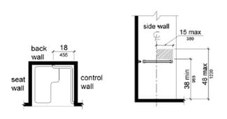
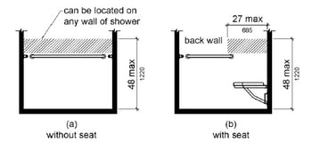
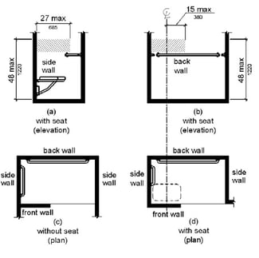

Complying with the American with Disabilities Act (ADA) is required by federal law for all places of public accommodation, commercial facilities, and state and local government facilities. The law was put in place to ensure people with disabilities’ safe entrance and use of public buildings.

We know the laws of ADA can be quite challenging to comply with, and every day we are asked specific questions by our [code consulting](/what-we-do/code-consulting/) clients on how they can make their buildings safer and more accessible by meeting ADA requirements. The Burnham team is here to help you navigate through these complicated requirements. [Contact us](/contact/) to keep your project on the right track. 

To help, we are sharing with you a specific question that we answered in regards to ADA shower requirements.

> “On an ADA shower, are there measurements (both horizontal and vertical) for the shower valve and the handheld shower on the slide bar?”

Requirements for an ADA-compliant bathroom shower facility can be found in section 608 of the [ADA Plumbing Elements and Facilities Standards](http://www.ada.gov/regs2010/2010ADAStandards/2010ADAstandards.htm). Diagrams are provided as well.

## Transfer-Type Shower Compartments

In a 36-inch by 36-inch transfer-type shower compartment (the person must move from a wheelchair to a shower seat), controls, including the valve, faucet, and shower spray unit, are to be installed on the wall opposite the seat no less than 38 inches and no more than 48 vertical inches from the floor. These shall be located on the control wall no more than 15 inches from the center line of the seat and extending toward the compartment’s opening. You have a 10-by-15-inch area to locate the controls.

## Standard Roll-In Type Shower Compartments

If the compartment does not contain a seat, the controls can be located above the grab bar 38 to 48 inches vertically from the floor and can be positioned on any of the stall’s three walls. For a compartment containing a seat, the controls should be positioned on the back wall, 38 to 48 inches above the floor and no more than 27 inches horizontally from the seat wall.

## Alternate Roll-In Type Compartments

Transfer and standard roll-in compartments generally contain only three walls. Alternate type compartments are described as having four walls, or more accurately, three and a half, with an opening to enter.

If no seat is provided, the requirement is similar to that of the standard type of unit: the control unit should be above the grab bar, 38 to 48 vertical inches above the floor. For units containing a seat, the controls should be placed on the wall adjacent to the seat, 38 to 48 vertical inches from the floor and no more than 27 horizontal inches from the seat wall or back rest of the seat (if there is a back rest). If the controls are to be located on the wall opposite the seat, they should be placed no more than 15 horizontal inches from the center line of the seat, to the left or to the right.

## Spray Unit

For adjustable-height shower head units that attach to a vertical slide bar, the bar should not get in the way of the person being able to reach the grab bars. If the unit is the type that can be used as a fixed or handheld shower head, the hose should be a minimum of 59 inches long.

An exception can be made for buildings that are not medical facilities, long-term care facilities, certain types of hotels, and residential units: a fixed shower head can be used in placed of a handheld shower as long as it is positioned 48 inches maximum above the finished floor.

## Shower Curtain Rods

A frequently asked question our team receives, regards the height of shower curtain rods. A definitive answer has been difficult to determine, since the ADA Standards do not specifically cover shower curtain rods. However, the minimum height clearance for objects located above an accessible route is 80”.

We reached for clarification from ADA Technical Assistant with the Department of Justice as to whether this would apply to curtain rods. The feedback we received stated that, there is no minimum requirement for the height of a curtain rod, since the curb at the edge of a typical shower or the side of a bathtub provides detection to alert a person with visual impairment to the curtain rod above.

The only showers where there is a minimum height for the curtain rod are accessible roll-in or alternate roll-in type showers. In these showers, the threshold must comply with ADA 303 for changes in level, which permits a maximum change of level of ¼” if vertical or ½” if beveled. At these locations there is not sufficient detection, so the curtain rod must comply with ADA 307 and be no lower than 80” above the finished floor.

Do you have a question about general ADA bathroom requirements? [Contact Burnham National](/contact/) to simply get it done.

We also suggest you refer to our article [Commonly Overlooked ADA Bathroom Requirements](/final-review-blog/commonly-overlooked-ada-bathroom-requirements/), where we cover more frequently missed rules. Still need assistance with ADA code compliance? Our [code team](/what-we-do/code-consulting/) is available to answer your questions and assist on making your project compliant.  
   

What's the height range for shower controls in an ADA transfer-type shower? Controls (valve, faucet, shower spray unit) must be installed on the wall opposite the seat, between 38 and 48 inches above the floor, positioned no more than 15 inches from the center line of the seat, giving you roughly a 10-by-15-inch zone to locate the control unit. Does the control placement differ between roll-in showers with and without a seat? Yes, for a roll-in shower without a seat, controls go above the grab bar (38-48 inches high) and can be on any of the three walls. For a roll-in shower with a seat, controls must go on the back wall, also 38-48 inches high, positioned no more than 27 inches horizontally from the seat wall. How long does the handheld shower hose need to be for ADA compliance? A minimum of 59 inches, for units designed to function as either a fixed or handheld shower head. There's an exception for certain building types - non-medical, non-long-term-care, non-hotel residential units can use a fixed shower head instead, as long as it's positioned no higher than 48 inches above the finished floor. Is there an official ADA height requirement for shower curtain rods? It depends on the shower type. For standard showers with a curb or tub edge, there's no minimum height requirement, since the DOJ has clarified that the curb itself provides sufficient tactile detection for someone with a visual impairment. For accessible roll-in or alternate roll-in showers (which have a near-flush threshold with no detectable curb), the curtain rod must be at least 80 inches above the finished floor to maintain proper overhead clearance. Why does the threshold height matter for whether a curtain rod needs a minimum height? Roll-in shower thresholds are nearly flat by design (limited to a 1/4-inch vertical or 1/2-inch beveled change in level under ADA 303), so there's no curb to alert someone with a visual impairment to the shower opening - that's specifically why those compartments require the curtain rod to meet the 80-inch overhead clearance rule under ADA 307, while standard showers with a detectable curb don't.
