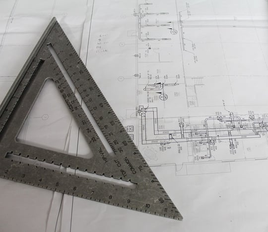

Burnham recently completed a code review of preliminary drawings for a new multi-unit residential building in California. Our code consultants prefer to be involved at this early stage of the construction design process. An initial assessment allows us to suggest modifications and solutions to avoid building department requests for corrections that can result in project delays. The review helped the design team amend their plans, a four-story building with multiple roof decks and a large parking garage, to meet code requirements.

  

For this particular project, we were asked to identify critical issues relating to occupancy classification, construction type, and exiting. We often conduct more comprehensive reviews that may include life safety, zoning, historic preservation, site planning, energy conservation, and accessibility.

## Understanding Relevant Code Provisions

The 2016 California Building Code (CBC) was the relevant building code for this project at the time we were engaged. This version of the CBC is based on the 2015 International Building Code (IBC) and contains California specific amendments to the IBC. Although many jurisdictions adopt the IBC, it is critical to understand the different amendments that may be included locally as well as how code officials choose to interpret the cited provisions.

When we conduct our review, we prepare a Code Analysis Report which summarizes the relevant code provisions. In this case, in addition to summarizing the relevant CBC provisions, we also noted where the local code contains more restrictive amendments to the IBC.

## Important Issues Highlighted by Code Review

### Sprinkler Provisions

Choosing a construction type for a building requires assessment of a number of factors including the height and area limitations, sprinkler provisions, and occupancy classification. The intended construction type for the project was V-A, meaning it can be constructed using any materials allowed by the IBC, including wood, but critical building elements, such as the structural frame and exterior and interior bearing walls, must have a minimum of a 1-hour fire-resistance rating. Although this construction type offers a lot of flexibility, it is necessary to also be aware of its limitations.

The CBC, similar to the IBC, allows for an increase in the maximum building height for a V-A building when an approved automatic sprinkler system is installed. Such a system must be built in accordance with the National Fire Protection System (NFPA) 13 sprinkler system requirements and cannot merely meet the NFPA 13R standards.

While residential use often specifies NFPA 13R and is permitted by most municipalities, we clarified for the design team that the increases in building height or number of stories would not be code compliant if an NFPA 13R sprinkler system was substituted for the NFPA 13 system. NFPA 13R is only designed to allow building occupants to escape a fire. NFPA 13 is a more extensive system than NFPA 13R because it is designed to help protect the building by aiding in fire control.

### Story Above Grade Plane

We alerted the design team that the drawing elevation details needed to be corrected to precisely indicate that the building would be four stories. The CBC does not permit a five-story building based on the proposed V-A construction type. The initial drawings did not clearly dimension the first-floor elevation difference in relation to grade and it appeared that this might exceed six feet above the grade plane, giving the impression it was a five-story building.

According to the CBC, a story above the grade plane can include a story that has a finished floor surface of more than six feet above the grade plane, the average finished ground level next to the building’s exterior walls. Our Code Analysis Report provided instructions for calculating the grade plane and correctly indicating the height from the lowest grade to the first floor to clearly identify compliance and prevent issues during the permit review process.

### Roof Decks

In determining the building’s occupancy and use classification, we needed to also consider whether the multiple roof decks called for in the plans could affect how the building is classified. The IBC does not provide a clear statement about how to classify a residential roof deck. We conducted in-depth code research on this issue in order to provide guidance to our client.

IBC Section 303, Assembly Group A, sets forth the building use and occupancy classification for areas where people may gather for different functions. We noted in our Code Analysis Report that a roof deck might be viewed as an A-3 Assembly Use, the classification for “worship, recreation, or amusement and other assembly uses not classified elsewhere in Group A.” However, given the drawings we reviewed were at a very preliminary stage, we recommended including more details, such as landscaping and clearly defined occupied areas on the plans, to better define the use and occupancy classification.

Based on the built out elements, the roof deck is not defined as a floor in this instance, and therefore, should not affect building height and area limitations. However, we warned the design team that this is subject to interpretation so it would be prudent to discuss the roof decks’ use with the local municipality.

## Continuing Review

Our initial scope of work for this project did not include an accessibility review. However, we still highlighted a few critical accessibility concerns in our Code Analysis Report which led to a request for further analysis.

Accessibility reviews in California are particularly complex due to the myriad of differences between the federal Americans with Disabilities Act, state, and local accessibility requirements that may apply to a project. Fortunately, our team has nationally recognized expertise in these accessibility laws and codes.
