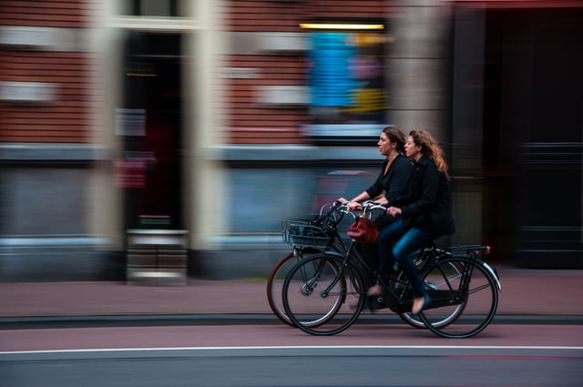
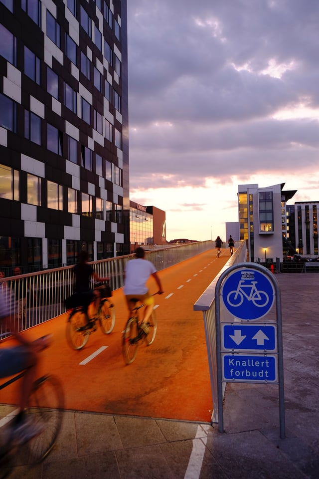

Long part of the culture of European cities such as Copenhagen, Amsterdam, and Oslo, biking as transportation is heralded as a solution to inactivity and an alternative to trips by car. From 2000 to 2016, bike commuting grew by 51 percent in the United States. Bike use has grown by 105 percent in some states, with an influx of bike friendly communities (BFCs) in Virginia, Pennsylvania, and Kentucky among others as cities continue to promote bicycling as a form of urban transit. But without the infrastructure to support safe biking and encourage bicycles as car alternatives, the “biking boom” can easily stall. <em>image by [David Marcu](https://unsplash.com/photos/Op5JMbkOqi0)</em>

[Project Drawdown](/final-review-blog/burnham-nationwides-climate-change-drawdown-series/) ranks Bike Infrastructure as #59 in solutions to global warming, estimated to reduce 2.31 gigatons of carbon dioxide by 2050 and a savings of $400.47 billion dollars. Yet, the value of promoting a biking culture extends beyond carbon reduction. Better bike infrastructure promotes [cleaner air quality and healthier populations](https://www.fastcompany.com/3065591/bike-lanes-may-be-the-most-cost-effective-way-to-improve-public-health) and is less expensive to implement than other preventative health measures. It also contributes to a snowball effect - the more accessible bike routes become and the safer riders feel, the more people choose to bike, and more bicyclists means more visibility, safety, and the normalization of bike commuting as a part of everyday life, leading to long term health improvements and reduction in car use.

Copenhagen a Model for Successful Bike Culture

[Project Drawdown](http://www.drawdown.org/solutions/buildings-and-cities/bike-infrastructure) considers the following to be key components of bicycle infrastructure:

-   Networks of well-lit, tree-lined, and interconnected bike lanes or paths
-   Well-designed intersections and points of access where bicycles and car traffic interact
-   Access to public transport via bike, secure bike parking, city bike-share programs, and workplace showers

In Copenhagen, 41 percent of [commuters arrive at work via bike](https://www.citylab.com/transportation/2017/10/why-have-copenhagens-bike-commuters-dropped-in-number/542859/), a number that has increased significantly over the last decade. In total, 24 percent of all trips in the Copenhagen area take place via bike, a number that far exceeds any US city. Bike use is greater than car traffic and only [25 percent](https://www.fastcodesign.com/3065696/copenhagen-now-has-more-bike-use-than-car-use?utm_content=buffer3d82f&utm_medium=social&utm_source=facebook.com&utm_campaign=buffer) of residents own a car.

In 2014, the City completed the Cykelslangen, or Bicycle Snake, which moves users between the Bryggebroen - a pedestrian and cyclist-only bridge across the Copenhagen harbor - and the region’s Cycle Superhighways. Over 26 Superhighways are either completed or under construction. Copenhagen anticipates reaching its goal of 28 bikeways by 2025 as part of its climate action plan.

<em>The Cykelslangen by [Steinar Engeland](https://unsplash.com/photos/51a-o3mNJ14)</em>

The City of Copenhagen’s [2025 Climate Plan](https://www.siemens.com/press/pool/de/events/2014/infrastructure-cities/2014-06-CCLA/copenhagen-climate-close-up.pdf) - a proposal to become completely carbon neutral - projects that 75 percent of all trips will be completed by bike, on foot, or via public transportation and has a target goal of 50 percent of all commuters riding bicycles by 2025. By investing in the Cycle Superhighways that connect surrounding suburbs with the city center, the City estimates a savings of $55 million on public health expenditures.

Copenhagen was ranked as the world’s 1# most livable city by [Metropolis](http://www.metropolismag.com/cities/the-best-cities-to-live-in/?cparticle=2&siarticle=1#Copenhagen) in 2016 due to its robust bike infrastructure and prioritization of bike transit, mass transit, and pedestrian-friendliness.

Not only has the city grown its bike infrastructure, it’s made biking easier and faster than driving - the primary motivating factor for adopting car alternatives is a [better commute](https://www.citylab.com/transportation/2017/10/why-have-copenhagens-bike-commuters-dropped-in-number/542859/), and doing so requires a critical mass of protected bike lanes and other incentives, including “green waves.”

When lights are most often timed to cars, "green waves" for cyclists are timed for approximately 12mph (the average speed of biking). This means that riders can bike without stopping at red lights, speeding up commuting times and reducing vehicle-bike crashes. Green waves are implemented globally, and cities such as [Chicago](https://chi.streetsblog.org/2015/06/19/surfing-the-green-wave-cdot-pilots-bike-friendly-signal-timing-on-wells/) and San Francisco have incorporated light timing into their existing infrastructure to make biking quicker and safer.

Positioning the bike as a form of transportation is key to its adoption in the US where biking is most often considered a leisure activity. By providing numerous protected bike lanes and ease-of-use changes such as green waves, more commuters will choose to see the bike as a viable form of transportation, shifting it from exercise to everyday.

## Bike Infrastructure Improves Quality of Life Even for Non-Cyclists

There are [significant health benefits](http://www.bmj.com/content/357/bmj.j1944.short?rss=1&utm_source=TrendMD&utm_medium=cpc&utm_campaign=TBMJ_UK_TrendMD-0) resulting from biking to work, but improving bike infrastructure improves public health even for those who do not ride.

In a study by the Mailman School of Public Health at Columbia University, researchers found that [installing bike lanes in New York City](http://injuryprevention.bmj.com/content/23/4/239) was a cost-effective way of addressing multiple public health problems, more than “the majority of preventative approaches used today.” Promoting biking promotes physical activity but also leads to fewer trips via car and less pollution, and residents benefit from cleaner air overall. Bike infrastructure calms traffic in residential neighborhoods and reduces congestion on major roads, fuel consumption, air pollution, and more.

## Actively Planning for Alternative Transportation Needed to Reach Drawdown Goal

In 2014, 5.5 percent of all global urban trips were completed via bicycle. An increase of 2 percent would lead to a displacement of “2.2 trillion passenger-miles traveled by conventional models of transportation … \[and avoid\] 2.3 gigatons of carbon dioxide emissions,” according to [Drawdown](http://www.drawdown.org/solutions/buildings-and-cities/bike-infrastructure) sources.

Project Drawdown estimates a lifetime savings of $1.2 trillion for pedal power alone. However, a [study](https://www.itdp.org/how-cycling-can-save-cities-money-and-emissions/) by the Institute for Transport and Development Policy and the University of California-Davis indicates that combined cycling - which includes [e-bikes](http://www.drawdown.org/solutions/transport/electric-bikes) - could save approximately $24 trillion and avoid 225 million tons of CO2 and equivalent emissions by 2050.

But a global increase in bike use can only be obtained by prioritizing new cycling infrastructure over roads, as bike use only increases when it becomes easier and safer to cycle. Reducing vehicle emissions will rely on developing biking culture in major cities with dedicated and protected bike lanes and bicycle-first urban planning.

*This blog post is part of Burnham Nationwide’s* [Drawdown Series](/final-review-blog/burnham-nationwides-climate-change-drawdown-series/)<em>.</em>
