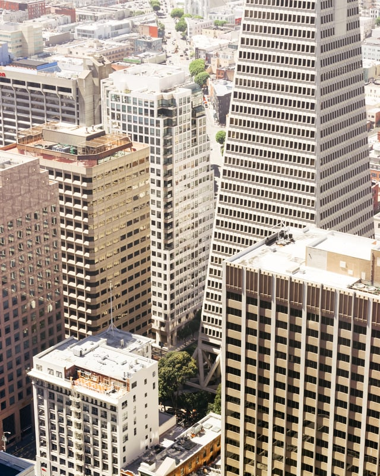
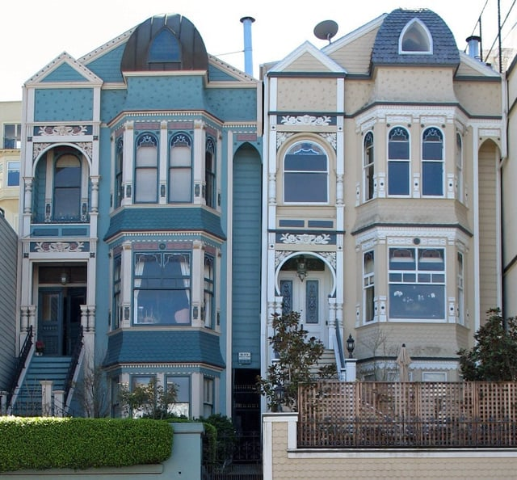

San Francisco has been updating its standards for building façade inspections and maintenance. In 2016, the City adopted an [ordinance](http://sfgov.org/esip/sites/default/files/Documents/Facade%20Maintenance%20Working%20Group/Building%20Facade%20Inspection%20and%20Maintenance%20Ordinance_Final.pdf) amending the San Francisco Existing Building Code (Ordinance) in June of 2017. The Department of Building Inspections (DBI) recently released an administrative bulletin implementing the legislation, the final phase of the new building façade inspection and maintenance requirements.

<em>Photo by Shasha Zvereva on [Unsplash](http://Unsplash.com)</em>

## Adoption of Code Amendments

New proposed standards were introduced in 2014 for existing façades to reduce hazards in light of San Francisco’s susceptibility to earthquakes. The City had some mandates to lower existing buildings’ earthquake risks, such as requirements to strengthen unreinforced masonry bearing walls. However, there were no specific standards for existing building façade inspection and maintenance.

The San Francisco Building Code is comprised of the 2016 California Building and Residential Codes (incorporating the 2015 International Building and Residential Codes) with San Francisco specific amendments. The state requires each municipal jurisdiction to determine its potential for earthquake hazards and ways to prevent earthquake building damage, leaving it to San Francisco to create its own building façade standards.

Ed Lee, the Mayor of San Francisco, approved the Ordinance on May 6, 2016, creating a new Chapter 4E (16E under the prior Building Code) in the San Francisco Existing Building Code. In the 2015 edition, the International Code Council moved the sections of International Building Code pertaining to existing building repairs, alterations, additions, change of occupancy, and relocation to a new code, the International Existing Building Code. Similarly, San Francisco has a new Existing Building Code comprised of the 2016 California Existing Building Code (based on the 2015 International Existing Building Code) and San Francisco’s own amendments.

## New Facade Requirements for Existing Buildings

The Ordinance defines a façade as anything on the building exterior such as walls, wall covering, windows, balconies, as well as a variety of other listed elements. Also included as façades are roof level supported walls and interior walls that were originally exterior areas.

Inspection Schedule

The new inspection requirements apply to all buildings of five or greater floors that are Construction Types I, II, III, or IV. The mandated inspections must be performed by a licensed architect or engineer. Historic buildings should be inspected by professionals with historic structures expertise.

An initial inspection is required for existing buildings, and the deadline for submitting the resulting report is based on the building’s construction completion date: (1) December 31, 2021 for buildings constructed pre-1910; (2) December 31, 2023 for buildings constructed 1910-1925; (3) December 31, 2025 for buildings constructed 1926 - 1970; and (4) December 31, 2017 for buildings constructed constructed after 1970.

Buildings that applied for a new construction permit after January 1, 1998, do not need to undertake an initial inspection and must begin periodic inspections 30 years after the Certificate of Final Completion is issued. Also, buildings that conducted a façade inspection and any required maintenance in the 10 years before the initial inspection report deadline may seek a waiver.

Periodic inspections must be performed every 10 years after the initial inspection submittal deadline but are not required to include interior walls converted from a prior exterior area. However, if there is significant damage to a façade, an inspection is required within 60 days unless waiting would be unsafe. Professionals preparing an inspection report must immediately report unsafe conditions to DBI regardless of any inspection deadlines.

### Elements to be Included in Inspection and Fees

The Ordinance requires inspections to include the examination of the list of elements specified in ASTM E2270 and additional elements listed in the Ordinance, for example, attached equipment, decorative elements, signs, and fire escapes. Certain elements enumerated in the Ordinance are exempt from the inspection requirements.

The fees required to compensate DBI for processing and reviewing the inspection reports are also stated in the Ordinance.The effective date of the Ordinance was June 5, 2016, 30 days after it was signed.

### Procedures for Inspections and Reporting

Inspecting and maintaining a facade must follow DBI’s procedures set forth in the recently published [Administrative Bulletin No. AB-110](http://sfdbi.org/sites/default/files/AB-110.pdf) (Administrative Bulletin).The Ordinance requires the Administrative Bulletin to be based on the international standard ASTM E2270, Standard Practice for Periodic Inspection of Building Façades for Unsafe Conditions.

The Administrative Bulletin highlights some special considerations in the use of ASTM E2270, such as the type of documentation that must be reviewed and submitted to DBI. According to the Administrative Bulletin, the professional conducting the inspection should inquire about any water leaks in order to select areas of inspection. Also, DBI must approve the use of any remote sensing methods for the façade reviews. Inspections of historic resources must be in keeping with the federal Secretary of the Interior’s standards and should use “the least intrusive or invasive means feasible.”

Additionally, the Administrative Bulletin elaborates on the Ordinance’s mandates regarding unsafe conditions. It provides contact information for those who need to be notified during emergencies and describes mitigation plan requirements.

A detailed list of the information to be included in a façade inspection report is included in the Administrative Bulletin, such as specific property information, building description, photographs of each elevation, the qualified professional’s contact information, prior report information, statement of the inspection scope, and a detailed description of the findings and recommendations. The inspection report must also assign one of three categories to the report: (1) repair/stabilization following temporary mitigation of unsafe conditions; (2) requires repair, stabilization, and maintenance; or (3) ordinary maintenance.

Also, outlined in the Administrative Bulletin is information for façade inspection report submittals as well as DBI’s procedures for processing the reports. The Administrative Bulletin contains some detailed requirements for façade repair and maintenance work.

The Ordinance’s inspection schedule will hopefully provide building owners and managers with sufficient time to plan for façade inspections and maintenance. In addition to bringing buildings into compliance with the Ordinance’s requirements, proper façade maintenance can protect a building against liability from injuries caused by unsafe façade conditions, and the documentation of proper façade maintenance can make a building more attractive to potential purchasers.
