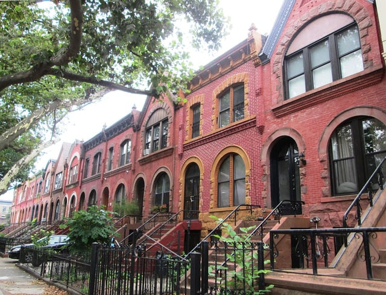

New York City has 35,000 landmark properties and most are located in 139 historic districts and historic district extensions [across the five boroughs](http://www1.nyc.gov/site/lpc/designations/maps.page). These properties also include individual, interior, and scenic landmarks. With that in mind, it is natural to wonder how to obtain permits for alterations and improvements in New York City’s historic buildings. We decided to dive into the details of New York City’s landmark preservation requirements and show how renovations in historic districts may receive approval.

## New York City's Landmarks Preservation Commission

The New York City [Landmarks Preservation Commission](http://www1.nyc.gov/site/lpc/about/about-lpc.page) (LPC), the largest municipal preservation agency in the United States, grants landmark or historic district status and regulates these entities. The agency is composed of [11 commissioners](http://www.nyc.gov/html/lpc/html/about/commissioners.shtml) and is required by law to include a minimum of three architects, a historian, a city planner or landscape architect, a realtor, and at least one resident of each of the boroughs. The LPC’s work is supported by an extensive [staff](http://www1.nyc.gov/site/lpc/about/departments.page).

## The Importance of Historic Preservation in New York City

The LPC was created in 1965 in response to the losses of historically significant buildings in New York City, most famously, [Pennsylvania Station](http://www.nypap.org/preservation-history/pennsylvania-station/). Completed in 1911, the prominent Beaux-Arts style train station was demolished in 1963 to construct Madison Square Garden and an underground commuter railroad station.

According to Title 25, Chapter 3 of the New York City Administrative Code, commonly called the Landmarks Law, there are multiple reasons for safeguarding New York City’s historic and significant buildings and places. For example, landmark status protects property values, encourages civic pride and education, improves the economy, and preserves tourist attractions. The full text of the Landmarks Law is available through an online portal to the [Charter, Administrative Code, and Rules of the City of New York](http://library.amlegal.com/nxt/gateway.dll/New%20York/admin/newyorkcityadministrativecode?f=templates$fn=default.htm$3.0$vid=amlegal:newyork_ny).

## Example of a New York City Historic District

Burnham recently worked on a facade repair project for a building that was located in the Greenwich Village Historic District. This particular area of Manhattan was designated in 1969. According to the official [Designation Report](http://s-media.nyc.gov/agencies/lpc/lp/0489.pdf), the primary purpose of the designation is to give an opportunity to city government and the citizens of the city to save from destruction the best remaining buildings.

The report cited the “exceptionally fine quality of \[Greenwich\] Village architecture together with its special quaintness, found nowhere else in New York… From the totality of Greenwich Village emanates an appearance and even more a spirit and character of Old New York which no single block thereof and no individual Landmark could possibly provide.”

As outlined in the New York City Landmarks Law, the predominant consideration in creating a historic district is the protection of an entire outstanding area, and only the creation of a historic district can halt the “piecemeal destruction of such a fine area.” For a project in a historic area, the appropriate permit applications must be filed with the LPC.

## Permits from the Landmarks Preservation Commission

There are three different LPC applications that may be required depending on the type of work undertaken. The [Expedited Certificate of No Effect Application](http://www1.nyc.gov/assets/lpc/downloads/pdf/forms/Application%20form_XCNE_20160720.pdf) is used if only interior work is being conducted and assuming the proposed work meets certain conditions. Because this doesn’t affect the exterior of a building, it usually receives the quickest approval and often is processed in about 5 days. The [FasTrack Application](http://www1.nyc.gov/assets/lpc/downloads/pdf/forms/Application%20form_Fastrack61115.pdf) can be processed within 10 days of receipt for certain types of small projects, including minor exterior repairs; interior alterations; sidewalk repairs; rooftop and rear yard decks; window and door work; and heating, ventilation, and air conditioning equipment.

The regular [Application Form for Work Permit on Designated Properties](http://www1.nyc.gov/assets/lpc/downloads/pdf/forms/application_form_permit20160720.pdf) must be used when more extensive exterior work is being done on a landmark building or within a historic district. Along with the application, one must submit documents describing the project and its impact on the landmark property. The LPC reviews an application to ensure that the proposed work will not interfere with the original look of the building and preserves the aesthetic of the surrounding area, especially in the case of historic districts. The Commission may require additional documentation, including photos of the building or architecture plan details.

Based on our experience obtaining permits for New York City landmarks and properties in the city’s historic districts, we have found the LPC review process takes a minimum of 30 days or longer depending on the nature of the project. If you have any questions or concerns about your landmark project, please [contact us](/contact/).
