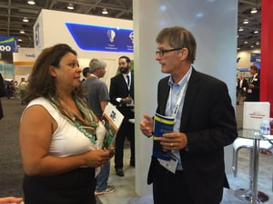

[Intersolar North America](http://www.intersolar.us/en/home.html) has become the most attended solar event and the premier networking platform for the North American solar industry. Co-located with SEMICON West, it takes place annually at the Moscone Center in San Francisco, California, the United States’ pioneering solar market on July 14 - 16th. Burnham is excited to take part again in InterSolar and will be an [exhibitor](http://www.intersolar.us/en/for-visitors/exhibition/exhibitor-list/exhibitors/exhibitor-infos.html?no_cache=1&tx_intersolarexhibitorlist_pi1[exhibitor]=35741&tx_intersolarexhibitorlist_pi1[action]=infos&tx_intersolarexhibitorlist_pi1[controller]=Exhibitor) (booth 8811 8812) at the conference.  

The event’s exhibition and conference both focus on the areas of photovoltaics, PV production technologies, energy storage systems and solar thermal technologies. Burnham’s Energy Team will be ready to answer your questions, show you the benefits of using the BurnhamEYE PV inspection application and network with other leading names in the solar community.

A total of 530 exhibitors and 17,473 trade visitors participated in Intersolar North America in 2014. The conference featured 40 sessions and 25 workshops with more than 200 speakers. [Register Today](http://www.exhibitorinvites.com/cgi-bin/click2?EI_INTERSOLAR+reg15cds+201506181059071burnhamenergyincT+aliviad@exhibitorinvitesteam.com+1+ISNA03010364E+70000001) (free of charge) to this solar-tacular event.

We look forward to connecting with you at Intersolar!
