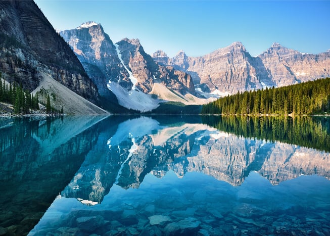

How can we in the building industry take effective steps to reverse global warming? We hope to answer this question over the coming year.

With the start of 2018, we are launching the Burnham Drawdown series on our blog, The Final Review. The inspiration for this series is the book [Drawdown: The Most Comprehensive Plan Ever Proposed to Reverse Global Warming](http://www.drawdown.org/the-book), edited by Paul Hawken.

<em>Photo by [John Lee](https://unsplash.com/@john_artifexfilms)</em>

Project Drawdown

Drawdown in the context of climate change is the stage when atmospheric greenhouse gases begin to steadily decrease. The book Drawdown is part of Hawken’s [Project Drawdown](http://www.drawdown.org/about), “to identify, measure, and model one hundred substantive solutions to determine how much we could accomplish with three decades” to reverse global warming.

Using the expertise of researchers and scientists from across the world, Project Drawdown evaluates each potential climate change solution by conducting climate and financial models and literature reviews. Outside experts and an advisory board representing a variety of disciplines undertake further reviews.

Project Drawdown’s work resulted in a list of “the 100 most substantive, existing solutions to address climate change.” Hawken notes that the majority of the listed solutions will also have a positive impact beyond their role in reversing climate change, for example, by creating jobs, improving health, saving money, decreasing hunger, and/or reducing pollution.

Drawdown presents a narrative for each solution that summarizes the solution’s history and science. Additionally, each solution is ranked from a global perspective according to the amount of greenhouse gases the solution “can potentially avoid or remove from the atmosphere” by 2050. Similarly, the book provides an estimate of the amount of carbon dioxide (CO₂) in gigatons a particular solution could eliminate by 2050. The global cost and savings are also included for some of the solutions.

Project Drawdown’s [website](http://www.drawdown.org/) provides additional resources such as a detailed technical assessment and references for each solution. The full models and technical reports for the different solutions will eventually be added to the website.

## Burnham’s Focus

Buildings, particularly older buildings, are still a major source of CO₂ emissions, [almost half of United States CO₂ emissions](http://architecture2030.org/buildings_problem_why/). According to the [International Energy Agency](/final-review-blog/the-building-industrys-link-to-climate-change-northwesterns-2017-symposium/), CO₂ related to buildings is rising globally about one percent per year. Inefficient forms of heating and cooling and poor building envelopes are largely responsible for buildings’ sizeable contribution to greenhouse gas emissions. The materials used in buildings and infrastructure are also significant contributors to global warming. Cement is responsible for approximately five percent of worldwide CO₂ emissions.

Drawdown offers many solutions relevant to the building industry. The book divides the solutions into sectors, one sector being Buildings and Cities that contains 15 solutions. This sector spans such subjects as green roofs, heat pumps, smart glass, retrofitting, and building automation. In Burnham’s blog, we plan to use the solutions offered by Drawdown as a starting point and will look more deeply at particular aspects of these solutions.

Additionally, we will also examine solutions from several of the other sectors identified by Drawdown. We plan to write about Energy sector solutions that impact the building industry such as microgrids and grid flexibility and Materials sector solutions such as alternative cement and refrigerant management. Also, Drawdown includes a category identified as Coming Attractions, solutions that are at an early stage. We will look at some of the Coming Attractions such as building with wood, living buildings, and smart grids.

## Please Join Us

We hope you will join us as we explore the solutions proposed by Project Drawdown over the coming year. Our goal is to write about Drawdown solutions at least twice a month and inspire problem-solving and innovation in our industry. Together we may play role in helping the building industry do its part to reverse climate change.
