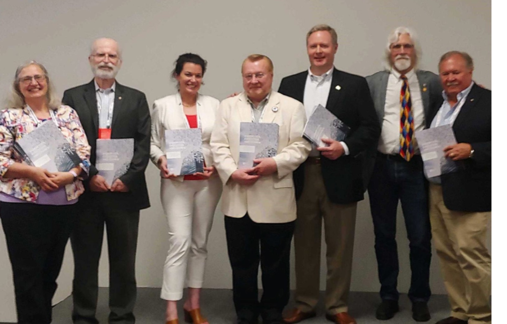

Before an individual can legally be called an architect, they must be licensed to practice the profession. Once they do, they may certify to their clients and community that the designs, drawings and specifications they produce will protect the health, safety, and welfare (**HSW**) of those who live and work in the built environment. Building officials using legislative regulation commonly referred to as building codes address routine safety issues architects follow to safeguard building occupants from hazards such as fire and collapse, while providing minimum standards for adequate ventilation and thermal comfort. This relationship between the architect, building codes and standards, enforcement, and building performance outcomes has not significantly changed in more than 100 years.

However, today we observe a rapidly changing world that is not properly reflected in what it means to protect **HSW**. The “*devastating effects of climate change throughout the world, growing social inequity, and human health crises demand the definition of* <strong>*HSW*</strong> *now focus on and include the growing bodies of knowledge in resilience, equitable design, and advanced building performance*.” <strong>This holistic definition of HSW incorporates and embraces additional areas of need and concern to protect human life and the natural environment now and in the future.</strong>

<strong></strong>

That is the essential finding of a new American Institute of Architects (AIA) report “*Disruption, Evolution, and Change*”, which calls on architects, policy makers and construction industry partners to adopt sweeping new resiliency and sustainability codes that would protect not only today’s building inhabitants but future generations. The AIA’s Codes and Standards 2018 chair, Christopher Chwedyk, and a Blue Ribbon Panel handpicked and chaired by Dave Collins, including Jim Dinegar (facilitator), Gary Dempster, Rosemarie Grant, Maureen Guttman, Anica Landreneau, RK Stewart and Ryan Taylor, have envisioned a future “*where AIA architects have demonstrated knowledge and understanding of holistic HSW and the appropriate tools to apply that knowledge and advise their clients on project options that* <strong>*exceed the minimum requirements of model building codes and standards*</strong><em>.</em>”

Staff shortages in jurisdictions across the country has forced local governments to rely on outside plan reviewers, who are most often not architects and do not possess architects’ specialized expertise. Today’s marketplace has opportunities for architects to assume these roles, engaging in peer reviews and promoting their enhanced knowledge. By filling this gap, architects would collectively take responsibility for code compliance as a profession, as they already do as individuals, while taking advantage of opportunities for valuable work in the void that is growing in code enforcement.

Raising expectations for HSW means greater promotion of sustainable and durable design solutions that enable the best possible environments to support holistic **HSW** for building occupants and the natural environment alike. The report recommends advancing codes to outcome-based and performance standards, as well as widespread adoption of transparency and benchmarking policies. The report also offers a proposed timeline defining what must be accomplished in five-year increments, outlining the actions and decisions that need to successfully translate to architectural practice based on high-performance design.

For more information, download a copy of [“Distribution, Evolution, and Change.”](http://content.aia.org/sites/default/files/2019-06/ADV19_Disruption_Evolution_Change.pdf)

Has the AIA's 2019 call for resilience and sustainability codes produced any actual code changes since this report? Several, yes — the 2024 IBC adopted a new Chapter 1A on community resilience and equity, building directly on the outcome-based and performance-standard framework the report advocated for, and the ICC's broader code development cycle has increasingly reflected resilience, equity, and advanced building performance as explicit code objectives rather than aspirational add-ons. What does it mean to shift from prescriptive codes to "outcome-based" or "performance standards"? Prescriptive codes tell builders exactly what to do (install a specific type of sprinkler system, use a specific R-value of insulation). Outcome-based or performance standards instead specify what result the building must achieve — a certain fire safety outcome, a certain energy use intensity — leaving the design team more flexibility in how to get there, which tends to enable more innovation and higher actual performance than minimum prescriptive compliance. Why does the report call for architects specifically to fill the gap in code enforcement? Municipal plan examiner and inspector shortages (driven by retirements and budget cuts) have created a growing void that's already being filled by third-party reviewers who often lack architects' specialized design expertise. The report's position is that architects are uniquely suited to assume peer review and plan examination roles — bringing deeper knowledge of design intent alongside technical code compliance, rather than just checking boxes. What does "holistic health, safety, and welfare" mean beyond the traditional building code focus? The report argues that the traditional HSW framework (protecting occupants from fire, structural collapse, and basic ventilation hazards) no longer captures the full scope of what architects must consider — it now needs to include climate resilience, social equity, mental health outcomes from the built environment, and long-term environmental impact, all of which affect human wellbeing in ways the 100-year-old HSW framework doesn't directly address. Is benchmarking and transparency already being implemented the way this report recommended? Increasingly yes — NYC's energy efficiency letter-grade program, DOE's Better Buildings benchmarking campaign, and various state-level building performance standards (covered elsewhere in this blog) all represent the transparency and accountability framework the report advocated for, having moved from recommendation to active policy in several major jurisdictions since 2019.
