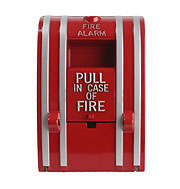

In order to best protect residents, the California fire code is updated on a regular basis. Though many of the requirements stay the same, new additions, edits, and changes are often made annually. For the average investor or builder, these can be hard to keep up with. But here at Burnham Nationwide, we make keeping up with changing codes part of our job.Our local code experts stay up-to-date on all the building, fire, and zoning regulations in the area as they change – all so you don’t have to.

##  What is new with the California fire code 2015?

We have gathered the main points right here:

-   **Roof-mounted solar panel systems must be classified** – One of the biggest changes to the California fire code in 2015 pertains to rooftop-mounted photovoltaic systems, better known as solar panel systems. As of Jan. 1, these systems must all be tested, listed, and given a fire classification rating before they can be used. Previously, these were only required on stand-alone PV systems, not mounted ones.
-   **All PV systems must be typed** – This means the type of glass, frame, backsheet, and other features must be considered before the appropriate fire rating system can be determined.
-   **Shields and skirts can help improve a PV system’s fire rating** – For builders looking to increase their fire rating, adding a leading edge deflector, also called a shield or skirt, can help. They must be installed before the system is tested.

These may not be the only changes to the California fire code 2015, so we will keep you apprised of any updates or pending changes that may be on the books in the near future. Stay tuned to [our blog](/final-review-blog/) to ensure you receive the latest updates.
