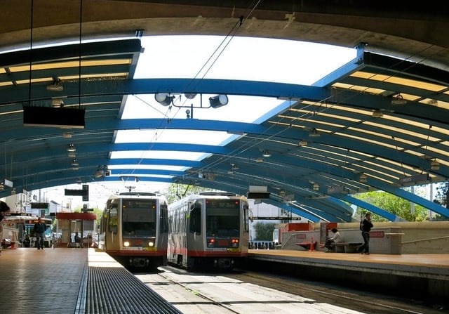

A contentious California bill is designed to increase affordable housing and sustainability by providing density bonuses for developments near transit hubs throughout the state. This latest legislative effort to solve California’s housing crisis and encourage walkable communities, [SB 827](https://leginfo.legislature.ca.gov/faces/billTextClient.xhtml?bill_id=201720180SB827), was introduced in the state senate in January 2018. The bill already faces opposition by some because its requirements would force local communities to accept denser development.

## Latest in a Series of Laws

In September of 2017, California’s Governor Brown signed into law a [group of 15 bills](/final-review-blog/californias-new-affordable-housing-laws-impact-developers/) crafted to stimulate affordable housing development. California is experiencing a state-wide housing shortage, and the new package of laws was designed to overcome barriers to development at the local level. Some of these laws will expedite project reviews, provide additional sources of funding, and make it more difficult for local communities to limit affordable housing development.

The new California transit-rich housing bonus legislation takes additional steps to stimulate affordable housing in conjunction with increasing sustainable development.

## TOD Increasing Throughout the Country

Cities across the United States are adopting zoning and policy changes to encourage transit oriented development (TOD), the building of a mixed-use community within a half-mile of a train station. Chicago, for example, has a [TOD ordinance](/final-review-blog/overview-of-chicago-transit-oriented-development/) that has been updated in the last few years to increase building near transit and more affordable housing. TOD developments are designed to support sustainability, create more affordable housing, increase access to jobs, encourage a healthier lifestyle, and lower transportation costs.

The California bill is unique because it is legislating TOD at the state level and its requirements override some local zoning restrictions.

## Senate Bill Overview

The legislation would amend Title 7 of the California Government Code (Planning and Land Use) by adding a new Chapter 4.35, Transit-Rich Housing Bonus. The bill, introduced by State Senator Scott Wiener, mandates that a local jurisdiction must grant the developer of a project near transit certain bonuses if the project meets the requirements specified in the amendments.

Under the legislation, a transit-rich housing project is one located within a half a mile radius of a major transit stop or a quarter mile of a “high-quality transit corridor,” an area with a bus route scheduled a minimum of every 15 minutes during peak hours. Specified limitations are placed on the degree to which a portion of a project may be located outside of the designated area in order to qualify as a transit-rich housing project.

The state law exempts qualifying transit-rich housing bonus developments from local laws placing limits on:

-   Residential density;
-   Floor area ratio (FAR) requirements that are more restrictive than those granted by the transit-rich housing bonus;
-   Car parking requirements;
-   Building height limitations that are lower than those granted by the transit-rich housing bonus. For a project within a quarter mile of a major transit stop or a high-quality transit corridor, the local program cannot limit the height to less than 85 feet, or 55 feet if the property is street facing and less than 70 feet wide. Projects located within a half a mile radius of a major transit stop cannot be limited to less than 55 feet high (street facing is 45 feet); and
-   Zoning that limits additions to existing buildings or lots that comply with other transit-rich housing bonus program requirements.

To be exempt from local maximum height limitations, the developer must comply with a local jurisdiction’s standards for:

-   Demolition permit requirements and cannot eliminate rent controlled units to build a new development unless the local government authorizes it;
-   Inclusionary housing ordinances such as those requiring a given percentage of units for households with low-income classes, or alternative programs such as in-lieu fees. If there is no local mandatory requirement, a voluntary incentive-based program may also apply under certain conditions;
-   Relocation assistance and benefits plan submission requirements that also meet the legislation’s requirements;
-   Zoning design standards in effect at the time of the local government application unless the local FAR is less than those listed in the legislation: (1) 2.5 FAR for a height limit of 45 feet; (2) 3.25 FAR for a height limit of 55 feet; or (3) 4.5 FAR for a height limit of 85 feet;
-   Zoning design standards that are not merely based on the subjective views of a public official; and
-   Minimum unit mix requirements so long as they don’t result in more than 40 percent of the development’s units being two or more bedrooms.

Transit-rich housing development projects must comply with local requirements for relocation benefits and assistance if the project displaces tenants, and such projects must submit a relocation and benefits plan in compliance with the legislation’s detailed requirements. The bill also has detailed procedures that must be followed once the local government approves a transit-rich housing development project’s relocation benefits and assistance plan, e.g., specific requirements regarding information that must be shared with displaced persons and assistance that must be provided.

Additionally, the project must offer displaced tenants the right to a comparable unit in the new project at a rate that can be no more than the base rent as calculated following the legislation’s guidelines.

Receipt of a transit-rich housing bonus does not preclude the project from also being eligible for a density bonus or incentive. However, the transit-rich housing bonus will serve as the base development standard for calculating density bonus eligibility.

## Opposition to the Bill

The transit-rich housing bonus legislation is still at an early stage. It was only introduced on January 3, 2018, and still remains in committee. Yet, it has already received significant pushback and was revised March 1, 2018, to accommodate concerns about the legislation encouraging development that evicts low-income residents.

A recent New York Times [article](https://www.nytimes.com/2018/03/16/business/energy-environment/climate-density.html) discussed the fact that Sierra Club opposes the bill despite its goal to increase sustainability. In the Sierra Club’s view, the legislation goes too far in controlling the local community. However, according to the article, in the opinion of the bill’s sponsor, Mr. Wiener, “local activists and homeowners too often use zoning codes to prevent apartments from being built in California’s cities, a dynamic that has worsened the state’s housing shortage.”
