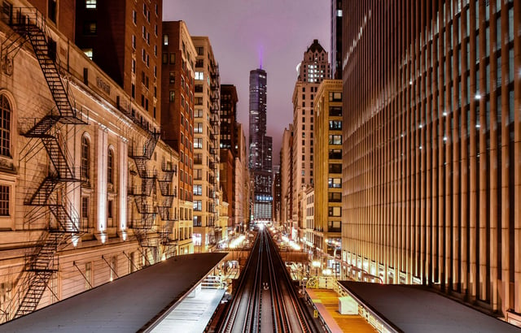

A recent program, City of Chicago: Pushing the Envelope, was designed to inspire the architectural community to do more to help Chicago meet its sustainability targets. The Illinois Green Alliance, AIA, Passive House Alliance Chicago, and Living Building Collaborative Chicago hosted the event on February 21, 2018, at the beautiful new West Loop offices of Skender Construction.

*Photo by* <em>[Pedro Lastra](https://unsplash.com/@peterlaster)</em>

Katie Kaluzny, Associate Director, Illinois Green Alliance, explained how the event grew out of prior work on initiatives such as Illinois Green Alliance’s Developers’ Roundtable and the Chicago Sustainable Development Policy. Representatives from a variety of organizations who worked on these programs continue to collaborate on Chicago sustainability initiatives. They wanted to galvanize others to become involved by sharing information about the current status of Chicago sustainability efforts

## City of Chicago Initiatives

Amy Jewel, Senior City Advisor, NRDC and IMT City Energy Project discussed some of the City of Chicago’s latest initiatives and programs. In June of 2017, Mayor Emanuel issued an [Executive Order](https://www.cityofchicago.org/content/dam/city/depts/mayor/Press%20Room/Press%20Releases/2017/May/ParisAccordEO.pdf) committing Chicago to meeting the goals of the 2015 Paris Climate Agreement, a 26-28 percent reduction in greenhouse gases from 2005 levels by 2025. Since the Trump administration called for the United State’s withdrawal from the Paris Climate Agreement, mayors from across the United States are adopting the Paris Agreement’s goals for their cities.

Chicago hosted over 50 mayors in December 2017 for the North America Climate Summit. At the summit, the mayors signed the [Chicago Climate Charter](https://www.cityofchicago.org/content/dam/city/depts/mayor/Press%20Room/Press%20Releases/2017/December/2017ChicagoClimateCharter.pdf), affirming the mayors’ pledge to meet the Paris Agreement’s goals and committing their cities, “to take aggressive action on climate.”

Ms. Jewel also highlighted the [Retrofit Chicago Energy Challenge](http://www.retrofitchicago.net/). Participating buildings voluntarily commit to reduce their energy use by 20 percent over five years and share their information. Currently, 86 buildings are part of this initiative.

Chicago’s Energy Benchmarking program recently released the [2017 Chicago Energy Benchmarking Report](https://www.cityofchicago.org/content/dam/city/progs/env/EnergyBenchmark/2017_Chicago_Energy_Benchmarking_Report.pdf). In 2017, 85 percent of large buildings reported their energy use. Chicago also [recently adopted an energy rating system](/final-review-blog/chicago-energy-benchmarking-disclosure-requirements/) and water use reporting. Beginning in 2019, buildings will be assigned a rating from 0 to 4 based on their energy performance, and the rating must be publicly visible at the building. The design of the displayed rating card is still being finalized.

Michael Berkshire of the City of Chicago’s Department of Planning and Development spoke about the [latest updates to the Chicago Sustainable Development Policy](/final-review-blog/critical-revisions-to-the-chicago-sustainable-development-policy/). Real estate development projects that receive financial assistance from the City of Chicago must comply with the policy. Previously, the policy required projects to obtain a recognized green building certification and build a green roof. The Chicago Sustainable Development Policy adopted a point based system with the 2017 updates that provides more flexibility. New developments must achieve 100 points while renovations must attain 25 - 50 points, depending on the nature of the project. Some of the city’s architects helped develop the revised policy.

Mr. Berkshire also discussed Chicago’s involvement with the [C40 Reinventing Cities Competition](http://www.c40.org/programmes/reinventing_cities). Participating cities provide underutilized areas and via a competition, choose private parties to develop the properties in a sustainable manner. Chicago currently has two selected sites and is embarking on the process of selecting bids.Those interested in participating will find updated information on the city’s [website page devoted to the competition](https://www.cityofchicago.org/city/en/depts/dcd/supp_info/c40-reinventing-cities-competition.html).

## AIA 2030

Arathi Gowda, SOM Associate Director, and Scott Farbman, Building Performance Analyst, dbHMS, spoke about [AIA’s 2030 Challenge](http://architecture2030.org/2030_challenges/2030-challenge/) (AIA 2030), calling on architects and the building community to adopt as standard practice designing all new buildings and major building renovations as carbon-neutral by 2030. AIA 2030 also sets interim targets, such as those for fossil fuel reductions of 80 percent by 2020 and 90 percent by 2025.

The initiative helps architects see how design impacts energy use and encourages them to take a leadership role in decreasing greenhouse gas emissions. An important component of AIA 2030 is architects’ and their firms’ commitment to collect Predicted Energy Use Intensity (pEUI) data for each project and submit it to a portal. The pEUI data enables architects to compare projects in the same category and see what they should be attaining.

At this time, there are 23 Chicago firms that are participating in AIA 2030. In Chicago and nationally, the average pEUI savings has only been 42% despite the target of 70% or more by 2015. Also, there are still too many projects that are not being modeled. Yet, increases in pEUI are being seen, more firms are joining AIA 2030, and there is still optimism that the AIA 2030 goals are achievable. The AIA Chicago 2030 Working Group offers support and is trying to encourage additional firms to participate in the initiative.

## AIA COTE Chicago

Jason Sippel, Sustainability Specialist, Solomon Cordwell Buenz, spoke on behalf of the AIA Committee on the Environment and highlighted some Chicago high-performance building designs, one being Loyola University’s Richard J. Klarchek Information Commons. Mr. Sipple pointed out that replicating what was done at a university is more difficult in the private sector because one needs to convince developers and investors of the value of the investing in a sustainable building. However, businesses increasingly have sustainability policies and this may encourage more sustainable development.

## Passive House Alliance Chicago

Tony Holub, Senior Associate, Farr Associates and Tim Zelazny, Senior Associate, ESD led a presentation about buildings designed to use the [Passive House Institute US (PHIUS](http://www.phius.org/home-page)) standards to achieve a high level of energy efficiency. Even though the organization’s name is “Passive House,” their methods may also apply to skyscrapers and other building types. The PHIUS standards provide considerable design freedom and can be used to attain the AIA 2030 goals.

In 2012, Chicago had more LEED-certified projects than any other municipality. However, we are “resting on our laurels,” and other cities are passing us by in the number of sustainable buildings. New York City, for example, has many more PHIUS projects than Chicago.

There are some PHIUS projects in Chicago, but there are obstacles that need to be overcome and incentives Chicago should adopt to increase the number of PHIUS projects. The [Passive House Alliance Chicago](https://www.meetup.com/Passive-House-Alliance-Chicago/?_cookie-check=N0JBIOv47ERhq4H3) has regular meetings and classes. They are encouraging more architects to be trained in the PHIUS standards, and they also provide support through their meetings.

## Need for Chicago Architects to be More Active

During the question and answer portion of the event, a number of architects expressed their disappointment that Chicago isn’t further along in developing sustainable buildings and more of the city’s architects haven’t committed to participating in AIA’s 2030 Challenge. The event was definitely a wake-up call for some in the Chicago architectural community.

The presenters and others called on their fellow architects to get more involved in working on greater sustainability in Chicago projects.The event sponsors are organizing committees to work on five initiatives in the short-term: (1) mitigating climate change; (2) airtightness; (3) permitting and /or zoning variances for deep green; (4) training and education for deep green; and (5) research. If you are interested in volunteering for any of these committees, please contact Katie Kaluzny: [kkaluzny@illinoisgreenalliance.org](mailto:kkaluzny@illinoisgreenalliance.org).
