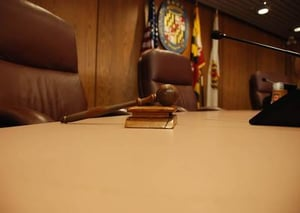

Let the experts that City employee’s know by name represent and resolve your violations.

Receiving a Notice of Violation from a City of Chicago inspector can be unsettling for any business owner. Whether it’s a building, zoning, or fire code violation the hearings can be intimidating or even overwhelming; first offense or not. Yes, the City of Chicago offers resources on what to expect during the [Hearing Process](https://www.chicago.gov/city/en/depts/ah/supp_info/the_hearing_process.html) and provides an array of [resources](https://www.chicago.gov/city/en/depts/ah.html) for basic how to’s; but when it comes down to it, if a notice violation has been issued, it means something has been lost in translation.

The Administrative Hearing Process was [established in 1997](https://digitalcommons.pepperdine.edu/cgi/viewcontent.cgi?article=1274&context=naalj) to allow persons charged with ordinance violations to have access to a process that is *less intimidating* and **more efficient** than going to court. During this time, Burnham Nationwide offered their services to assist in correcting any issues. That all changed in 2014, when the Illinois Appellate Court determined that [legal entities](https://www.hmblaw.com/media/83274/stone_street_partners_llc_vs._the_city_of_chicago_department_of_administrative_hearings.pdf) (Limited Liability Corporations and corporations) could not represent themselves, therefore must be represented by an attorney.

In 2017, the (Illinois Supreme Court) City of Chicago took a step back and realized that the reason administrative hearings were in place, were to eliminate that “court” environment. If the point of having an Administrative Hearing was to make the process *less intimidating* and **more efficient**, there would be no need for an attorney’s assistance throughout the process.

Today, we’re able to offer our assistance once again. We work on similar projects and interact with city officials on a daily basis, giving us a head start in helping. If you have received a Building Notice of Violation and need assistance please feel free to reach out to our team!

Contact us for a consultation on future plans or for site services on your active projects.

Can a non-attorney like a permit expediter still represent an LLC or corporation at a Chicago administrative hearing today? It's legally ambiguous and risky. The 2014 Appellate Court ruled corporations must have attorney representation. The 2017 Illinois Supreme Court decision described in this post as resolving the issue actually declined to decide whether non-attorneys can represent corporations at administrative hearings - it resolved the case on narrower grounds - so the underlying question hasn't been definitively answered by the Supreme Court. What is Chicago's Department of Administrative Hearings, and what types of violations does it handle? It's a quasi-judicial city agency that handles building, zoning, fire code, and other municipal ordinance violations - about 70 contracted Administrative Law Judges (all licensed Illinois attorneys with at least three years of practice) conduct hearings at three city facilities. Why were Chicago's administrative hearings established in the first place? The system was created in 1997 specifically to give people charged with municipal ordinance violations a process less intimidating and more efficient than going to court - the goal was a faster, simpler alternative to the circuit court system. What are the risks of ignoring a Notice of Violation from a Chicago inspector? Missing a hearing typically results in a default judgment against you, which can impose penalties, place liens on property, and create barriers to future permit applications and license renewals - the consequences compound significantly the longer a violation goes unresolved. What's the benefit of having a permit expediter involved in resolving a building violation, even if an attorney is ultimately required? Permit expediters who regularly interact with city departments often know the fastest path to actually correcting the underlying violation - getting the work done, inspected, and signed off - which may resolve the matter before a hearing is even needed, since violations can often be non-suited once corrected.
