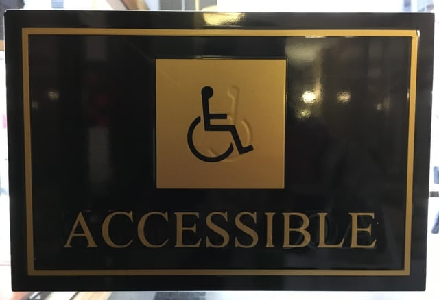

New Chicago Human Rights Ordinance disability rights regulations governing accessibility will go into effect on July 1, 2017. Promulgated to provide greater clarity and alignment with federal requirements, these new regulations govern the accessibility of facilities, goods, and services of public accommodations. This post will specifically focus on the components of the new regulations governing accessible design.

## Chicago Human Rights Ordinance

The [Chicago Human Rights Ordinance](https://www.cityofchicago.org/content/dam/city/depts/cchr/AdjSupportingInfo/AdjFORMS/OrdinanceBooklet2012.pdf) (Ordinance) prohibits discrimination by public accommodations. It defines public accommodation as a place that “sells, leases, provides, or offers any product, facility or service to the general public.”

Included in the Ordinance’s prohibitions is discrimination against those with disabilities, and the Ordinance defines disability as “a determinable physical or mental characteristic which may result from disease, injury, congenital condition of birth or functional disorder.”

Similar to the [Americans with Disabilities Act](https://www.ada.gov/pubs/adastatute08.htm) (ADA), the federal law prohibiting discrimination against people with disabilities, the Ordinance also includes as a disability the history of a disability characteristic and the perception of a disability by the person accused of discrimination. The ADA provides details and rules of construction not found in the Ordinance’s definition of disability.

A violator of the Ordinance can be fined from $100 to $500 per offense and each date that the violation continues is considered a separate offense.

The [Chicago Commission on Human Relations](https://www.cityofchicago.org/city/en/depts/cchr.html) (CCHR) is responsible for implementing and enforcing the Chicago Human Rights Ordinance. Therefore, the CCHR develops the specific regulations necessary to carry out the Ordinance’s mandates.

## Prior Disability Rights Regulation of Public Accommodations

Before enacting the new disability rights regulations, Chicago relied on rules that applied to discrimination against members of any protected classes, including people with disabilities. Part 500 of the regulations implementing the Chicago Human Rights Ordinance, [Discrimination of Place of Public Accommodation](https://www.cityofchicago.org/content/dam/city/depts/cchr/AdjSupportingInfo/AdjFORMS/2016AdjForms/2016CCHRRegsUpdate.pdf), required public accommodations to “fully accommodate” someone with a disability unless it caused “undue hardship.” If they did create such hardship, then the public accommodation must “reasonably accommodate” the person with a disability unless that also caused undue hardship. The regulations also contained a standard for determining undue hardship.

These earlier Chicago disability rights regulations did not provide the detailed standards necessary for determining how public accommodations were to achieve compliance. Furthermore, the regulations did not always align with the ADA’s requirements.

Title III of the ADA specifically prohibits discrimination by private entities operating as places of public accommodation and commercial facilities. The federal statute has implementing regulations, the 2010 Standards for Accessible Design, containing specific scoping and technical requirements. Public accommodations and commercial facilities in Chicago must comply with the ADA and its regulations as well as the Chicago and Illinois requirements. Thus, inconsistencies between the federal and Chicago requirements can pose problems.

## New Disability Rights Regulations

In January of 2017, the [CCHR Board of Commissioners approved](https://www.cityofchicago.org/city/en/depts/cchr/provdrs/discrim/news/2017/january/DisabilityRegsPR.html) new disability rights regulations pursuant to the Ordinance, new Part 600, [Discrimination on the Basis of Disability in Public Accommodations and Commercial Facilities](https://www.cityofchicago.org/content/dam/city/depts/cchr/AdjSupportingInfo/AdjFORMS/2017AdjForms/CHRORegsPart600616eff7117.pdf). The new regulations, effective July 1, 2017, provide more detailed requirements and better align with ADA Title III. However, they also contain requirements in addition to those governing accessible design.

For accessible design purposes and similar to the ADA Title III, the new regulations now apply to both public accommodations and commercial facilities. They introduce a definition of commercial facilities which excludes amongst other things facilities under the federal Fair Housing Act of 1968.

The new rules also clarify that it is the responsibility of both landlords and tenants to make public accommodations accessible unless a contract specifically allocates responsibility.

### Existing Facilities

As does the ADA, the new regulations require that existing facilities, those in existence on the regulations’ effective date of July 1, 2017, remove architectural barriers when it is “readily achievable” and provide examples of different types of barrier removal.

The new requirements adopt the ADA’s definition of readily achievable as “easily accomplishable and able to be carried out without much expense” and lists factors to be considered in determining whether barrier removal is readily achievable.The regulations also require that barrier removal is accomplished according to the regulation’s stated list of priorities

When barrier removal is demonstrated to not be readily achievable, alternative methods must be provided unless they are not readily achievable. The regulations also contain examples of such alternatives.

A specific provision requires an existing assembly area include wheelchair seating in compliance with the regulation’s new construction requirements and the Chicago Building Code (CBC) when readily achievable. Additionally, wheelchair spaces and companion seating must also be available in spectator sections with specialty services.

### New Construction

A facility built for first occupancy after June 30, 2017, meaning the last building permit application was received by the City after that date, must be “readily accessible and usable by individuals with disabilities.” Compliance with this requirement will be achieved by designing and constructing buildings according to the CBC’s design and construction accessibility requirements, Chicago Code Chapter 18-11.

Exceptions to these requirements are: (1) the completely residential portion of a commercial facility in a private residence; (2) cases of demonstrated structural impracticability; and (3) the provision of elevators in certain specified circumstances.

### Alterations

Alterations to public accommodations or commercial facilities after June 30, 2017, must also provide accessibility “to the maximum extent feasible,” meaning the alteration will provide what is feasible in the rare circumstances when it is impossible to meet the standards. An alteration is a change that “affects or could affect the usability” of the facility such as remodels, renovations, and historic restorations.

Similar to new construction, an alteration designed and constructed in compliance with Chicago Code Chapter 18-11 is considered to be accessible for the purposes of the new regulations.

The regulations also contain provisions governing the alteration of paths of travel, “a continuous, unobstructed way of pedestrian passage” and also includes such items serving these areas such as “restrooms, telephones, and drinking fountains.” When an alteration affects a path of travel that serves the primary function (the “major activity”) of the facility, the alteration must be accessible unless the cost to make it accessible is disproportionate to the entire alteration cost.

The accessible path of travel cost is considered disproportionate if it exceeds 20% of the primary function area alteration cost, and in such instances, the path of travel is required to only be accessible to the degree it doesn’t result in disproportionate costs. Also, the accessibility requirements for alterations of paths of travel may not be circumvented by making a series of smaller alterations. The provision of elevators in some circumstances may be exempt from the accessible path of travel requirements.

If a tenant makes alterations that affect a path of travel serving a primary function area but are limited to the tenant’s area, it does not create an obligation for the landlord to make changes to any of their unaltered areas.

Alterations of facilities designated as historic under federal, state, or local laws are required to comply with Chicago Code Chapter 18-11 to the maximum extent feasible. However, if making the facility accessible could threaten its historic significance, alternative forms of accessibility may be used.

The regulations also incorporate the CBC specific accessibility requirements for the new construction or alteration of places of transient lodging, social service centers, places of education, assembly areas, and medical facilities.

## Complying With the Chicago Disability Rights Regulations and the ADA

Although the Chicago Human Rights Ordinance’s new disability rights requirements do a better job of aligning with the federal requirements, there is still plenty of potential for conflict. The new Chicago regulations require compliance with Chicago Code Chapter 18-11 which has differences from the ADA Title III’s regulations, the 2010 Standards for Accessible Design and the Illinois Accessibility Code (IAC), 1997 edition. We look forward to future revisions to the Chicago Building Code and IAC that will make it easier to simultaneously comply with both the federal and local accessibility requirements.

<em>It should be noted that the version of the new regulations available to us at the time of publication and linked to in the post contains the correct effective date in the header but incorrect dates in the text of the regulations.</em>
