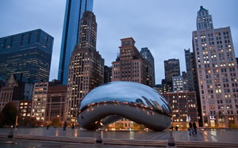

Nearly every major city in the United States, including New York City, has adopted some form of the [International Building Code (IBC)](/final-review-blog/should-chicago-adopt-the-iccs-international-building-code-ibc/). First published by the International Code Council (ICC), model building codes are regularly updated on a three-year cycle. There has been an ongoing discussion regarding the adoption process in the City of Chicago.

Since the early 20th century, the U.S. has used a diverse of regional building codes, but it was not until the development of the IBC between 1997-2000 that standards became more uniform across the country. The IBC sets design criteria for building life safety, construction types, accessibility and special construction.

The IBC is applicable to the construction of new buildings and/or alterations to existing structures. Generally, codes are not retroactive except to mitigate impending hazards. In a city like Chicago, where there is a tremendous amount of growth, it would be beneficial to have a standard set of building codes modified to fit the City’s needs and requirements.

If the IBC is adopted, architects, engineers, designers, developers, builders, and contractors would have a better understanding of the codes pertaining to new construction in the city. This would save time and cost for everyone involved. The IBC is regularly updated to include current materials, technologies, and methods, which can be catered to the city’s unique conditions.  

When it comes to Chicago, there is already a movement of progressiveness present in many facets of the city life and culture. The adoption of the International Building Code would propel the city to greater heights. Connect with our experts to [ask us any questions](/contact/) on the IBC and how it applies to your construction or renovation projects, and [follow our blog](/final-review-blog/) for the latest industry news and updates!
