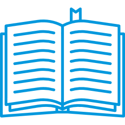

Last week, the City of Chicago’s Department of Building introduced an ordinance to modernize the current construction code. What some may not know is that this modernization is over 20 years in the making.

**The Background**

The City of Chicago Council adopted its first code in 1875, four years after the Great Chicago Fire, to administer code with the goal to reduce fire and disease. In 1893, Chicago City Council adopted a new building code and established the Department of Buildings. When established, reformers were not satisfied and problems remained; issues like [corruption and lack of funding](http://www.encyclopedia.chicagohistory.org/pages/179.html) made it hard for the city to move forward. It would not be until 1949 that Chicago would receive its last comprehensive revision to the building code. The updates included code language, construction equipment and products that were being used nationwide. It would be another 40 plus years until a proposed revision would be brought up again.

**They Come In Waves**

In 1998, the [“first wave”](https://www.chicagotribune.com/news/ct-xpm-1998-12-25-9812250191-story.html) to modernize the Chicago Code took place under Director of Code Review Harold Olin, FAIA. The Department’s goal was to update the “antiquated standards and sections that did not make sense anymore.” Extensive research and studies lead the proposed ordinance to be presented in 2004 where it failed to gather sufficient  support across Departments. The second wave was led by Director of Code Development, Elizabeth Scanlan, AIA in 2010 but lost momentum in 2011.

Then in November or 2015, “The Merits of Moving the International Building Code (IBC)”, co-sponsored by  AIA Chicago and BOMA/Chicago, took place in an effort to promote the adoption of the IBC for Chicago. At the event speakers, including Burnham’s [Chris Chwedyk](https://www.linkedin.com/in/christopher-chwedyk-b3b606a/), provided [information](https://www.slideshare.net/RachelSalvato/the-merits-of-moving-to-the-ibc) on how to transition from self-written building codes to the IBC, resources and support that would be available to help adopt the IBC, and challenges and potential benefits of adopting it. Being the last major city in the United States to adopt the change, Chicago needed [all of the support](/final-review-blog/should-chicago-adopt-the-iccs-international-building-code-ibc/) it could get to move this approach forward.

**Phasing it Out**

After the seemingly failed attempt to get some traction to adopt the IBC, a new approach was presented by the Department of Buildings, the goal being “To better align the City of Chicago’s construction requirements with up-to-date model codes and standards used in other major US jurisdictions while maintaining long standing local requirements that are adapted to the unique conditions in Chicago.” The Department of Buildings plans to  modernize the code, by breaking it down into three phases that will extend over the next several years.

The first phase of modernizing Chicago’s Code began in 2016 with a focus on updating the Electrical Code and Conveyance Device Code with the help of the National Fire Protection Association [(NFPA)](https://www.nfpa.org/product/nfpa-70-national-electrical-code-nec/p0070code). The Department of Buildings worked with a team of elevator industry representatives and drafted their requirements based on the 2016 *Safety Code for Elevators and Escalators*. When it came to the electrical code, the department worked with a team of representatives that included electricians, contractors, engineers, ComEd and the Fire Department to align with the 2017 <em>National Electrical Code.</em> Due to the broad support of both code updates, city council adopted the changes and the requirements are now in effect.

The second phase of the implementation is what’s currently going through City Council, which includes updating the core construction, renovation requirements and property maintenance standards. The City of Chicago plans on aligning their current code with the International Building Code (IBC) and relating model codes with those of the International Code Council (ICC). If the ordinance passes, it will take approximately 6 months to implement, followed by 6-9 month transition period, and conclude with an anticipated phase two completion date in 2020.

The third phase of the implementation calls for updating plumbing, mechanical, natural gas and energy efficiency requirements which have not been updated since the early 2000s. The last phase plans to include further updates to streamline construction trade licensing provisions and regulation of signs. This phase is subject to change depending on the Department’s experience of phase 2.

**What’s Next**

Now that the ordinance has been introduced to City Council and has been referred to committee for hearings, the plan is to be “recommended” in favorable action, to then be returned to City Council for a final vote. Follow us to learn how these new codes will impact your new construction projects.

The city plans to begin implementation summer 2019 and complete by August 2020. If the ordinance is adopted, a pilot program will begin in August 2019 initiated by the [Department of Buildings](https://www.youtube.com/watch?v=tW1Xa02MUqQ) on a volunteer basis for projects choosing to use the new code to act as test subjects for plan examination training purposes.

At Burnham Nationwide, we specialize in conducting plan reviews for code compliance. Contact us for a consultation on future plans or for site services on your active projects.

Did Chicago's Building Code modernization actually happen, and is it in effect today? Yes - Phase 2 (the core construction, renovation, and property maintenance update) was adopted by City Council in 2019 and took effect August 2019, with the transition period running through 2020. Chicago is no longer the last major U.S. city operating on a fully self-written building code. What happened to Phase 3 - plumbing, mechanical, natural gas, and energy? It's still ongoing. Chicago adopted energy code updates separately (the 2022 Chicago Energy Transformation Code, covered elsewhere in this blog), and the Department of Buildings continues to issue periodic supplements to the 2019 CBC. Full Phase 3 completion hasn't followed a clean schedule, which this post did acknowledge was subject to change. How long did it actually take to modernize Chicago's building code from first proposal to adoption? Roughly 20 years of formal effort - the first wave began in 1998, the ordinance ultimately passed in 2019. The Great Chicago Fire of 1871 prompted the original 1875 code, and 1949 was Chicago's last comprehensive revision before the 2019 modernization. Why was it significant that Chicago was the last major U.S. city to adopt the IBC? Architects, engineers, and contractors working across multiple jurisdictions had to learn Chicago-specific code language that didn't align with the nationally-standard IBC they used everywhere else - creating efficiency costs, higher risk of errors, and barriers to bringing outside design expertise into the city. How does the current Chicago Building Code differ from a straight adoption of the IBC? Chicago adopted the IBC as a base but retained numerous local amendments adapting it to Chicago-specific conditions (soil, weather, historical construction practices, local industry requirements) - the color/style coding system in the published code (blue text for Chicago-specific provisions) makes it possible to identify where Chicago departs from the national model code baseline.
