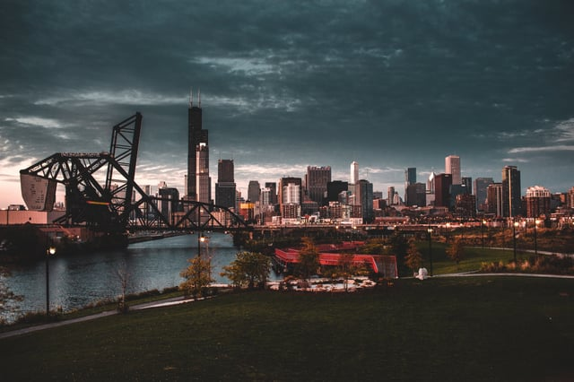

The City of Chicago’s Department of Buildings (DOB) utilizes the [Chicago Building Code](https://www.cityofchicago.org/city/en/depts/bldgs/provdrs/inspect/svcs/chicago_buildingcodeonline.html) for all permitting. The City offers multiple plan review tracks: Easy Permit Process, Standard Plan Review, and the Developer Services Program to manage projects of different scopes and review requirements. Direct Developer Services - a subset of Developer Services - is also available for major redevelopments.  Additionally, Chicago has a Green Permit Program, and the DOB continues to accept projects into the [Self-Certification Permit Program](/final-review-blog/what-to-know-about-the-self-certification-program-in-chicago/) (the Program).

## <em>image via [Steven Wang](https://unsplash.com/photos/upmNZcqtvRM)</em>

## Changes to the Self-Certification Process

By opting into the Self-Certification Program, the Design Professional of Record assumes responsibility for plan review and code compliance for the submitted project. The Program continues to grow, and in December 2017, DOB announced [new rules](https://www.cityofchicago.org/content/dam/city/depts/bldgs/general/Rules%20and%20Regs/SelfCert_Permit_Program_Amended_Rules_FOR_POSTING.pdf) for the process that became effective January 1, 2018.  

The 2018 changes expand the Program to include additional project types. Residential new construction and alterations, single-occupancy non-residential new construction and alterations, and some institutional and school (C-3) projects may now utilize Self-Certification. Additionally, the rules introduce new requirements for registrants. Registered Design Professionals are subject to an audit process for deficiencies including incomplete applications, plans with non-compliant conditions, or false statements which may result in suspension or disqualification after multiple deficiencies.

Regardless of review track, DOB requires that all projects be submitted using [E-Plan](https://www.cityofchicago.org/content/dam/city/depts/bldgs/general/SPR/StandardPlanReviewFlowChart2017.pdf), the City’s electronic submittal process unless submitted over the counter. All plans must be signed and sealed by a licensed Design Professional to be submitted electronically and some projects may require a separate [Structural Peer Reviewer’s Report](https://www.cityofchicago.org/city/en/depts/bldgs/supp_info/structural_peer_reviewprogramoverview.html).

## Easy Permit Process

[Easy Permit Process](https://www.cityofchicago.org/city/en/depts/bldgs/provdrs/permit_proc.html) (EPP) for simple residential and commercial projects, most often “repair-or-replace” permits and other minor projects such as drywall replacement, door and window replacement, and electrical work.

For qualifying projects, plans examiners complete their reviews immediately, and the project is routed to Final Review for same-day processing by DOB staff . Any Easy Permits are paid for at the Department of Revenue counter once ready for issuance.

## Standard Plan Review

The majority of commercial and residential projects qualify for [Standard Plan Review](https://www.cityofchicago.org/city/en/depts/bldgs/provdrs/stand_plan.html) (SPR), the core review track at the Department of Buildings. SPR encompasses a variety of projects including new construction, interior alterations and tenant finish projects, and excavation projects.

Standard Plan Review requires up to 13 departmental reviews. Projects may be routed to other agencies including the Chicago Department of Transportation, the Mayor’s Office for People with Disabilities, and the Office of Underground Coordination. All Standard Plan Review projects must receive Zoning approval from the Chicago Department of Planning and Development as a part of the DOB review process, and other external reviews may be required based on project scope.

Once submitted to the DOB via E-Plan, each permit is assigned to a City Project Manager who facilitates all technical reviews. The Project Manager serves as a single point of contact at DOB throughout the permitting process.

## Developer Services and Direct Developer Services

The City of Chicago Department of Building’s Developer Services [process](https://www.cityofchicago.org/city/en/depts/bldgs/provdrs/dev_svcs.html) addresses the needs of major new construction and other large scale projects. During a Developer Services submittal, construction plans are reviewed by a third party consultant reviewer assigned by the City negotiated through a single point of contact at the DOB (“Project Administrator”.) Though some projects are required to be submitted through the Direct Developer Services partner program and others may elect to use the program, all submittals are subject to an additional review fee upon permit issuance.

#### Projects that meet the following criteria are required to use the Developer Services Program:

-   Building greater than 80 feet tall
-   Business and mercantile projects greater than 150,000 square feet
-   Residential projects with more than 50 dwelling units
-   Gut rehab projects with 50 units or more
-   School projects greater than 60,000 square feet
-   Projects that require two levels of basement or deeper, and in addition, use earth retention systems

Direct Developer Services further reduces the time required by DOB staff to review plans by allowing the project team to select the third-party plan reviewer via a bidding process. Once a consultant has been selected, plans are then reviewed by the third-party for structural compliance and other approved reviews. Direct Developer Services is frequently used for major new construction including new skyscrapers and redevelopments.

## Green Permit Process

The City of Chicago [leads the country](http://www.chicagobusiness.com/realestate/20170706/CRED03/170709964/when-it-comes-to-green-chicagos-in-the-lead) in green office space. Sixty-six percent of all Chicago office space is Energy Star or LEED certified, and DOB incentivizes the use of green technology for residential, commercial, and industrial projects.

The City of Chicago’s [Green Permit Process](https://www.cityofchicago.org/city/en/depts/bldgs/supp_info/overview_of_the_greenpermitprogram.html) expedites submittals of qualifying projects and may also qualify for reduced permit fees. In order to be eligible the program and receive incentives, projects must meet DOB criteria and incorporate “Green Menu” items in construction:

-   Projects that include only green roofs, rainwater harvesting, solar panels, wind turbine, and geothermal systems are *required* to be submitted through the Green Permit Process
-   Commercial projects must earn LEED certifications
-   Small residential projects must earn a Chicago Green Homes Program rating certification or LEED for Homes designation
-   Projects must incorporate green strategies or green technologies to qualify

Applicants must meet with a DOB Project Administrator before filing a permit using the Green Permit Process and acceptance is not guaranteed. The program is most often used for smaller projects where it is required, such as sollar installations and green roofs.

## 2018 Changes to the Structural Peer Review Program

The [Structural Peer Review Program](https://www.cityofchicago.org/city/en/depts/bldgs/supp_info/structural_peer_reviewprogramoverview.html) (SPRP) is open to qualifying projects and allows applicants to complete structural review using an external reviewer from the City’s approved list, reducing review times.

The City’s [new rules](https://www.cityofchicago.org/content/dam/city/depts/dol/rulesandregs/StructuralPeerReviewProgramRules.pdf) for the SPRP program went into effect January 1st, 2018 and include changes for registered design professionals, including a rule that all reviewers must provide proof of license as part of the Structural Peer Review Report.

As the 2018 program changes go into effect, we will continue to provide updates to DOB rules and requirements. Read our [blog post](/final-review-blog/the-three-different-types-of-chicago-plan-reviews/) to learn more details about the different Chicago Plan Reviews. As always, the Burnham Nationwide team is always available to answer questions and manage permit filings of any scope.
