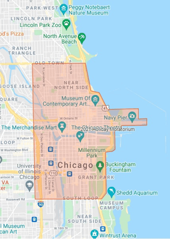

The holiday season is fast approaching, and Chicago, with many major municipalities, typically issue a temporary moratorium for activities affecting the public way to promote full access to stores, restaurants and businesses. This year the Chicago Department of Transportation (CDOT) has set the dates and boundaries per official memo issued by Deputy Commissioner Jai Kalayil, Department of Transportation, Division of Infrastructure Management.

Friday, November 21, 2025 4:00 p.m. - Friday, January 2, 2025 at 9:30 a.m.  

 What type of work is effected:

“No street openings or traffic obstructions, except for emergencies, shall be allowed within the moratorium boundaries.”

“All existing permits within the moratorium boundaries will be automatically revoked. Restrictions will not be lifted for any non-emergency work without permission from CDOT’s Permit Office.”

 Moratorium Boundaries:

“Beginning at the easternmost point of North Avenue extending to Lake Michigan, west on North Avenue to Halsted Street; then south on Halsted Street to Roosevelt Road; then east on Roosevelt Road to its easternmost point extending to Lake Michigan.”

\*Post Moratorium Considerations:

“Any work performed from January 2, 2026 through April 1, 2026 shall be subject to criteria acceptable for snow removal and control operations. Specifically, all plates in the public right of way must be collected prior to the commencement of snow operations. If plates cannot be removed, or new plates must be installed, please immediately notify the snow operations unit by phone (312) 746-8630 or [email.](mailto:OEMCCICD@cityofchicago.org) 

When is Chicago's holiday construction moratorium in effect? This year's moratorium runs from 4:00 p.m. on Friday, November 21, 2025, through 9:30 a.m. in early January 2026, as set by CDOT's Division of Infrastructure Management. What areas of Chicago are covered by the construction moratorium? The boundary runs from the easternmost point of North Avenue (at Lake Michigan) west to Halsted Street, south on Halsted to Roosevelt Road, then east on Roosevelt back to Lake Michigan - covering much of Chicago's downtown core. What happens to existing construction permits during the moratorium? All existing permits within the moratorium boundaries are automatically revoked. Non-emergency work cannot resume during this period without specific permission from CDOT's Permit Office. Are emergency repairs allowed during the Chicago construction moratorium? Yes, the moratorium prohibits street openings and traffic obstructions except for emergencies. Routine or planned work must wait until the moratorium lifts unless CDOT grants an exception. What rules apply to construction right after the moratorium ends? From the moratorium's end through April 1, work becomes subject to snow removal and control requirements - meaning any steel plates placed in the public right-of-way must be cleared before snow operations begin, or the city's snow operations unit must be notified immediately if plates can't be removed or new ones need to be installed.
