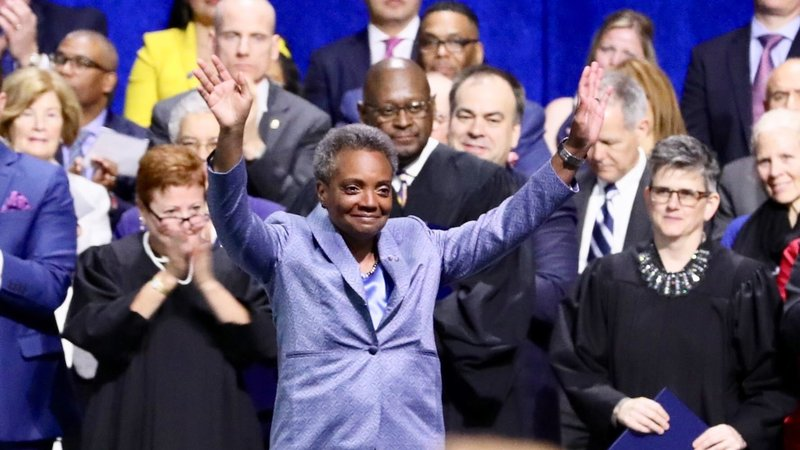

Chicago’s new mayor, Lori Lightfoot, has had a productive first week in office following her inauguration ceremony on May 20, by signing off on her [first executive order](https://news.wttw.com/sites/default/files/article/file-attachments/Executive%20Order%20No.%202019-2_0.pdf) which plans to eliminate Aldermanic Privilege, or Aldermanic Prerogative. Mayor Lightfoot set the tone after taking the oath of office [and proclaiming](https://chicago.suntimes.com/2019/5/20/18632430/lori-lightfoot-mayor-inauguration-council) “I campaigned on change. You voted for change. And I plan to deliver change to our government.”

[Image by Manuel Martinez/WBEZ](https://www.npr.org/2019/05/20/724951238/capping-a-stunning-political-rise-chicago-to-inaugurate-lori-lightfoot-as-mayor)

Aldermanic Prerogative is a Chicago unwritten rule where Aldermen have the final say in what can or cannot be zoned or built in their given ward. Lightfoot believes that this gives Aldermen too much power and can lead to corruption. Those opposing this new change, believe that the Aldermen speak for the people in their ward, and this would limit ‘the voice of the people’ their alderman represent. The order states that Aldermen will still have a say on the project - they just won’t be able to veto.

<strong>What does this mean for future projects?</strong>

It’s business as usual for Burnahm. Changes will come to the city departments who will have to submit a sixty-day report that will review historical practices and make sure the content provided is true and accurate.

Burnham will keep you up to date with what new changes are implemented and how they may affect you and your construction or licensing plans. Mayor Lightfoot’s first City Council meeting is May 29, and this is likely the first of many campaign reforms she will implement; proclaiming that the new order was “the first step in a comprehensive ethics reform package to reform the way government works in Chicago.”

Did Lori Lightfoot's 2019 executive order actually end aldermanic prerogative? No — despite the announcement this post describes, aldermanic prerogative remained functionally intact throughout Lightfoot's term and continues under Mayor Brandon Johnson today. It's an unwritten custom, not a codified law, so an executive order alone couldn't eliminate it, and the City Council never passed the legislative changes that would have been required. Is aldermanic prerogative still a factor in Chicago development projects today? Yes, actively. In 2025, a major 500-unit housing development (Old Town Canvas) was blocked outright by a local alderman citing prerogative; separately, Mayor Johnson successfully challenged the custom to win approval for a 615-unit Lincoln Park project — only the second time in recent years a high-profile project was approved over a local alderman's explicit objection. Has the federal government weighed in on aldermanic prerogative? Yes — a 2023 HUD investigation found that aldermanic prerogative fuels segregation in Chicago and violates the civil rights of Black and Latino residents by limiting affordable housing development, calling the practice a tool that deters integrated, affordable housing citywide. Negotiations over a corrective agreement were ongoing as of mid-2025. Does aldermanic prerogative apply to sign permits and public way permits, or only to zoning? It extends well beyond zoning — aldermanic approval remains part of the process for sign permits over the public way, Grant of Privilege permits, loading and standing zones, parking regulations, sidewalk café permits, and outdoor dining permits, as described across multiple Burnham posts in this blog. Has Mayor Johnson taken any formal steps to limit aldermanic power over development? Mayor Johnson's "Cut the Tape" initiative (launched 2024-2025) aims to streamline permit and construction approvals by reducing bureaucratic barriers — including some that aldermanic prerogative enables — though the core practice itself remains unchanged without full City Council action to revise Chicago's zoning and planning procedures legislatively.
