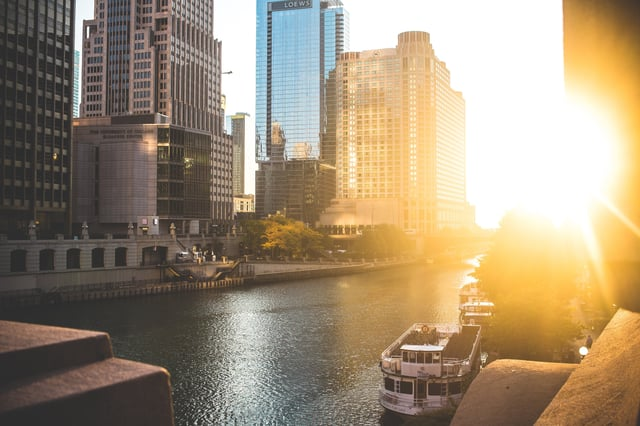
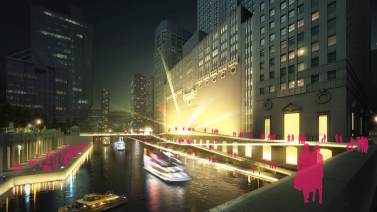
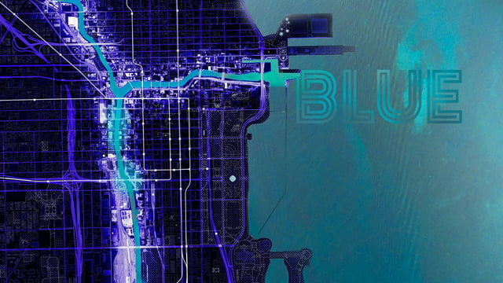

Chicago’s “second coast” boasts [a new riverwalk](/final-review-blog/a-cultural-hub-on-chicagos-second-waterfront/) downtown and plans for [major redevelopment](/final-review-blog/chicago-north-branch-corridor/) of the industrial corridor along the Chicago River’s North Branch. The City of Chicago Department of Planning and Development (DPD), in a collaboration with the Metropolitan Planning Council (MPC) and Chicago Architecture Biennial, explores the river’s potential by inviting nine world-class architecture firms along the South Branch. <em>image credit: [Steven Wang](https://unsplash.com/photos/q4m7Nk157u4?utm_content=creditCopyText&utm_medium=referral&utm_source=unsplash)</em>

## Enlivening, Accessing the South Branch

The Chicago River Edge Ideas Lab (the Lab) is nine firms: Ross Barney Architects, Skidmore, Owings, & Merrill (SOM), James Corner Field Operations, site design group, ltd (site), Sasaki, Studio Gang, Adjaye Associates, SWA, and Perkins + Will with partner Omni Ecosystems. Each firm will create continuous, accessible pedestrian and bicycle paths that incorporate landscaping, art, and lighting.

[Three South Branch sites](https://www.chiriverlab.com/sites/civic-opera-edge) are the Lab’s focus and have unique attributes and challenges: Civic Opera Edge, Congress Parkway Edge, and Air Line Bridge Edge.

### The Civic Opera Edge

The Civic Opera Edge is part of the downtown canyon, with the historic Civic Opera and Riverside Plaza Buildings on the east and west sides respectively. Unlike the Chicago Riverwalk to the north, the Civic Opera Edge site’s challenge is to create a human-scale, continuous path where buildings directly front the river.<em>image credit: [Lyric Opera Landing - SOM via River Edge Ideas Lab](https://www.chiriverlab.com/visions/river-rooms-of-light-life)</em>

Proposals such as SOM’s [Lyric Opera Landing](https://www.chiriverlab.com/ideas/lyric-opera-landing) and Ross Barney Architects’ [Lyric Colonnade](https://www.chiriverlab.com/ideas/lyric-colonnade) lower the Opera Building to water level with a multi-level landing and performance spaces built along the building’s walls. Sasaki’s [River Ballet](https://www.chiriverlab.com/ideas/river-ballet) creates a tri-level curved walkway along the Opera building with habitat hives, designed to attract wildlife, constructed alongside the river.

Visions seek to open up the Opera building to the water in a way that mirrors the Riverside Plaza Building’s open space, connecting the two sides of the river, and to provide performance spaces for programming.

### The Congress Parkway Edge

Further south, the Congress Parkway Edge site sits alongside the Chicago River where three major highways and Congress Parkway converge. Pedestrian access to the riverfront is still complicated by high-volume traffic despite public space near the river (Grant Park is at the end of Congress Parkway) and the Congress Interchange Park completed in 2012.

James Corner Field Operations’ [Mbankment](https://www.chiriverlab.com/visions/mbankment) unifies all three sites with a dynamic linear park. By creating a new river edge through modular blocks, the two-mile plan would allow access to the South Branch and create a more resilient riverfront and a safer, more interconnected pedestrian experience at the Congress Parkway Edge.

Studio Gang’s [Green Graft](https://www.chiriverlab.com/ideas/green-graft) prioritizes new green space and pedestrian access at the Congress Interchange. The existing park is supplemented with elevated, green crossways and biking and walking paths alongside the river. Plans for each site echoes the firm’s vision for a green riverfront along industrial stretches of the Chicago River.

Similarly, the Urban Thread by [Perkins + Will's](https://www.chiriverlab.com/ideas/the-urban-thread) links new parkland and a multitude of biking and walking paths to the existing Congress Interchange Park and  greater Loop District. The interchange is friendlier to pedestrians and the spaces can host programming and provide access to the river recreation  such as kayaking and fishing.

### The Air Line Bridge Edge

Located on the South Side outside of the downtown core, the Air Line Bridge Edge is bordered by a [62-acre vacant parcel](http://www.chicagotribune.com/business/columnists/ct-south-loop-new-neighborhood-development-ryan-ori-0514-biz-20170512-column.html) to the north.The St. Charles Airline Bridge (a designated landmark) and Ping Tom Memorial Park are adjacent to the site. Goals for this site include incorporating the Airline Bridge into designs, linking the river with the existing park, and providing new access to the river in an industry-heavy neighborhood.

SWA’s [Max F.A.R! The Forest Area Ratio](https://www.chiriverlab.com/ideas/max-far-the-forest-area-ratio) introduces an ecological network alongside the river with varieties selected to attract birds, stabilize the banks, and provide fall color in an area that can support a natural connection to the river. The design reflects the nearby vacant land’s natural growth as well as the landscaped parkland.

Other proposals, such as [Arena Walk](https://www.chiriverlab.com/ideas/arena-walk) by Adjaye Associates, create a curved riverwalk with a natural flow that can support future densification and is characterized by its generous promenades and new public spaces that serve as community centers.

[Conflux](https://www.chiriverlab.com/ideas/pulse-conflux) (by site) seeks to make the river available year round. A designated bike commuter pathway opens up the riverfront to alternative transportation, and a sledding hill and pavilion is tailored to local residents.

## Submit Your Feedback to the Project

<em>image credit: [Blue - SWA via River Edge Ideas Lab](https://www.chiriverlab.com/visions/blue)</em>

Cultural programming, pedestrian priorities, and ecologically-conscious installations shape the possible future of the South Branch sites. Each design prioritizes access to the Chicago River along the South Branch where it is rare, and by building on the success of the downtown riverwalk, Lab projects can bring the amenities, green spaces, and unique culture of the Chicago River to underutilized spaces and underserved communities in the city. We look forward to further developments from this community-focused, innovated project.
