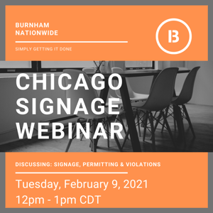

Do you have questions regarding signage, sign permitting and ways to prevent violations? 

Join us for our first Webinar of 2021 where our Sign Permit expert, Louie Greenebaum, will review the topics below in detail:

-   Signs in the Public Right of Way
-   Violation Trends 
-   Exterior and interior signage 
-   Troubleshooting and Timelines
-   Signage on or over Public Property
-   Zoning and more!  
    <strong>When:</strong> Tuesday, February 9  
    <strong>Where:</strong> Virtually (ZOOM)  
    <strong>Time:</strong> 12pm - 1pm CDT

City of Chicago requires public way use permits for anything that extends over, under, or is on the public way. Burnham has extensive experience in navigating the process and helping to cut through the red tape.

[**Click here to sign up and attend**](https://www.eventbrite.com/e/chicago-signage-webinar-tickets-136743444323)

Do I need a permit for a sign that doesn't hang over the sidewalk or street? Yes, in a different way - every sign in Chicago needs a Department of Buildings sign construction permit regardless of location, installed only by a licensed sign contractor. A separate Public Way Use Permit (Grant of Privilege) is only required additionally if the sign extends over, under, or sits on public property like a sidewalk, street, or alley. How long does it take to get a Public Way Use Permit for a sign in Chicago? Plan for 30–90 days from a complete application submission, since the process requires both your alderman's approval and a City Council ordinance before BACP can issue the permit - it's not a simple staff-level approval. How long is a Chicago Public Way Use Permit valid once issued? Five years - after that, it needs to be renewed through BACP's online permitting portal rather than treated as a one-time approval. What size sign triggers the need for City Council approval specifically? Five years - after that, it needs to be renewed through BACP's online permitting portal rather than treated as a one-time approval. What happens if I don't pay my Public Way Use Permit fees on time? The city can place a hold on your business license account until fees and any outstanding debt are paid - it's not just a late fee on the sign permit itself, it can affect your broader ability to operate.
