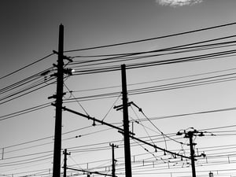

The City of Chicago recently released it’s [preliminary municipality utility feasibility study](https://www.chicago.gov/content/dam/city/depts/dgs/supp_info/City_of_Chicago_20200828_Preliminary_Municipal_Utility_Feasibility_Study.pdf). The study’s goal was to determine whether the city should continue with its efforts to establish a locally controlled municipal electric utility in light of the agreement with ComEd inked in 1992 that expires at the end of the year. 

Currently, ComEd provides retail electric supply and delivery services to the city for private and public use. The study, which took place in fall 2019, focused on analyzing the estimated costs of electric delivery service for a proposed city utility compared to ComEd’s. 

  
Photo by [Damon Lam](https://unsplash.com/@dayday95?utm_source=unsplash&utm_medium=referral&utm_content=creditCopyText) on [Unsplash](https://unsplash.com/s/photos/utility-chicago?utm_source=unsplash&utm_medium=referral&utm_content=creditCopyText)

## Analysis of Viability of Municipalization - Financial Model Development

NewGen developed a financial pro forma cash flow model to determine the financial feasibility of creating a municipal electric utility (MEU) for the City. The preliminary financial feasibility analysis suggests that the average annual MEU delivery rate would be greater than the average ComEd delivery rate for each year of the Study period (2020‐2039). The difference in average rates is primarily due to the substantial estimated investment of nearly $9 Billion required to sever the MEU system from the ComEd system. Most of the cost is driven by establishing/purchasing the transmission network and management ($4.9B) and isolating Chicago from the ComEd’s service area ($3.9B) which includes much of northern Illinois.

## Analysis of Viability of Municipalization - Strategic Assessment

In addition to the financial feasibility analysis, NewGen conducted a strategic assessment of the City’s goals and objectives as they relate to the City’s municipalization review. The strategic assessment is critical to defining success for the MEU and aided in guiding the various analyses and discussions during the Study process. The assessment’s purpose was to provide alternatives in municipalization that are supportive of the City’s overall objectives as they relate to electric utility services.

## Analysis of Viability of Municipalization - Next Steps

Now that municipalization by the City appears to not be feasible, the City can focus on getting the best deal for residents and will continue to seek sustainable and equitable solutions that address the environmental and energy challenges.

About [14% of the nation](https://news.wttw.com/2020/08/28/city-can-t-afford-take-over-comed-study-finds) is powered by municipally owned electric providers who enjoy more stable service and on average 13% lower bills with better accountability and safety standards. Chicago is not alone in this pursuit as California has mulled a [public takeover of PG&E](https://energynews.us/2019/12/16/west/publicly-owned-utilities-not-a-panacea-but-can-produce-customer-benefits/) following years of issues with the utility.

Time will tell what future sustainable and energy efficient plans Chicago plans on presenting as alternatives to the one presented. As Burnham learns more, we’ll be here to share. 

Did Chicago end up creating its own municipal electric utility after this study? No - the city ultimately chose not to municipalize. Instead, after a multi-year process including a 2021 Request for Information, Chicago renegotiated its franchise relationship with ComEd directly rather than pursuing the costly municipal utility model this study found infeasible. What replaced the expired 1992 ComEd franchise agreement? A new Franchise Agreement and accompanying Energy and Equity Agreement, signed February 1, 2023 under Mayor Lori Lightfoot. The new agreement runs 15 years with an option for a 5-year extension, replacing the agreement that had technically expired in December 2020 but stayed in effect via a rollover provision until the new deal was finalized. Did Chicago give up its right to municipalize the electric grid by signing this new ComEd agreement? No - the new agreement specifically preserves the city's right to municipalize at any point after the first five years of the contract, even though the 2020 feasibility study (and a later updated analysis) found the financial case for doing so weak given the multi-billion-dollar cost to separate from ComEd's system. What does Chicago actually get financially from the new ComEd agreement? The city collects an estimated $90-100 million annually in franchise fees, plus ComEd committed up to $120 million in shareholder (not ratepayer) funds toward local climate initiatives - building retrofits, community solar, electrification of transit and fleets, and pollution-reduction projects - through a new nonprofit, the Clean Energy & Equity Collaborative. Is the new ComEd franchise agreement focused only on cost and reliability, or does it address clean energy too? It explicitly ties into Chicago's climate goals - including funding for workforce training (10,000+ residents for clean energy careers), rooftop solar for up to 4,000 low-income households via Illinois Solar for All, and broader investments aimed at the city's stated 62% carbon emissions reduction target by 2040.
