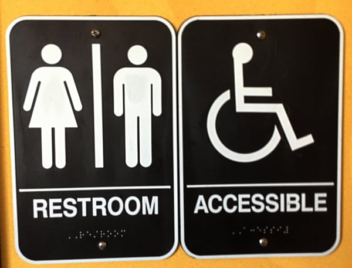
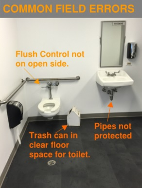

It is essential to comply with the federal Americans with Disabilities Act (ADA) toilet and bathing room requirements. Non-compliance with the ADA’s requirements may prevent bathroom use by people with disabilities or cause injuries, and owners of properties who do not comply with the ADA’s bathroom requirements may invite compliance actions and lawsuits.

The ADA’s Title III prohibits places of public accommodation and commercial facilities from discriminating against people with disabilities. To prevent such discrimination, it is necessary to comply with the [2010 ADA Standards for Accessible Design](https://www.access-board.gov/guidelines-and-standards/buildings-and-sites/about-the-ada-standards/ada-standards/chapter-1-application-and-administration) (2010 ADA Standards or Standards), the rules implementing Title III of the ADA. These rules include the United States Access Board’s [2004 ADA Accessibility Guidelines](https://www.access-board.gov/guidelines-and-standards/buildings-and-sites/about-the-ada-standards/background/ada-aba-accessibility-guidelines-2004) (ADAAG).

Most of the technical requirements for toilets and bathing rooms may be found in ADAAG’s [Chapter 6: Plumbing Elements and Facilities](https://www.access-board.gov/guidelines-and-standards/buildings-and-sites/about-the-ada-standards/ada-standards/chapter-6-plumbing-elements-and-facilities#604%20Water%20Closets%20and%20Toilet%20Compartments). Other parts of the Standards are also important for designing and building bathrooms, such as Sections 308 - Reach Ranges; 309 - Operable Parts; 404 - Doors, Doorways, and Gates; and 216.8 & 703 - Signs.

In describing the ADA bathroom requirements below, we are only highlighting some of the most important provisions. It is necessary to review the relevant code sections for a complete understanding of the requirements; that's why we offer [Code Consulting Services](/what-we-do/code-consulting/). [Contact Burnham](/contact/) to learn how we can work with you to make a safe and accessible bathroom for all. 

## Toilets and Toilet Compartments

The 2010 ADA Standards have very specific requirements for toilet location, clearances, and size. The toilet should be installed with the top of the seat between 17” and 19” above the floor and located between 16” and 18” from the side wall to the center line, unless it is regarded as an ambulatory accessible toilet compartment that must be between 17” to 19” from the side wall.

A toilet room must provide a turning space of a minimum of a 60” in diameter to allow someone in a wheelchair to properly maneuver. It is necessary to check the Chapter 3 requirements for t-shaped turning spaces, door swings, and clear floor space.

There must be a clearance around a toilet of a minimum of 60” from a side wall. Also, the water closet, measured perpendicular from the rear wall, must be a minimum of 56” deep for wall mounted units and a minimum of 59” deep for floor mounted units to allow wheelchair access. The flush control shall be located on the open side.

The clear floor space under the sink is no longer permitted to be used as part of the toilet clear floor space. A defined clear floor space to allow for a side or forward approach to the toilet must be available at all times, meaning it is not permitted to be obstructed by a sink, garbage can, or another object.

In toilet compartments, there must be grab bars on the side wall next to the toilet and the rear wall. The side wall grab bars must be at least 42” long, placed no more than 12” from the rear wall, and be a minimum of 54” in length from the rear wall. The grab bars on the rear wall must be a minimum of 36”, extend at least 12” on one side from the toilet centerline, and must be at least 24” on the other side.

Most grab bars in toilet rooms are circular and need to have an outside diameter of 1¼” minimum and 2” maximum and be 1½” from the wall. Please see Section 609.2.2 for non-circular grab bar requirements. Grab bars should be stationary in their fittings, with no looseness or tendency to revolve.

The Standards require grab bars be installed in a horizontal position, 33” minimum and 36” maximum above the floor measured to the top of the gripping surface. They must be spaced 1½” from the wall, a minimum of 1½ “ from a projecting object below, and at least 12” from an object projecting above a grab bar. Grab bars should be able to support 250 lbs. of force, and it is important to make sure any decorative flanges are attached properly to the wall with no sharp edges.

Sections 604.8.1 & 2 contain additional requirements, including those for size, doors, and toe clearance, depending upon whether the toilet compartment is wheelchair or ambulatory accessible. It is also necessary for toilet and bathing rooms to comply with the requirements set forth in Chapter 4 - Accessible Routes, such as those found in Section 404 for doors and doorways.

## Mirrors

A toilet and bathing room mirror should be mounted so that the bottom edge of the reflecting surface is not more than 40” above the floor if above a sink or countertop or 35” if there is no object below.

## Toilet Paper Dispensers

Toilet paper dispensers should be mounted so that the center line is between 7” and 9” in front of the toilet. The dispenser’s outlet shall be between 15” and 48” above the floor and not be located behind the side grab bar or in a position that would obstruct their operation.

## Urinals

A urinal’s rim must be a maximum of 17” above the floor and a minimum of 13 ½” from the rim’s outer face to the back of the urinal. A minimum 30” clear width should all be provided.

Getting overwhelmed yet? [Contact the experts at Burnham](/contact/) to review your submittal package for completeness and accuracy. 

## Sinks

A sink should be mounted at a maximum 34” above the floor to the top rim with clear floor space underneath to allow for a forward approach. It is important to provide a knee clearance of 27” in height to the sink underside for at least an 8” depth. Pipes must be insulated or otherwise covered, and faucets should be in reach range and easily operated with one hand (force required no greater than 5 lbs).

## Bathtubs

The Standards require a clearance area the length of the bathtub and a minimum of 30” wide when bathtubs are provided in transient lodging or required in a residential unit. Either a permanent (at the bathtub’s head end) or removable seat may be used and each has its challenges.

For bathtubs with permanent seats, it is difficult to accurately meet the Standards’ detailed grab bar requirements for bathtubs with permanent seats found in Section 607.4.1. We often see mistakes in this area.

Finding portable seats that are stable and also meet the Standards’ requirements for height is very difficult. The Standards have separate grab bar requirements for tubs with removable seats that are found in Section 607.4.2.

## Showers

Either a roll in or transfer shower is permitted by the 2010 ADA Standards, but each has specific allowances for size, location of grab bars and controls, permanently installed shower seat, threshold, and clear floor space. For example, a transfer shower compartment must be 36” by 36” (measure at center opposing sides’ center points) and a minimum entry of 36” wide. A standard roll-in shower compartment must be a minimum 30” wide by 60” deep (measured at the opposing sides’ center points) and a minimum entry of 60” wide.

It is critical to remember to use measurements within the finished materials or account for the dimensions of the completed space. Also, the specific code requirements found in Section 608 should be referenced based on the intended design.

## Soap Dispensers, Hand Dryers, and Waste Receptacles

Soap dispenser buttons and pistons must be operable with one hand and not require more than 5 lbs. of force to activate. The reach range and height of soap dispensers, hand dryers, and towel dispenser depends on whether something, e.g., a countertop, is mounted below and the depth of the lower object.

Dispenser and hand dryers can be mounted no higher than 48” if the sink below is less than 20” deep (See Section 308 for details). If there is a sink or counter below that is between 20” and 25” (maximum), the soap dispenser or hand dryer may be no higher than 44” from the floor. Also, if there is no object below, the dispenser or dryer may not be more than 48” and should not protrude more than 4”.

Loose trash cans and waste receptacles must not be in the clear path or blocking access to fixtures such as a sink or hand dryer. Units that project more than 4” from the wall and 27” above the floor.

## Signage

Accessible toilet and bathing rooms must be identified by signs containing the International Symbol of Accessibility. The Standards require such signs to be mounted outside of accessible bathroom on the door’s latch side and 48” above the finished floor or ground surface, measured from the baseline of the lowest tactile character and 60” measured from the baseline of the highest tactile character. Section 703 contains detailed requirements for the visual and tactile characters to be used on ADA compliant signs. For existing bathrooms not in compliance with the ADA’s requirements, directional signs must indicate the nearest accessible toilet or bathing room.

## Stay Informed about Bathroom Accessibility Requirements

We have summarized some of the federal ADA’s requirements relevant to bathrooms. However, a comprehensive review of the 2010 ADA Standards is required before designing and constructing toilet and bath rooms. It is also necessary to be aware of your state and local accessibility requirements that may be different or more stringent than the federal standards. If you don't have the time or bandwidth to become an accessibility expert, [contact us](/contact/) and together we will make sure your project is complaint and safe.

Test your knowledge of the ADA bathroom requirements with our post: [ADA Restroom Requirements:  What is Wrong with This Picture?](/final-review-blog/ada-restroom-requirements-what-is-wrong-with-this-picture/) Also, we frequently conduct ADA compliance reviews - feel free to [Contact Us](/contact/) for a consultation.

<em>This updated and revised post was originally published in 2013.</em>
